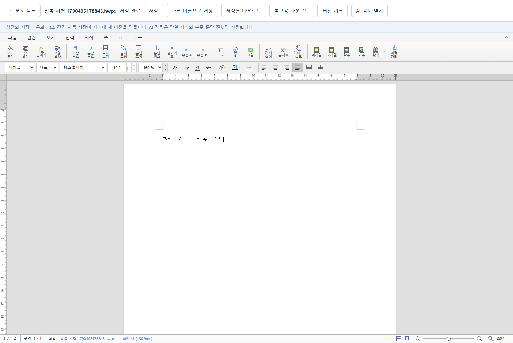
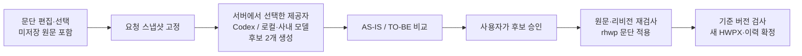

<div align="center">

# HWP Assistant

**한글 문서를 웹에서 편집하고, AI 제안은 확인한 뒤 저장합니다.**

HWPX 문서함 · 문서 권한 기반 대화 · 승인 기반 AI 수정 · 버전 보존

`rhwp` · `React / TypeScript` · `FastAPI` · `Codex / MCP`

[주요 기능](#주요-기능) · [실행 안내](#windows에서-api웹-개발-실행) · [검증 현황](#검증-현황) · [문서 모음](#문서-모음)

</div>



<p align="center"><sub>합성 문서로 확인한 실제 편집 화면. 회사 문서와 인증 정보는 포함하지 않았습니다.</sub></p>

HWP Assistant는 HWPX 파일을 열고, 편집하고, AI 수정안을 비교해 새 버전으로 저장하는 웹 애플리케이션입니다. 문서 원본은 **HWPX**로 유지하고, 최초 업로드와 이전 확정 버전은 보존합니다. 문서의 대화·작성 기준·수정 후보도 함께 관리합니다.

> [!NOTE]
> **개발·검증 단계입니다.** 실제 Codex 승인·저장 흐름과 일부 한컴 2018 왕복을 확인했습니다. 전체 문서 호환성이나 운영 배포 완료를 뜻하지 않습니다. Docker 작업은 현재 보류 중입니다.

## 주요 기능

| 기능 | 현재 할 수 있는 일 |
|---|---|
| **HWPX 편집** | 문서 업로드·새 문서 생성, 본문·표 수동 편집, 자동 저장·다른 이름으로 저장 |
| **안전한 저장** | 기준 버전·편집 임대 검사, 변경분 전송, 중복 요청 방지, 불변 버전 기록·다운로드·복원 |
| **AI 문단 수정** | 요청 당시 미저장 원문 → 설정한 Codex 또는 로컬·사내 모델의 후보 2개 → 비교 → 사용자 승인 → 적용·저장 |
| **문서별 대화** | 문서 권한자가 모든 작성자의 대화·미적용 후보·적용 이력을 열람 |
| **자체 컨텍스트** | 작성 목적·확정 사실·작성 기준·선택 문단을 문서 기준 버전과 함께 보관 |
| **양식 재사용** | 등록한 HWPX 버전의 이름·설명·태그로 추천하고, 해당 양식으로 새 문서 생성 |
| **보고서 기본 서식** | 주제 입력 → Codex 초안 승인 → 지정 기준서의 파란 제목선·들여쓰기·글꼴·줄간격·A4 여백 자동 적용 |

기본 작성 기준은 [문서작성 표준](docs/document-writing-standard.md)이다. [기준서 원본](backend/app/assets/document-standard/reference.hwpx)과 검증용 해시·서식 설정을 저장소에 보관하며 보고서 생성 화면에서도 원본을 내려받을 수 있다. 이미 저장한 문서는 자동으로 바꾸지 않는다.

문서의 열람 권한과 편집 권한은 별개입니다. `reader`는 대화와 후보를 볼 수 있지만 승인·적용·저장할 수 없습니다. 공유 문서 안에서 작성자만 볼 수 있는 비공개 대화는 제공하지 않습니다. [권한·템플릿 상세](docs/collaboration-and-mcp.md)

### AI 수정은 이렇게 저장됩니다



후보 생성만으로 본문이나 확정 버전이 바뀌지 않습니다. 승인 시 원문·편집 상태가 달라졌거나 저장 기준 버전이 오래됐다면 충돌을 알리고 후보와 미저장 작업을 보존합니다. 작업 ID → 후보 ID → 승인 → 적용 영수증 → 저장 버전으로 결과를 추적합니다.

템플릿 추천은 등록된 양식의 메타데이터를 검색하는 방식이며 모델 호출이 필요하지 않습니다. 적용 단위는 **양식으로 새 문서 만들기**입니다. 기존 문서에 블록을 삽입하거나 변수를 자동 치환하는 기능은 후속 범위입니다.

## 검증 현황

**2026-10-06 추가:** 로컬·사내 OpenAI 호환 모델을 기존 두 후보 흐름에 연결했습니다. 실제 rhwp와 **모의 HTTP 모델**의 승인·저장·응답 유실 복구, 엄격한 후보 검증, 서버 재시작·600초 만료를 시험했습니다. 실제 모델 서버는 연결되지 않아 실모델 생성·사람 승인은 미실행입니다. 별도 합성 문서의 웹 저장·재업로드·재열기 3회와 과거 버전 복원도 확인했습니다. [이번 검증과 제한](docs/verification-2026-10-06.md) · [로컬 모델 설정](docs/local-model-rewrite.md)

**2026-09-27 기록 기준.** 아래 결과는 기존에 실제 실행한 시험의 요약입니다. 고정 응답 시험과 실제 모델 호출을 구분합니다.

| 항목 | 상태 | 확인 범위 |
|---|---|---|
| 실제 Codex + MCP | **통과** | 미저장 원문 → 후보 2개 → 실제 사용자 승인 → rhwp 적용·저장·웹 재열기 |
| 권한·충돌·중복 방지 | **회귀 시험 통과** | 타인 작성 대화 열람, 비권한자 차단, 원문·기준 버전 충돌과 중복 요청 보호. 고정 후보 시험 포함 |
| 템플릿 추천·적용 | **엔진 시험 통과** | 등록된 합성 양식으로 새 문서를 만들고 편집·저장 |
| 한컴 2018 왕복 | **일부 통과** | 단순 문단과 2×2 표의 실제 열기·수정·저장·재열기·웹 재가져오기 |
| 수정 엔진 빌드 | **진단 빌드 통과** | 빌드 보호 11개, 실제 WASM 검사 8개, Windows no-opt 코어와 앱 번들 확인 |
| Docker · PostgreSQL · nginx | **보류 / 미실행** | 최적화 배포 빌드와 컨테이너 실행 미검증 |
| 실제 사내 Qwen · 폐쇄망 실행 | **미검증** | 모델 ID·접속 규격과 외부 통신 차단 환경의 전체 흐름 확인 필요 |
| 다른 사용자 Codex 후속 요청 · 독립 컨텍스트 복원 | **미검증** | DB에 보관된 사실과 세션 없는 복원 성공은 구분 |

한컴 125% 편집 화면에서 표 외곽선이 보이지 않는 차이가 남아 있습니다. 저장 파일과 한컴이 생성한 미리보기에는 외곽선이 보존됐지만 **완전한 시각 일치는 확인하지 못했습니다.** 그림·필드·복합 서식·반복 왕복도 추가 검증이 필요합니다.

[전체 검증 기록](docs/verification-2026-09-27.md) · [실제 Codex 승인·저장 증거](docs/evidence/codex-human-completed-2026-09-27.json) · [한컴·빌드 후속 증거](docs/evidence/engine-release-and-table-2026-09-27.json)

## Windows에서 API·웹 개발 실행

검증 환경은 Windows, Node **24.15.0**, Python **3.14.4**, Chrome입니다. React **19.2.0**, TypeScript **5.9.3**, FastAPI **0.121.0**, SQLAlchemy **2.0.44**를 사용합니다. 로컬 DB는 SQLite이며 PostgreSQL 실행 결과로 대체해 표현하지 않습니다.

### 1. 의존성 준비

저장소 루트의 PowerShell에서 실행합니다. Git에는 데이터·인증·엔진 산출물·PC 전용 `.codex/config.toml`이 포함되지 않습니다. `.env`는 Compose용이며 네이티브 서버가 자동으로 읽지 않습니다.

```powershell
python -m venv .venv
.\.venv\Scripts\python -m pip install -r backend/requirements.lock.txt
# Codex/MCP 기능을 사용할 때 추가 설치
.\.venv\Scripts\python -m pip install -r backend/requirements-mcp.lock.txt
cd frontend
npm ci
cd ..
```

### 2. Docker 없는 PC의 수정 엔진 준비

**최초에는 추가 도구 준비가 필요합니다.** [수정 엔진 안내](docs/engine-empty-fill-fix.md)의 위치에 Rust 1.93.1·wasm32 대상·wasm-bindgen 0.2.127을 설치하고 Visual Studio C++ Build Tools를 준비한 뒤 실행합니다. `npm ci`만으로 편집기 엔진이 만들어지지는 않습니다.

```powershell
powershell.exe -NoProfile -ExecutionPolicy Bypass -File scripts/build-patched-core.ps1
node scripts/build-engine.mjs --diagnostic --core-dir .cache/rhwp-core-fix/pkg --out .cache/local-preview/public/rhwp
```

이 경로는 **Windows 진단 빌드**입니다. 별도 폴더에 출력하므로 기존 기본 엔진과 실행 중인 문서함을 대체하지 않습니다. 아래 서버는 기존 프로세스와 겹치지 않는 포트에서 실행합니다.

### 3. API와 웹 실행

터미널 1, 저장소 루트:

```powershell
.\.venv\Scripts\python -m uvicorn app.main:app --app-dir backend --host 127.0.0.1 --port 8000
```

터미널 2, 저장소 루트:

```powershell
node scripts/serve-engine-preview.mjs --public .cache/local-preview/public --port 5173 --api http://127.0.0.1:8000
```

[문서함 열기](http://127.0.0.1:5173) · [API 문서](http://127.0.0.1:8000/docs)

인증을 설정하지 않으면 `local` 단일 사용자 개발 모드입니다. 사용자별 토큰과 문서 권한 설정은 [협업·인증 안내](docs/collaboration-and-mcp.md)를 따릅니다. `data/metadata.db`와 `data/files/`가 재시작 후에도 유지되며, 백업할 때는 둘을 함께 보관합니다.

<details>
<summary><strong>Docker 배포 경로 — 현재 보류, 실행 미검증</strong></summary>

Docker Linux engine이 있는 환경을 위한 구성입니다. 현재 개발 PC에서는 빌드·실행을 검증하지 않았습니다.

```powershell
Copy-Item .env.example .env
docker compose up --build
```

[문서함](http://127.0.0.1:8080)으로 접속한다. 최초 빌드는 npm/PyPI/GitHub/컨테이너 레지스트리에 연결한다. 이미지 생성 뒤 실행은 모델을 자동 설치하거나 다운로드하지 않는다. API와 DB 포트는 외부에 노출하지 않고 웹 포트도 loopback에만 바인딩한다.

이 작업 환경에는 Docker/Podman/PostgreSQL 실행 파일이 없어 Compose 빌드·실행은 **미검증**입니다. 사내 반입 전 별도 환경에서 확인해야 합니다.

Docker로 코어만 생성한 뒤 기본 개발 경로에 결합할 때는 `frontend`에서 다음 순서로 실행합니다.

```powershell
npm run engine:core
npm run engine
npm run build
```

기본 `npm run build`는 검증된 최적화 코어를 요구하며 진단 산출물을 거부합니다. Docker 없는 PC의 앱 번들 생성은 [별도 진단 빌드 안내](docs/engine-empty-fill-fix.md)를 따릅니다.

</details>

## 사용자 동작

시험용 [합성 문단·표 HWPX](samples/paragraph-and-table.hwpx)를 바로 업로드할 수 있다. 실제 rhwp 브라우저 편집·재저장 시험에서 생성한 파일이며 회사 자료가 아니다.

1. HWPX 업로드 → 목록에서 문서명 클릭 → rhwp의 한글·문단·서식·표 도구로 편집.
2. 상단 **저장** → 서버 확정 후 **저장 완료** → **저장본 다운로드**.
3. 목록의 **새 버전 업로드**로 같은 문서에 한글 수정본 등록. 같은 파일명 신규 업로드는 다른 문서가 된다.
4. **버전 기록**에서 과거 파일 다운로드 또는 복원. 복원도 새 버전이다.
5. **새 문서**는 엔진의 정상 빈 문서 생성 경로를 사용한다. 첫 저장 시 HWPX로 직렬화한다.
6. **다른 이름으로 저장**은 별도 문서 ID를 생성한다. 현재 문서는 유지된다.
7. 변경이 있으면 20초 간격 자동 저장. 수동/자동 저장은 하나의 진행 상태를 공유한다. 저장 중 추가 편집은 계속 미저장으로 표시한다.
8. 충돌·세션 만료 시 **복구용 다운로드**로 현재 버퍼를 보관하고, 목록으로 돌아가 최신 문서를 연다. 자동 병합은 없다.

편집 세션은 120초 만료, 30초 간격 갱신이다. 닫힌 탭이 세션을 반납하지 못하면 만료를 기다린다. 서버 응답 유실 시 같은 바이트·기준 버전·요청 ID로 재시도한다. 이미 최신 버전이 바뀌면 오래된 영수증을 저장 성공으로 표시하지 않는다.

## AI 설정

AI를 설정하지 않아도 문서 업로드·편집·저장·다운로드가 동작합니다. 앱에는 다음 두 실행 경로가 있으며 연결 설정도 각각 적용됩니다.

| 경로 | 용도 | 연결 조건 |
|---|---|---|
| **Codex + 문서 MCP** | 선택 문단 후보 2개 생성·비교·승인 | 서버와 같은 OS 사용자의 설치된 Codex CLI와 기존 ChatGPT 로그인, MCP 의존성 |
| **로컬·사내 LlmProvider** | 설정된 모델에 질문·검토 요청, 선택 문단 후보 2개 | `LLM_*` 환경변수와 OpenAI 호환 `/chat/completions` 서버. 두 후보 경로는 `HWP_REWRITE_PROVIDER=llm` |

Codex 요청에는 `LLM_API_KEY`가 필요하지 않습니다. `HWP_CODEX_USER`는 본인 Codex 환경에 연결되는 앱 사용자 ID이며 기본값은 `local`입니다. `HWP_CODEX_API_URL`은 실행기에서 접근하는 앱 API 주소로 기본값은 `http://127.0.0.1:8000`입니다. 다른 앱 사용자에게 서버 소유자의 Codex 실행 권한을 자동으로 부여하지 않습니다. 로그인·사용량·연결 문제는 오류로 알리며 유료 API로 자동 전환하지 않습니다. [Codex/MCP 설정과 실제 실행 경로](docs/collaboration-and-mcp.md)

본문에서 문단을 선택한 뒤 **대화 · AI 열기 → 공유 대화 만들기 → 표시된 제공자로 후보 2개 요청 → 후보 N 승인·적용·저장** 순서로 사용합니다. 기존 대화를 선택해 이어갈 수도 있습니다. `HWP_REWRITE_PROVIDER`의 기본값은 `codex`이며 `llm`을 명시해야 로컬 경로를 사용합니다. AS-IS는 요청 순간의 미저장 원문이며, 비교 중에는 자동 저장을 보류합니다. 두 후보 요청에는 선택 문단과 개선 지시만 전달하고 저장된 작성 목적·확정 사실·대화는 포함하지 않습니다. 실제 사용자 클릭으로 승인해야 적용·저장이 진행됩니다. [Codex 사람 승인 시험](docs/manual-codex-verification.md) · [로컬 모델 흐름과 재시도](docs/local-model-rewrite.md)

### 로컬·사내 모델 설정

PoC는 보존했으며 앱에서는 공용 전역 messages를 사용하지 않습니다. 공급자 경계는 `backend/app/llm.py`의 `LlmProvider`입니다. 다음은 로컬·사내 모델 경로에만 해당하는 설정입니다.

| 환경변수 | 예시 / 의미 |
|---|---|
| `HWP_REWRITE_PROVIDER` | 후보 2개 생성 경로. 기본 `codex`, 로컬·사내 모델은 `llm`. 자동 전환 없음 |
| `LLM_PROVIDER` | `openai-compatible`; 미설정이면 503 |
| `LLM_BASE_URL` | 네이티브: `http://127.0.0.1:1234/v1` |
| `LLM_API_KEY` | `lm-studio`는 예시. 실제 키는 `.env` 또는 실행 환경에만 보관 |
| `LLM_MODEL` | `google/gemma-4-e4b`는 PoC 예시. UI의 **AI 연결·모델 확인**으로 `/models` 실제 ID 확인 |
| `LLM_TIMEOUT_SECONDS` | 기본 `30`, 0 초과 240 이하의 유한한 초 단위 값 |
| `DATABASE_URL` | Compose는 PostgreSQL, 네이티브 기본값 `sqlite:///./data/metadata.db` |
| `STORAGE_DIR` | 네이티브 기본 `./data/files`, Compose `/data/files` |
| `SESSION_TTL_SECONDS` | 기본 `120`; UI 갱신 주기보다 충분히 길게 설정 |

네이티브 실행에서 연결하려면 API 실행 전 터미널에 설정한다.

```powershell
$env:HWP_REWRITE_PROVIDER='llm'
$env:LLM_PROVIDER='openai-compatible'
$env:LLM_BASE_URL='http://127.0.0.1:1234/v1'
$env:LLM_API_KEY='lm-studio'
$env:LLM_MODEL='google/gemma-4-e4b'
$env:LLM_TIMEOUT_SECONDS='30'
```

`localhost`는 호출하는 프로세스가 속한 환경이다. 네이티브 API는 개발 PC, 컨테이너 API는 해당 컨테이너를 가리킨다. Compose에서 PC의 모델에 연결하려면 `host.docker.internal`을 사용하고 모델 서버의 바인딩·방화벽을 확인한다. 다른 Codex 호스트/격리 런타임이면 그 환경의 localhost이며 PC의 모델을 의미하지 않는다. 이번 실행은 이 Windows PC의 네이티브 프로세스였고 `127.0.0.1:1234/v1/models`는 **연결 거부**였다. 회사 폐쇄망 접속은 시도하지 않았다.

운영 모델 명칭 **Qwen 3.8**의 정확한 ID·크기·API는 미확인이다. 임의로 다른 Qwen ID로 치환하지 않는다. Ollama 설치는 필요 없다. 외부 유료 API로 자동 대체하지 않고 OpenAI 유료 서버 도메인도 거부한다. 모델 서버 URL은 관리자가 제공하는 로컬·사내 주소만 설정한다.

검토는 커서가 놓인 **본문 문단 전체**를 대상으로 한다. 표 셀·필드·컨트롤·혼합 글자 서식 문단은 엔진의 안전 명령 대상이 아니다. 문서 첫 문단에 구역 설정 컨트롤이 있으면 다음 본문 문단을 사용한다. 원문·수정안·이유를 표시하며 승인 시 문서 ID/버전, 편집 리비전, 선택 위치, 원문·서식·인접 문맥 해시를 검증한다. 승인 적용은 엔진의 단일 실행 취소 트랜잭션이다.

## 구성과 보존 원칙

```text
backend/app/       FastAPI · 권한 · 버전 저장 · AI 실행기 · MCP
backend/tests/     저장·권한·충돌·공급자·MCP 회귀 시험
frontend/src/      React 화면 · EditorAdapter · 대화·후보 비교
frontend/tests/    실제 브라우저·편집기 시나리오
scripts/           고정 rhwp 빌드 · 안전 검사 · 수동 시험 하네스
samples/           합성 HWPX 샘플
docs/              요구사항 · 설정 안내 · 검증 근거 · 남은 범위
```

- **원본 유지:** 최초 업로드와 과거 버전은 변경하지 않고 복원도 새 버전으로 기록합니다.
- **저장 확정:** 파일 영속화와 DB commit을 확인한 뒤 저장 완료를 응답합니다. 다운로드·export만으로 서버 저장 성공을 표시하지 않습니다.
- **권한과 기준 검사:** 문서 행 잠금 안에서 접근권·편집 임대·최신 버전을 확인하고 새 버전을 게시합니다.
- **승인 범위 적용:** AI가 HWPX 전체 XML을 작성하지 않습니다. 승인한 문단만 rhwp 명령으로 적용합니다.
- **로컬 자료 분리:** DB·실문서·인증·PC별 설정·생성 엔진은 `.gitignore`로 제외합니다. 저장소의 HWPX와 화면 증거는 합성 자료입니다.

<details>
<summary><strong>엔진 고정 · 자체 호스팅 · 라이선스</strong></summary>

`@rhwp/editor` **0.8.6**, npm 배포 `gitHead` **e8800c8def63449808a4092798442652ed460552**의 Studio·Rust 코어에 한컴 색상 없음 패치를 적용한다. `npm run engine:core`는 Docker에서 고정 Rust/wasm-pack/wasm-bindgen/Binaryen으로 코어를 생성하고 실제 WASM 회귀 검사를 수행한다. `npm run engine`은 코어 출처·해시·최적화 기록을 검사한 뒤 같은 커밋의 Studio와 묶는다. npm의 미수정 WASM으로 자동 대체하지 않는다. 고정값은 `scripts/engine-lock.json`, 소스는 `.cache/rhwp`, 코어는 `.cache/rhwp-core-release/pkg`, 결과는 `frontend/public/rhwp`다. 결과를 Vite 또는 nginx가 직접 제공한다. 공개 데모 iframe은 사용하지 않는다.

`npm run build`도 실제 번들 파일 해시를 전후 검사한다. 기본 경로는 진단 산출물을 거부하며, Windows 진단은 명시적 `--diagnostic`과 별도 출력 경로가 필요하다. Docker 레시피 연결과 Docker 실행 통과는 구분하며, 현재 실행 근거는 [검증 기록](docs/verification-2026-09-27.md)에 남긴다.

`scripts/assistant-bridge.ts.txt`는 SDK에 없는 원문/서식 증거·손실 보고·원자적인 저장 리비전 확인을 추가한다. 텍스트 변경은 공개 `applyTextCommand`를 사용한다. `chrome=embed`로 엔진의 별도 파일 열기·저장을 차단해 호스트가 문서 수명주기를 관리한다. 폰트는 업스트림 `assets/fonts`의 번들 자원을 자체 제공하고 `RHWP_DISABLE_EXTERNAL_WEBFONTS=1`로 CDN 폰트를 끈다. 회사 글꼴은 추가하지 않았다. 업스트림 LICENSE, THIRD_PARTY_LICENSES, fonts/FONTS.md와 포함된 폰트 고지를 배포 디렉터리에 보존한다. 전체 라이선스 감사가 완료된 것은 아니며 반입 전 폰트별 고지를 재확인한다.

의존성은 `frontend/package-lock.json`, `backend/requirements.lock.txt`, 업스트림 고정 커밋의 `rhwp-studio/package-lock.json`에 고정한다. 프런트엔드 Docker의 Node/Rust/nginx 베이스는 공식 레지스트리에서 확인한 digest도 고정했다. 백엔드·DB 이미지는 기존 버전 태그를 유지하며 전체 공급망 감사는 미완료다. 인터넷 없이 새로 빌드하려면 의존성 캐시 또는 사전 빌드 이미지를 별도로 반입해야 한다.

</details>

<details>
<summary><strong>저장 구조 · 마이그레이션 · 파일 검사</strong></summary>

`documents`: 표시 이름, UUID, 최신 버전, 임대 토큰/만료.
`versions`: UUID, 문서 ID, 기준 버전, UUID 파일 키, 크기, SHA-256, 시각, 원인, 멱등 키, 요청 지문, 세션 해시.

PostgreSQL에서는 문서 행 `FOR UPDATE` 잠금으로 세션 확인과 최신 버전 갱신을 직렬화한다. 첫 문서 생성의 중복 요청은 UUID 기반 advisory lock으로 보호한다. SQLite 개발 모드는 `BEGIN IMMEDIATE`로 쓰기를 직렬화한다. 표시 파일명은 저장 경로에 쓰지 않는다.

빈 DB 초기 스키마: `backend/migrations/001_initial.sql`. 추가형 협업 스키마는 `002_collaboration.sql`이다. Compose는 `python -m app.migrate`로 기존 테이블·파일을 보존하며 확장한다. 기존 공용/local 문서에 인증을 도입할 때 `HWP_LEGACY_OWNER`를 명시해야 한다. 자세한 내용은 협업 설정 안내를 참조한다.

파일은 배타적인 새 키로 작성하고 fsync 후 DB를 commit한다. 실패 파일·프로세스 중단으로 남은 참조 없는 파일은 정상 버전으로 조회되지 않으며, 자동 삭제하지 않는다. DB와 볼륨을 함께 백업해야 한다. 영구 삭제·가비지 컬렉션은 후속 작업이다.

ZIP 크기 30MB, 해제 합계 120MB, 항목 수·중복 경로·압축률·필수 XML·mimetype·CRC·DTD/entity 등을 검사한다. 파일 경로로 ZIP을 풀지 않는다. 엔진 손실 보고가 있으면 게시 차단과 복구 후보 다운로드, 서버 리소스 누락 감지 시 후보 파일 격리를 수행한다. 이것은 완전한 의미/서식 비교나 한글 호환성 보증이 아니다.

</details>

## 테스트

기본 브라우저 명령은 실행 중인 개발 문서함에 합성 시험 문서를 추가한다. 기존 문서를 삭제하지 않는다. 기존 데이터와 분리하려면 [분리 실행기](docs/local-model-rewrite.md#분리된-자동-검증)를 사용한다. 일반·인증·로컬 API와 모의 HTTP 모델, 검증 엔진 복사본을 별도 포트로 실행하고 자신이 시작한 프로세스만 종료한다.

```powershell
# 저장소 루트
.\.venv\Scripts\python -m pytest -q
cd frontend
npm exec tsc -- --noEmit
npm run test:engine-build
# API:8000과 편집기 엔진을 제공하는 웹:5173을 먼저 실행. Chrome 설치 필요.
npm run test:e2e
```

자동 시험의 고정 후보·모의 AI 결과는 실제 Codex 호출 결과와 구분합니다. 위 명령을 실행했다는 사실만으로 한컴 왕복이나 폐쇄망 검증을 완료했다고 표현하지 않습니다. 기본 배포 빌드 `npm run build`와 실제 모델·한컴 시험은 각 안내의 전제 조건을 따릅니다.

## 문서 모음

| 문서 | 읽을 내용 |
|---|---|
| [누적 개발 인수인계 · 2026-10-14](docs/development-handoff-2026-10-14.md) | 이번 개발 브랜치의 누적 구현, 날짜별 검증, 미완료 항목과 다음 작업 |
| [협업·권한·Codex/MCP](docs/collaboration-and-mcp.md) | 인증, 문서 대화, 컨텍스트, 변경분, 템플릿과 실제 실행 경로 |
| [실제 Codex 수동 시험](docs/manual-codex-verification.md) | 사람이 볼 수 있는 브라우저에서 후보를 비교·승인하는 방법 |
| [로컬·사내 모델 후보](docs/local-model-rewrite.md) | 명시적 제공자 설정, 입력 범위, 엄격한 응답 계약, 실패·재시도·사람 시험 재개 |
| [2026-10-06 검증](docs/verification-2026-10-06.md) | 모의 모델·실제 엔진 구분, 저장 복구·서버 재시작·반복 왕복과 보존 근거 |
| [저장소 무결성 점검](docs/storage-audit.md) | SQLite 메타데이터와 HWPX 해시를 변경 없이 확인하는 운영 도구 |
| [실시간 보고서 작성](docs/report-stream-2026-10-08.md) | Codex가 생성 중인 본문 표시, 단계별 시간, 중단·복구 및 검증 범위 |
| [표준 블록 삽입](docs/template-blocks-2026-10-11.md) | 현재 편집본에 제목·요약·조치표를 준비하고 확인 후 반영 |
| [제목 참조 목차](docs/toc-2026-10-11.md) | 제목 선택, 실제 렌더 쪽수 검증, 편집 후 명시적 갱신과 지원 범위 |
| [보고서 템플릿·자동 목차](docs/report-template-toc-2026-10-12.md) | 표준 작성 프로필 선택, 생성 입력 고정, 초안의 실제 쪽수 목차와 편집 후 갱신 |
| [검증 기록](docs/verification-2026-09-27.md) | 실행 명령, 통과·실패·미실행, 작업·문서 버전 연결 증거 |
| [한컴 호환성 검증표](docs/compatibility.md) | 확인한 문서 범위와 남은 서식·왕복 제한 |
| [수정 엔진 빌드 안내](docs/engine-empty-fill-fix.md) | 고정 도구 설치 위치, Windows 진단·Docker 빌드 경로 |
| [남은 작업](docs/remaining-work.md) | 보류·미검증 항목과 현재 구현 밖의 기능 |
| [요구사항 기준선 v0.4](docs/internal-doc-assistant-plan-v0.4.md) | 원래 요구사항·설계. 구현 완료 보고와 구분 |

기존 문서의 블록 삽입은 기준서의 제목·요약·조치표를 지원합니다. 제목 참조 목차는 일반 편집기에서 선택한 제목을 대상으로 준비·검증·반영합니다. 새 보고서는 같은 표준 서식을 쓰는 업무보고·경영진 보고·대응계획 프로필을 선택하고, 최초 편집 가능 초안에 실제 쪽수로 확인한 목차를 준비합니다. 수동 편집 후 목차 갱신은 명시적으로 실행합니다. 임의 양식의 보고서 프로필 변환·조각 이식, 실시간 공동 편집, 자동 병합, SSO는 후속 범위입니다. 기존 계획과 검증 이력은 보존하며 새 일정이나 공수를 이 README에서 산정하지 않습니다.
