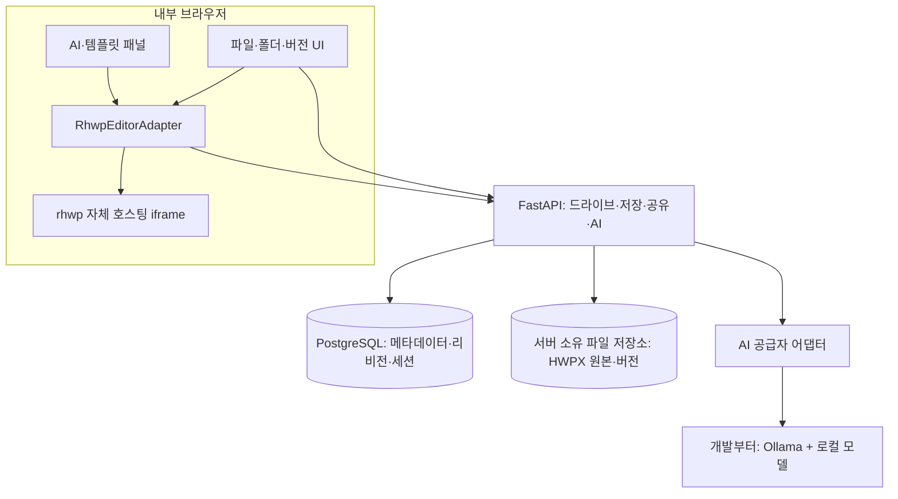
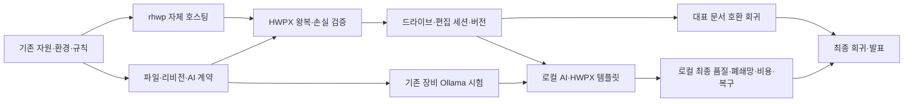

> **이전 버전 보관본 · v0.3 · 현재 실행 기준이 아님**
>
> 원래 자료명: `internal-doc-assistant-plan-v0.3.md` · 작성일: 2026-09-23.
> 아래 본문은 파일 도구로 확보한 추출 텍스트다. 원본 MD와 바이트 동일성을 보증하지 않는다.
> 유료 API·모델·개발 환경·A/B 역할에 관한 옛 내용은 [현재 기준](../README.md)과 [결정 기록](../decisions-and-open-questions.md)을 우선한다.
> 아래 구현·저장소·진척·외부 출처 설명은 당시 기록이다. 이번에 실행·재검증한 결과가 아니다.
> 원래 ZIP에 속한 상대 경로 링크는 ZIP 미포함으로 열리지 않을 수 있다. 코드를 복원했다는 뜻도 아니다.

---

# 사내 HWPX 드라이브 + AI 문서 작성 지원 — 통합 설계 v0.3

2026-09-23 · 비용 제약 반영 · 설계 문서이며 구현/검증 결과가 아님

각 원본 문서의 상대 링크는 ZIP의 디렉터리 구조를 기준으로 한다.

---

<!-- source: README.md -->

# 사내 HWPX 드라이브 + AI 문서 작성 지원

설계 v0.3 · 2026-09-23 · 2인 / Codex 개발 · 구현·실행 검증 전

> 한글 ↔ 웹에서 HWPX 문서를 이어서 편집하고, 웹에서 파일·폴더·공유·버전을 관리하며, 처음부터 로컬 LLM으로 초안과 검토를 지원한다.

## 이번 변경: 비용 최소화와 처음부터 로컬 AI

**초기 OpenAI API → 추후 Ollama 전환 계획을 철회한다.** 개발·데모·운영의 실제 문서 AI는 처음부터 Ollama + 승인된 로컬 모델만 사용한다. ReplayProvider는 화면·계약 테스트용이며 실제 AI를 대체하는 발표 수단이 아니다.

새 API·클라우드·구독·상용 부가 기능·GPU 구매 없이 기존 장비와 승인된 자원으로 시작하는 것을 목표로 한다. 기존 장비·한글 사용권·개발 도구의 포함 사용량이 있다는 전제이며, 전기·저장·백업·개발 공수까지 총비용 0원이라는 뜻은 아니다. 유료 자원 추가는 사용자 사전 승인 없이는 계획에 넣지 않는다.

v0.2의 **rhwp 우선 검증, HWPX 파일 버전 원본, 내부 DB+파일 저장 서비스, 한글↔웹 왕복 편집, 실시간 공동 편집 제외**는 유지한다. HWPX 호환성과 원본 보존을 비용 절감을 이유로 낮추지 않는다.

이 묶음은 설계·제안 계약·정적 WBS·Codex 작업 지시서다. 애플리케이션, 원격 저장소·실제 이슈, 검증된 rhwp 빌드, 실행 모델·글꼴 파일은 포함하지 않는다. v0.1/v0.2 파일은 덮어쓰지 않았다.

A의 첫 작업은 [HWPX 왕복 검증](CODEX_KICKOFF.md), B의 병렬 작업은 [기존 장비 로컬 AI 검증](CODEX_LOCAL_AI_KICKOFF.md)이다. Codex에는 [AGENTS.md](AGENTS.md)를 프로젝트 규칙으로 제공한다.

모든 실행 테스트는 현재 `NOT_RUN`이다. 모델과 실제 한글에서의 성능·호환성 통과를 주장하지 않는다.


---

<!-- source: docs/01_PRD.md -->

# 제품 요구사항 v0.3

## 확정된 방향

사용자는 망분리 회사의 문서 작성 효율화 챌린지에 2인 개발로 참여한다. 구현은 Codex를 사용한다. 문서 AI는 추가 API 비용을 피하기 위해 처음부터 Ollama에서 실행하는 로컬 오픈소스 모델로 구현한다. ChatGPT는 설계·리뷰에 사용하며 서비스 런타임으로 연결하지 않는다. 한글과 웹 사이 HWPX 가져오기·내보내기·재편집이 최우선이다. 실시간 공동 편집은 제외하며, 웹에서 파일 관리 전체 동선을 제공한다. 세부 권한은 후속 단계다.

## 제안 제품 구성

| 구성 | 첫 버전 기능 | 인수기준 |
|---|---|---|
| 파일 드라이브 | 폴더, 파일 목록·정렬·이름 검색, 드래그 업로드, 다운로드 | 브라우저만으로 관리 가능; 원본 업로드 보존 |
| 파일 동작 | 이름 변경, 이동, 복제, 휴지통, 복원 | 폴더 순환 이동 금지; 삭제는 기본 소프트 삭제 |
| HWPX 편집 | 기존 HWPX 열기·편집·저장·다른 이름 저장 | rhwp 기반; 저장 후 실제 한글 확인 |
| 왕복 편집 | 한글에서 수정한 파일을 기존 문서의 새 버전으로 업로드 | 명시적 document ID와 기준 리비전; 이름만으로 자동 덮어쓰기 금지 |
| 공유 | 공용 작업공간의 문서 링크 복사·열기 | 단일 문서를 참조; 외부 공개 링크 아님 |
| 버전 | 버전 목록·다운로드·복원, 저장 실패 복구 | 과거 파일 불변; 복원은 새 리비전 |
| 편집 충돌 | 1문서 1편집 세션 | 다른 사람은 열람; 만료 토큰으로 저장 불가 |
| AI | 양식 초안, 선택 문단 개선·검토, 사용자가 선택 적용 | 구조화 제안 검증; 서식 재생성 금지 |
| 템플릿 마켓 | 문서 양식과 제목·문단·표 블록 검색·미리보기·삽입·공유 | 실제 HWPX 요소·리소스 기반; 삽입 후 왕복 확인 |
| 최종 배포 | 내부 DB·파일 서버·웹 에디터·Ollama | 외부 통신 차단 후 핵심 흐름 성공 |

초기 공용 작업공간은 참가자들이 같은 테스트 파일을 볼 수 있는 단순 데모다. 개인 공간이 보호되는 것처럼 표시하지 않는다. 실제 회사 문서가 들어가기 전에는 최소 로그인/접근 제한과 복구 수단을 갖춘다. 부서 ACL, 외부 공유, SSO, 결재는 후순위다.

## 사용자 동선

**기존 문서:** 업로드 → 원본 저장 → 호환성 사전 확인 → 웹 편집 → AI 제안 적용 → 서버 저장 → HWPX 다운로드 → 한글 수정 → 웹에서 ‘새 버전 업로드’ → 최신 버전 열기.

**새 문서:** 새 문서/양식 선택 → 입력폼 또는 블록 선택 → AI 초안 → 편집·검토 → 저장·링크 공유 → 필요시 한글에서 재편집.

브라우저 밖의 로컬 파일 수정은 자동 감지·동기화하지 않는다. 데스크톱 동기화 클라이언트는 범위 밖이다. ‘모든 행위를 웹에서’는 파일 관리와 편집 동선을 뜻하며, 임의 모든 파일 형식의 웹 편집까지 뜻하지 않는다. HWP·기타 허용 파일은 저장·다운로드를 우선 제공하고 미리보기 지원은 별도 표시한다.

## 범위 제외

실시간 공동 편집·동시 커서·CRDT/OT, 전체 HWP 기능 구현, 실시간 데스크톱 동기화, 범용 오피스 편집, 모델 미세조정·대규모 RAG, 외부 마켓/결제는 제외한다. 유료·무료 체험 외부 AI API는 구현 범위에서 제외한다. Jev는 보류 상태로 남기며 재개 전 비용·배포·보안 조건과 사용자 승인을 다시 확인한다.

## 호환성 실패 시 원칙

HWPX 요구를 몰래 DOCX/PDF로 대체하지 않는다. 원본은 보존하며 실패 문서·편집 동작을 기록하고 rhwp 보강, 안전한 편집 제한, 대체 엔진 검토 중 결정을 남긴다. 읽기 전용/차단은 안전 대책이지 요구사항 달성으로 집계하지 않는다.

## 비용 인수기준

추가 API 사용료·클라우드 대여·신규 유료 구독 없이 기존 승인 자원을 쓰는 것을 기본 목표로 한다. 유료 소프트웨어 구매나 새 GPU 구매는 기본 전제가 아니다. 기존 장비·계정·한글 사용권의 존재 및 적법한 이용 범위는 실제로 확인한다. 전력·백업·유지보수·개발 시간은 숨기지 않고 별도 기록한다.

AI 범위는 작은 모델에 맞춰 양식별 입력 사실, 섹션 초안, 선택 문단 검토부터 구현한다. 긴 문서는 명시적으로 나누어 처리하고 검토한 범위를 표시한다. 모델이 약하다는 이유로 사실을 임의 생성하거나 HWPX 전체를 재작성하게 하지 않는다.


---

<!-- source: docs/02_RHWP_REVIEW.md -->

# rhwp 조사 결과와 채택 조건

확인일: 2026-09-23. 공개 README·로드맵·SDK 문서·선택 소스 파일을 읽은 **정적 검토**다. 저장소 전체 감사, 빌드·실행, 한컴 실물 검증은 하지 않았다. 검토 URL의 `main`은 움직일 수 있으며, 실제 채택 commit SHA와 배포 해시는 아직 고정되지 않았다.

## 확인한 내용

rhwp는 한컴 공식 웹 에디터가 아니라 독립적인 Rust/WASM 기반 HWP/HWPX 오픈소스 프로젝트다. HWPX 파싱·렌더링·편집·저장, `@rhwp/editor` 임베드, `@rhwp/core` 엔진 경로가 문서화되어 있다. 코드의 MIT 라이선스와 별도의 의존성/폰트 목록을 확인했다. [S01,S02,S03]

`@rhwp/editor`는 iframe wrapper다. `createEditor`, `loadFile`, `exportHwpx`, `notifySaved`가 문서화되어 있다. `createStudio`와 HwpCtrl 호환 표면에는 필드 채움·배치 편집이 안내되어 있으나, 우리 문서·선택 영역과 필요한 모든 명령이 사용 가능한지는 채택 버전으로 확인한다. [S04,S08]

기본 Studio 주소는 공개 GitHub Pages다. 자체 빌드한 Studio를 내부 URL로 지정하고 외부 웹폰트 로딩을 끄는 구성이 필요하다. `RHWP_DISABLE_EXTERNAL_WEBFONTS=1` 빌드 설정과 `studioUrl` 옵션이 안내되어 있다. 이를 적용해도 브라우저/서버 네트워크 차단 시험은 별도로 수행한다. [S04,S08]

README/패키지/변경 기록은 v0.8.6을 안내하며 CHANGELOG는 2026-09-02를 기록한다. ROADMAP의 버전 표기는 v0.8.4로 남아 있으므로 문서별 버전 차이를 인지해야 한다. 조판을 한컴오피스와 맞추는 작업은 로드맵상 진행 중이다. ‘HWPX 지원’은 임의 문서 전체의 완전한 외형·편집 호환 보장이 아니다. [S05,S11,S15]

## 실제 저장 코드에서 확인한 경계

`src/serializer/hwpx/mod.rs`의 `serialize_hwpx_with_report`는 HWPX 바이트와 내용 손실 보고를 반환한다. `header.xml`과 section XML은 내부 모델에서 동적으로 생성한다. 일부 보조 파일과 차트 등의 원문 보존 경로가 있지만, 모든 미지원 XML을 원형 그대로 통과시키는 범용 보존기라고 볼 수 없다. [S06]

리소스 읽기 실패/크기 상한 초과 시 일부 BinData·차트 파트를 빈 값으로 대체하며 `content_loss`를 기록하는 경로가 있다. 내보내기 성공만으로 데이터 보존을 보장하지 않는다. [S06,S07]

공개 wrapper의 `exportHwpx()`는 바이트 배열을 반환한다. 내부 손실 보고를 그 바이트에 결부해 앱으로 전달하는 방법은 별도 통합 검증 항목이다. 다른 export를 다시 수행해 만든 보고서를 처음 바이트의 보고서인 것처럼 붙이지 않는다. 필요하면 좁은 bridge 확장을 추가한다. [S07,S08]

`notifySaved()`는 저장된 바이트의 서버 영속화가 완료된 뒤 호출해야 한다. export만 끝났다고 ‘저장됨’ 표시를 하거나 복구 draft를 지우면 안 된다. 저장 도중 추가 입력이 있으면 스냅샷 이후 편집까지 저장됐다고 표시하지 않도록 우리 어댑터에서 편집 세대/저장 순서를 검증한다. [S04,S08]

## 통합 방침

우선은 독립 제품 저장소에서 `RhwpEditorAdapter`로 SDK를 감싸고 검증한 Studio/WASM을 자체 호스팅한다. rhwp 내부 코드를 넓게 복사·변경하지 않는다. bridge·보존 관련 보강이 필요한 부분만 작은 패치/포크로 관리하고 재현 가능한 합성 테스트를 남긴다.

React는 드라이브와 AI 패널 등 서비스 화면의 선택지이며 문서 내용을 React/Tiptap HTML로 다시 만드는 것이 아니다. 원래 Studio의 파일 열기·저장·최근 파일 메뉴와 우리 드라이브 메뉴가 별개의 원본을 만들지 않도록 정리한다. Ctrl+S도 우리 서버 저장 경로로 통합해야 한다.

## 미검증 항목

실제 한글 버전의 개방·재저장, 회사 폰트와 페이지 배치, 구조화 표 블록의 다른 문서 삽입, AI 선택 영역의 안정적인 참조, 손실 보고 전달, iframe 저장 이벤트/단축키 제어, 오프라인 빌드 및 네트워크 차단은 모두 미검증이다.


---

<!-- source: docs/03_ARCHITECTURE.md -->

# 아키텍처: HWPX 원본 + 내부 파일 드라이브

아래는 제안 설계다. 개발·데모·운영 모두 실제 AI는 내부 또는 개발 PC의 Ollama에서 실행한다. 외부 AI 공급자와 유료 API 경로는 구현하지 않는다.



단일 API 서버, PostgreSQL, 영속 파일 볼륨, 정적 에디터, AI 공급자 연결로 시작한다. NAS, S3 제품, 별도 벡터 DB, Kubernetes, 실시간 공동편집 서버는 필수 요소가 아니다. 단일 파일 볼륨으로 시작하고 필요할 때 저장 어댑터 뒤의 다른 파일 서버로 바꾼다.

## 기존 장비와 AI 독립성

단일 기존 PC/서버에서 API·DB·파일·Ollama를 함께 시험하는 구성을 우선 검토한다. 사용 가능한 내부 GPU 서버가 있으면 추론만 그 서버로 분리한다. 새 서버·GPU·NAS 구매나 유료 managed DB를 기본 조건으로 하지 않는다.

AI 요청은 초기 동시 실행 1개와 제한된 대기열로 시작한다. 문서 편집·저장은 추론 완료를 기다리지 않게 한다. 모델 장애 때는 AI만 명시적 오류/재시도를 제공하고 파일 작업은 유지한다. 테스트 fixture나 외부 모델로 몰래 전환하지 않는다. 무료 체험 계정·결제 정보·유료 API 키 없이 핵심 업무 흐름을 시험한다.

## 원본의 기준

**HWPX 파일의 불변 리비전이 문서 원본이다.** 업로드 원본을 byte-exact로 보관한다. 편집 중에는 rhwp 내부 모델을 사용하며, 저장하면 검증된 HWPX 바이트가 새로운 리비전이 된다. 검색 텍스트·AI용 문단 JSON·미리보기는 특정 리비전에서 만든 파생 데이터다. 파생 JSON으로 전체 HWPX를 재조립하지 않는다.

파일 서버는 앱만 접근하는 저장소다. 사용자는 서버 경로나 공유 폴더를 직접 열지 않고 웹 API로 모든 동작을 한다. 서버 저장명은 사용자가 지정한 문서 제목과 분리하고 UUID/해시 기반 내부 키를 쓴다.

## 데이터 모델 제안

| 테이블 | 주요 내용 |
|---|---|
| workspaces | 데모에서는 공용 1개; 이후 권한 경계의 자리 |
| folders | id, workspace_id, parent_id, name, deleted_at |
| documents | id, folder_id, title, format, current_revision_id, created_by, deleted_at |
| document_revisions | id, doc_id, parent_revision_id, blob_key, sha256, size, source, actor, engine_build, created_at |
| revision_reports | revision 또는 candidate 해시, checker_version, font_profile, content_loss, validation_state |
| edit_sessions | doc_id, session_id, lease_token/fencing counter, expires_at |
| templates/template_versions | 원본 HWPX/블록·리소스, 변수·스타일 매핑, 미리보기, 버전 |
| ai_suggestions | base_revision, editor_generation, target locator, expected_text_hash, 제안, 모델·프롬프트 버전 |
| audit_events | 최소 작업 이력: 사용자/세션, 문서 ID, 동작, 시각, 결과; 본문 기본 제외 |

검색용 텍스트 캐시와 미리보기에는 리비전·엔진·폰트 프로필 키를 사용한다. HWPX 내부 `Preview` 리소스가 현재 편집 내용을 반영한다고 가정하지 않는다. 검증된 최신 미리보기를 별도 생성하거나 표시를 보류한다.

## 저장 프로토콜

1. 편집 세대와 기준 리비전, 유효한 편집 lease를 고정하고 HWPX 스냅샷을 만든다.
2. 스냅샷과 **같은 산출물**의 손실 보고·패키지 검사 결과를 수집한다. 알려진 내용 손실은 게시를 막는다. 빈 보고서도 전체 호환성 보증은 아니다.
3. 서버가 파일 크기·포맷·압축해제 상한·참조 등 검사를 하고 임시 키에 저장한다. 후보 파일은 정규 리비전과 구분한다.
4. 영속 저장 완료 후 DB 트랜잭션에서 현재 리비전/lease를 재확인하고 새 리비전과 current 포인터를 확정한다. 모든 write API에 멱등 요청 키를 사용한다.
5. 서버 성공 응답 뒤에만 저장 완료를 알려준다. 저장 중 생긴 추가 편집은 dirty로 남기거나 다음 스냅샷으로 저장한다.

DB와 파일 저장이 자동으로 하나의 트랜잭션이 되는 것은 아니다. 실패 후보·고아 파일 정리와 재시도, 같은 기준 시점의 DB/파일 백업 매니페스트가 필요하다. 유효성 검사가 실패한 편집 결과는 복구 후보로만 보관하고 정규 원본을 대체하지 않는다.

## 동시 편집 없이 데이터 보호

문서당 하나의 편집 세션을 서버에서 발급한다. 다른 브라우저는 열람한다. HTTP heartbeat와 만료 시간으로 비정상 종료를 처리한다. 모든 저장은 lease의 최신 fencing 값과 기준 리비전을 함께 검사한다. lease가 만료됐던 오래된 탭이 다시 접속해도 다른 사용자의 저장을 덮어쓰지 못하게 한다.

세부 ACL과 달리 이 충돌 방지는 첫 버전의 데이터 보존 기능이다. 관리자 강제 해제·버전 복원·새 버전 업로드도 현재 편집 세션과 충돌을 검사한다. 실시간 문서 병합·CRDT/OT는 구현하지 않는다.

## 한글 ↔ 웹 왕복

웹에서 v3 다운로드 → 한글에서 편집·저장 → 기존 문서 화면의 ‘새 버전 업로드’로 v4 생성. 파일명이 같아도 자동으로 같은 문서라고 추론하지 않는다. 문서 선택, 기준 버전 확인, 충돌 안내가 명시적이다. 새 업로드가 기존 문서와 관계 없는 파일인지 판단하는 것은 사용자의 확인을 포함하며, 내용 병합은 하지 않는다.

서버에서 예전 v2를 복원하면 v5가 생성되고 v2–v4는 그대로 남는다. ‘다른 이름으로 저장’은 새 document ID를 만든다. 이름 변경·폴더 이동은 내용 리비전을 재직렬화하지 않는다.

## 내부 API 후보

- `GET/POST /folders`, `PATCH /folders/{id}`, `POST /folders/{id}/trash`
- `GET /documents`, `POST /documents/upload`, `POST /documents/from-template`
- `GET /documents/{id}/content?revision=...`, `POST /documents/{id}/revisions`
- `POST /documents/{id}/copy`, `/move`, `/trash`, `/restore-from-trash`
- `GET /documents/{id}/revisions`, `POST /documents/{id}/restore-revision`
- `POST /documents/{id}/edit-sessions`, `PATCH/DELETE /edit-sessions/{id}`
- `POST /ai/drafts`, `POST /ai/reviews`, `POST /templates`, `GET /templates`

위 경로는 구현된 API가 아니라 계약 초안이다. 실제 OpenAPI와 오류 코드는 M0에서 확정한다.


---

<!-- source: docs/04_HWPX_COMPATIBILITY.md -->

# HWPX 왕복 호환: 출시 관문

## 목표와 한계

최대한 완전한 HWPX 호환을 제품의 최우선 목표로 삼는다. 단순한 ‘파일 열림’이나 ‘웹에서 좋아 보임’으로 완료하지 않는다. 현재 rhwp 로드맵은 한컴과 동일한 조판을 만드는 작업을 진행 중이라고 밝힌다. 범용 완전 호환을 이미 확보했다고 말하지 않는다. [S05]

회사가 실제 사용하는 **한글 제품/버전·빌드, Windows·브라우저 버전, 원본 폰트/버전, 문서군, 편집 동작**을 검증 범위로 고정한다. 특정 문서군 통과를 모든 HWPX의 호환 보장으로 확대하지 않는다.

## 반드시 나눠서 시험할 것

| 시험 | 경로 | 합격 조건 |
|---|---|---|
| T0 원본 보관 | 업로드 → 다운로드, 엔진 미사용 | 원본 SHA-256 동일 |
| T1 무편집 엔진 왕복 | rhwp 파싱 → 실제 exportHwpx → 한글 열기 | 본문·표·개체·서식 보존, 복구 경고 없음, 기준 배치 유지 |
| T2 편집 왕복 | 문단·표 값/서식 편집 → export → 한글 | 요청 수정 반영, 비대상 내용/서식 훼손 없음 |
| T3 역방향 편집 | T2 파일을 한글에서 수정·저장 → 웹 재업로드 | 수정·구조 보존, 다음 웹 편집 가능 |
| T4 신규 문서 | 빈 HWPX/양식 → 생성·블록 삽입 → 한글 | 편집 가능한 정상 HWPX, 내용·리소스 참조 정상 |
| T5 반복 왕복 | T2/T3 과정을 제안 3회 반복 | 누적 누락·ID/리소스 손상 없음 |
| T6 비정상 입력 | 미지원 요소·외부 리소스·손상·큰 압축 입력 | 원본 보존, 위험 명시, 손실 파일 게시 차단 |
| T7 저장 실패 | 서버 저장 실패·세션 만료·연속 수정 | 이전 원본 유지, 새 입력이 저장됐다는 잘못된 표시 없음 |

T0에서 원본 바이트를 반환하는 방식은 옳지만 T1을 대체하지 못한다. ZIP 타임스탬프·압축·직렬화 순서 차이가 있으므로 엔진 출력의 전체 파일 바이트 동일성을 일반 합격조건으로 삼지 않는다. XML 정규화 시 무시할 필드 목록을 좁게 관리하고 의미 있는 스타일·참조를 숨기지 않는다.

T2에서 글이 길어져 줄/쪽이 정상 증가하는 것은 결함이 아니다. 같은 수정 작업을 실제 한글에서도 적용한 기대 결과와 비교하거나, 수정에 따른 허용 변화를 미리 기록한다. 무편집일 때의 쪽수 유지 조건을 모든 편집에 잘못 적용하지 않는다.

## 문서군과 확인 요소

초기 합성 스모크 1개로 경로를 연결한 뒤 대표 문서 20개 내외로 확장하는 것을 제안한다. 수량은 범용 정확도를 증명하는 통계 표본이 아니다. 실물 자료가 없다면 모두 합성 자료로 만들고 현장 미검증이라고 표시한다.

- 본문·제목·글자 크기/서체·자간·줄간격·들여쓰기·번호 목록.
- 결재란 등 병합표, 표 안 문단, 셀 여백·테두리, 여러 쪽에 걸친 표·행/쪽 분할, 중첩표.
- 이미지/직인·글상자·도형·개체의 본문 배치·외부 이미지 참조.
- 쪽 크기·여백·구역·단·머리말·꼬리말·쪽번호·바탕쪽.
- 누름틀·책갈피·각주/미주·수식·차트·변경추적·서명 등 실제 사용되는 특수 요소.

개별 요소마다 **열람 가능 / 편집 가능 / 비편집 상태 보존 가능 / 저장 위험 / 미검증**을 구분한다. 열람만 지원되는 요소를 편집 지원으로 표시하지 않는다.

## 이중 검증

**구조 검증:** ZIP 안전성, 필수 파트, XML 적합성, manifest/리소스 참조, 텍스트·표 셀·이미지·개체 개수와 값, 미편집 리소스의 보존을 확인한다. 엔진의 손실 보고는 보조 신호이며 빈 보고서 자체가 누락 없음의 증거는 아니다. HWPX serializer는 일부 XML을 재생성한다. [S06,S07]

**실제 한글 검증:** 원본과 출력물을 같은 대상 한글 환경에서 열고 편집·재저장한다. 쪽수·줄바꿈·표 경계·누락·겹침을 확인하고 필요하면 한글에서 출력한 기준 이미지/PDF와 웹 렌더를 비교한다. rhwp → rhwp 자기 재로드만으로 한글 호환을 판정하지 않는다. 시각 diff는 폰트 렌더링·안티앨리어싱 차이를 고려하고 숫자 한 개로 자동 완전 합격시키지 않는다.

## 원본 보존과 사전 차단

업로드 때 이미 보존이 불확실한 중요 요소가 보이면 편집 전에 경고하고 안전한 읽기 전용 경로를 제공한다. 저장할 때 비로소 손실을 발견했다면 candidate로만 보관하고 원본/현재 리비전은 유지한다. 검토·사용자 승인·명시적 별도 사본 처리 없는 손실 출력을 정상 문서로 게시하지 않는다. 원본 파일과 편집 복구 자료는 구분한다.

미지원 XML을 일괄 병합하면 ID·관계·스타일 참조가 깨질 수 있으므로 ‘원본 ZIP 붙여넣기’ 같은 편법을 쓰지 않는다. 보존 패치는 엔진 문서 모델/직렬화 계약과 재현 테스트 안에서 처리한다.

## 폰트 검증

rhwp의 폰트 자료는 번들 오픈 폰트와 미포함 전용 폰트를 구분하며, 조판 메트릭과 화면 glyph 공급 경로도 다룬다. 같은 폰트 이름이나 CSS 적용만으로 같은 배치가 확보된다고 보지 않는다. [S09,S10]

신규 양식은 웹과 한글 PC 양쪽에 적법하게 사용할 수 있는 동일 폰트 계열/버전을 우선 선정한다. 기존 문서는 임의로 폰트를 바꾸지 않고 누락·대체 여부를 표시한다. 폰트 대체만으로 한글↔웹 호환성 목표를 낮추지 않는다.

## 출시 판단

핵심 대표 문서의 **내용 누락·파일 손상·미반영 편집 0건**을 목표로 한다. 시각 허용 오차와 필수 요소는 문서군별로 정한다. 기준 미달 문서를 읽기 전용으로 제공하면 ‘지원 제한’으로 집계하며 호환 합격으로 세지 않는다. 우리 프로젝트에서 모든 검사와 기준 비교는 아직 실행하지 않았다.


---

<!-- source: docs/05_AI_PROVIDER.md -->

# 처음부터 로컬 AI: Ollama + 교체 가능한 모델

## 역할과 비용 결정

Codex는 구현·테스트의 개발 도구다. ChatGPT는 설계와 입력/출력·검토 기준 정리에 사용한다. **서비스의 실제 문서 AI는 개발부터 Ollama의 로컬 모델만 사용한다.** v0.2의 초기 OpenAI API 공급자 계획은 철회한다.

Codex의 포함 사용량·크레딧·추가 비용 조건은 계정에 따라 확인해야 한다. 기존 포함 사용량 활용을 기본으로 하고 새 구독·추가 크레딧 구매를 가정하지 않는다. 서비스의 로컬 AI를 쓴다고 Codex 비용까지 자동으로 없어지는 것은 아니다. [S21]

## 내부 인터페이스

```text
DocumentAssistant (업무 로직)
  └─ LlmProvider.generateStructured(request)
       ├─ OllamaProvider — 개발·데모·운영의 실제 로컬 추론
       └─ ReplayProvider — 합성 응답, 화면·계약 테스트 전용
```

이는 앱 내부 계약 제안이며 공급자 SDK의 실제 메서드명이 아니다. 외부 OpenAIProvider는 만들지 않는다. 모델 주소·이름·버전·문맥/출력 한도·프롬프트는 설정으로 분리한다. 문서 컨텍스트·대화 상태·출력 스키마·권한은 앱이 소유한다.

Ollama의 native `/api/chat`와 JSON Schema 응답을 첫 구현 후보로 삼는다. `format`에 schema를 전달할 수 있으며 결과는 앱에서 다시 검증한다. 형식이 맞는 것과 사실이 맞는 것은 별도다. [S22]

추후 다른 로컬 모델·서버를 채택할 때도 에디터와 저장 API를 바꾸지 않도록 공급자 어댑터 경계를 유지한다. Ollama의 OpenAI 호환 인터페이스는 부분 호환이며, 그 API 형식을 사용한다는 이유만으로 OpenAI 유료 서비스를 호출하는 것은 아니다. 실제 연결 주소·모델을 확인한다. [S12]

## 초기 모델 후보와 기존 장비

첫 비교 후보는 `Qwen/Qwen3-4B`, 여유 자원이 있으면 `Qwen/Qwen3-8B`다. 두 공식 모델 카드의 Apache-2.0 표기를 확인했다. 최신/최고 모델로 선정한 것이 아니라 작은 규모에서 비교할 기준선이다. 실제 채택 모델·양자화 파일 출처·digest·라이선스는 M0 결과로 고정한다. [S19,S20]

Ollama에는 `qwen3:4b` 배포 태그가 있다. 태그가 가리키는 파일은 고정된 영구 식별자가 아니므로 설치 시 manifest/digest를 기록한다. 공식 원본 모델과 반입 GGUF·토크나이저·템플릿의 출처를 연결한다. [S25]

GPU가 없어도 CPU/시스템 메모리 실행 경로는 있으나 그 장비에서의 속도나 품질을 보장하지 않는다. CPU·RAM·GPU/VRAM·OS와 모델을 기록하고 직접 측정한다. 다운로드 크기와 전체 실행 메모리는 같지 않다. [S17]

초기 작업은 짧은 섹션 초안과 선택 문단 검토, 동시 추론 1개, 문맥 4K 안팎의 시험 설정에서 시작한다. 이 숫자는 제품의 확정 상한이나 장비 보증이 아니라 측정 출발점이다. 입력이 한도를 넘으면 사용자가 분할 범위를 확인하도록 하고 무통보 잘라내지 않는다.

## 오프라인·장애 처리

Ollama의 `OLLAMA_NO_CLOUD=1` 또는 동등한 cloud 비활성화 설정을 적용하고 재시작·로그를 확인한다. 이 설정은 모델 다운로드를 포함한 모든 네트워크 통신을 차단하는 방화벽이 아니므로 별도 네트워크 차단과 실행 검사가 필요하다. [S17]

개발 PC에서는 loopback, 내부 서버에서는 승인된 내부 주소만 사용한다. 임의 외부 base URL·cloud 모델 설정을 거부하고 추론 포트를 브라우저나 다른 망에 무제한 공개하지 않는다. 필요한 모델·패키지는 회사 승인 절차로 먼저 반입한다. 실문서·코드를 Codex나 이 대화에 무단 전송하지 않는다.

실패 시 외부 AI fallback은 없다. 모델 미설치·시간 초과·과부하·스키마 오류를 명확히 알려주고 AI를 제외한 업로드·편집·저장·버전 기능은 계속 동작하도록 한다. Replay는 테스트 실행에서 명시적으로 선택할 때만 사용하며 실사용 fallback으로 쓰지 않는다.

## 내용만 제안하고 서식은 엔진이 관리

초안은 입력 사실과 양식의 슬롯/필드를 받아 텍스트·허용 표 값만 반환한다. 검토는 대상 위치, 기존 문자열 해시, 이유, 수정 문자열로 반환한다. AI에 HWPX ZIP/XML 전체 생성·스타일 ID·파일 경로·저장 권한을 맡기지 않는다.

rhwp의 필드 채움·배치 편집 capability는 채택 버전에서 검증한다. [S04]

문서 ID·기준 리비전·편집 세대·앵커·원문 해시 확인과 사용자 승인 후 엔진 명령으로 적용한다. 문서가 달라지면 재검토한다. 원래 서식을 유지하고 실행 취소 및 한글 재열기 시험으로 확인한다.

## 검증

`tests/llm/BENCHMARK_PLAN.md`의 동일한 합성 과제로 후보 모델을 비교한다. 한국어 문체, 필수 사실 보존, 임의 금액/날짜/담당자 생성, 누락 표시, 스키마 성공률, 오류·취소·시간 제한, 메모리·지연을 측정한다.

규칙으로 가능한 합계·필수 항목·형식 검사는 코드로 처리한다. 긴 문서는 나누어 작성·검토하고 전체 문서를 검토한 것으로 과장하지 않는다. 비용 때문에 정확성·원본 보호를 생략하지 않는다. 현재 모델 실행 결과는 모두 `NOT_RUN`이다.


---

<!-- source: docs/06_WBS.md -->

# WBS v0.3 — 2인 / Codex / 처음부터 로컬 AI

날짜와 소요시간은 미정이다. M0–M3는 구현 순서이며 4주 약속이 아니다. 필수 작업 19개와 선택 작업 2개다. 필수 작업과 OPT-01은 Backlog, Jev(OPT-02)는 Deferred다. 실제 앱·Git 이슈·PR은 아직 없다. P0는 호환/데이터/운영 관문, P1은 핵심 사용자 기능, P2는 선택 확장이다.

| 단계 | 초점 | 완료 관문 |
|---|---|---|
| M0 | rhwp·HWPX + 기존 장비 로컬 AI | 실제 왕복 경로·손실 보고와 작은 로컬 모델 실행 증거 |
| M1 | 웹 파일 드라이브 | 업로드→편집→저장→한글 수정→새 버전 업로드→복원 |
| M2 | 로컬 AI·템플릿 | 실제 Ollama 초안·검토와 블록 삽입 후 서식 보존 |
| M3 | 폐쇄망·품질·비용·발표 | 로컬 품질/부하 재검증·외부 차단·복구·한글 최종 확인 |

A는 rhwp/한글 호환을, B는 계약 정리 후 기존 장비의 Ollama/작은 모델 시험을 M0에서 병렬 진행한다. WBS-16은 번호를 유지하면서 M3의 ‘로컬 교체’에서 M0의 ‘초기 로컬 검증’으로 이동했다. 모델 준비 중 Replay로 화면/계약 테스트를 진행할 수 있으나 실제 추론 시험을 대체하지 않는다. 드라이브의 비AI 작업은 별도 병렬 진행한다.

| ID | 단계 | 우선 | 작업 | 담당 | 선행 | 상태 |
|---|---|---|---|---|---|---|
| WBS-00 | M0 | P0 | 저장소·계약·테스트 환경 기준선 | A | - | Backlog |
| WBS-01 | M0 | P0 | rhwp 내부 호스팅 및 bridge 탐색 | A | WBS-00 | Backlog |
| WBS-02 | M0 | P0 | HWPX 무편집·편집 왕복 스모크 | A | WBS-01 | Backlog |
| WBS-03 | M0 | P0 | 파일 원본·리비전·편집기·AI 계약 | B | WBS-00 | Backlog |
| WBS-04 | M0 | P0 | 저장 손실 보고·호환 출시 관문 | B | WBS-01, WBS-03 | Backlog |
| WBS-16 | M0 | P0 | 기존 장비 Ollama·소형 모델 초기 검증 | B | WBS-00, WBS-03 | Backlog |
| WBS-05 | M1 | P0 | DB·파일 저장소·원본 업로드 | B | WBS-02, WBS-03, WBS-04 | Backlog |
| WBS-06 | M1 | P0 | 웹 드라이브 목록·폴더·업로드·다운로드 | A | WBS-03, WBS-05 | Backlog |
| WBS-07 | M1 | P0 | 단일 편집 lease·리비전 충돌 | B | WBS-05 | Backlog |
| WBS-08 | M1 | P0 | 에디터 서버 저장·Ctrl+S·실패 복구 | A | WBS-01, WBS-04, WBS-05, WBS-07 | Backlog |
| WBS-09 | M1 | P0 | 버전 목록·다운로드·복원·재업로드 | B | WBS-05, WBS-07 | Backlog |
| WBS-10 | M1 | P0 | 이름·이동·복제·휴지통·링크 UI | A | WBS-06, WBS-08, WBS-09 | Backlog |
| WBS-11 | M2 | P1 | Ollama·Replay 공급자 및 구조화 검증 | B | WBS-03, WBS-08, WBS-16 | Backlog |
| WBS-12 | M2 | P1 | AI 초안·선택 검토·승인 적용 UI | A | WBS-08, WBS-11 | Backlog |
| WBS-13 | M2 | P1 | HWPX 템플릿 원본·목록·공유 저장 | B | WBS-05, WBS-09 | Backlog |
| WBS-14 | M2 | P1 | 제목·문단·표 블록 삽입·마켓 UI | A | WBS-12, WBS-13 | Backlog |
| WBS-15 | M2 | P0 | 대표 HWPX·폰트 호환성 회귀군 | A | WBS-02, WBS-08, WBS-10 | Backlog |
| WBS-17 | M3 | P0 | 오프라인 반입·라이선스·접근·백업 | B | WBS-09, WBS-11, WBS-12, WBS-16 | Backlog |
| WBS-18 | M3 | P0 | 최종 회귀·업무 시간 측정·발표 | A | WBS-10, WBS-14, WBS-15, WBS-16, WBS-17 | Backlog |
| OPT-01 | Later | P2 | 세부 문서 권한·SSO·승인 절차 | B | WBS-18 | Backlog |
| OPT-02 | Later | P2 | Jev 외부 실험 — 비용·보안 승인 전 보류 | B | WBS-18 | Deferred |

## 의존성 요약



정확한 이슈 의존성은 `planning/backlog.json`에 있다. 상태는 향후 실제 이슈 보드에서 관리하며 Mermaid와 WBS는 자동 동기화하지 않는다. 실제 실행되지 않은 모델/한글 테스트를 Done으로 처리하지 않는다. 새 비용과 외부 호출 의존성은 PR에서 검토한다.


---

<!-- source: docs/07_LICENSE_OFFLINE.md -->

# 라이선스와 폐쇄망 반입

## 검토 상태

공개 자료에 대한 1차 정적 검토이며 법무 승인·전이 의존성 감사가 완료된 상태가 아니다. v0.2의 rhwp 검토를 유지하고 v0.3에서는 로컬 모델·비용 조건을 추가한다. API 서버/DB/외부 개발 도구 등 실제 채택 패키지는 버전 고정 후 따로 확인한다. 기존 v0.1의 라이선스 표를 그대로 최종 승인표로 사용하지 않는다.

## rhwp

코드는 MIT이며 사용·수정·배포 등의 허용과 저작권/허가문 유지 조건을 확인했다. 이는 한컴 공식 제품 사용권을 얻었다는 뜻이 아니고, 동봉 폰트·샘플 문서·의존성까지 모두 동일 조건이라는 뜻도 아니다. [S01,S02]

저장소의 THIRD_PARTY_LICENSES는 Rust/npm/폰트 목록을 제공한다. 원본 고지, 선택한 dual-license 옵션, NOTICE, 런타임/빌드 의존성, 반입한 정확한 파일 해시를 배포 묶음에 기록한다. 목록을 참고하되 실제 빌드 산출물과 일치하는지 다시 확인한다. [S03]

폰트 목록은 오픈 폰트와 Git에 포함하지 않는 전용 폰트를 구분한다. 회사 PC에 한글/폰트가 설치되어 있다는 사실만으로 웹폰트 변환·서버 재배포 사용권이 있다고 추정하지 않는다. 폰트 파일은 이 설계 묶음에 포함하지 않는다. rhwp 문서는 일부 CDN 폰트 사용에 조건을 경고하므로 기본 외부 폰트 경로를 회사용으로 그대로 쓰지 않는다. 실제 권리자의 사용 조건을 별도 확인한다. [S04,S09]

## 자체 호스팅 조건

`@rhwp/editor` 기본 임베드는 공개 호스팅 주소를 사용한다. 회사 문서를 그 기본값으로 열지 않는다. Studio·WASM·정적 자산을 내부 HTTPS에 배포하고 내부 `studioUrl`을 지정한다. 외부 웹폰트 차단 빌드 옵션은 다음처럼 문서화되어 있으나 실제 채택 빌드로 검증해야 한다. [S04,S08]

```bash
RHWP_DISABLE_EXTERNAL_WEBFONTS=1 npx vite build --base=/vendor/rhwp/
```

위 명령은 upstream 문서의 설정 예이며, 이 묶음에 실행 가능한 Node 프로젝트나 빌드 결과는 없다. Rust/WASM 선행 빌드와 lockfile 설치 명령은 M0에서 확정한다.

## 오프라인 인수 체크

- Studio/SDK/WASM·승인 폰트·모델·토크나이저·패키지·컨테이너/OS 의존성의 버전·해시 고정.
- 외부 CDN·원격 폰트·외부 이미지 fetch·분석/telemetry·외부 AI 자동 전환 제거.
- 빈 캐시 브라우저와 서버 재시작 상태에서 외부 통신 차단 후 전체 흐름 시험.
- iframe 메시지는 예상 origin/source/capability를 검증. 임의 사이트에서 문서 명령 주입 방지.
- HWPX는 신뢰하지 않는 업로드로 취급: 파일 상한·압축해제 상한·entry 수·경로/참조 검사·XML 외부 참조 차단·작업 제한.
- 문서 스크립트/매크로·외부 연결 개체를 실행하지 않는다. 원문 보존과 실행 허용은 구분하며, 위험 요소가 있으면 무통보 삭제 대신 업로드/편집 정책을 명시한다.
- 제품에는 유료 AI API 키가 필요 없다. DB 비밀번호·세션 키·개발 도구 토큰 등은 서버/승인 환경에만 보관하고 브라우저·repo·로그·URL에 노출하지 않는다.
- 파싱·저장 오류/세션 만료/서버 재시작에도 기존 원본·버전 유지.
- 실제 문서 투입 전 최소 로그인/내부 접근 제한, 사용자별 최소 이력, 휴지통·백업·복구 시험.

세부 문서 ACL·부서 권한·SSO는 후순위지만 실문서 운영의 접근 통제를 완전히 생략하지 않는다. 공용 데모 공간은 민감문서 저장 용도로 승인된 상태가 아니다.

## 로컬 구성과 숨은 비용

| 항목 | 확인한 조건 | 설계 처리 |
|---|---|---|
| Ollama | MIT [S18] | 실행기 사용권과 모델 사용권을 별도로 기록 |
| Qwen3-4B / Qwen3-8B | 공식 카드 Apache-2.0 [S19,S20] | 실제 채택 개정·양자화 산출물·NOTICE 확인 |
| PostgreSQL | PostgreSQL License [S24] | 내부 설치 후보; hosted 서비스 비용을 가정하지 않음 |
| Docker Desktop | 기업 조건 등에 따른 구독 계약 [S23] | 무조건 무료라 가정하지 않고 기본 필수에서 제외 |
| Codex | 계정별 포함량·크레딧·추가 사용 조건 [S21] | 기존 승인 계정의 포함량 내 사용을 우선 |

가능하면 기존 OS에 직접 설치하거나 승인된 기존 실행 환경을 쓴다. Linux Docker Engine 같은 오픈소스 실행 구성과 Docker Desktop 구독은 구분한다. 새 실행 도구를 선택할 때도 정확한 버전과 약관을 확인한다. 회사에 한글이 설치되어 있다고 서버 자동화·폰트 재배포 사용권을 자동 취득한 것으로 보지 않는다.

로컬 추론은 Ollama cloud 기능을 비활성화하고 네트워크 차단을 함께 검증한다. 로컬 모델 파일의 최초 취득·반입에는 회사 승인 절차가 필요하다. [S17]


---

<!-- source: docs/08_CODEX_GIT.md -->

# Codex와 2인 Git 작업 방식

## 책임 분리

A: rhwp 편집 통합, HWPX 테스트·폰트, 드라이브/AI UI, 블록 삽입.
B: API·DB·파일 버전·편집 세션, AI 공급자, 배포·복구.

둘 모두 Codex로 구현하고 서로 PR을 검토한다. 통합 계약과 호환성 합격 여부는 사람이 확인한다. Codex가 실행하지 않은 테스트를 통과했다고 적거나 원본 문서를 테스트를 위해 변경하도록 두지 않는다.

OpenAI 문서는 Codex의 프로젝트 지침 수단으로 `AGENTS.md`를 안내한다. 이 묶음에 프로젝트 규칙을 제공했다. 실제 저장소 구조에 맞춰 하위 디렉터리 규칙을 추가할 수 있다. [S14]

## 저장소 제안

```text
AGENTS.md
CODEX_KICKOFF.md
apps/web/                  # 드라이브와 rhwp 호스트, 아직 미구현
services/api/              # 문서·파일·AI API, 아직 미구현
packages/editor-adapter/   # rhwp 경계, 아직 미구현
specs/                     # 제안 인터페이스
prompts/                   # 버전 관리할 모델 프롬프트, 아직 미구현
tests/compatibility/       # 합성 원본·기대 결과·검사기, 아직 미구현
planning/                  # WBS·이슈 초안
docs/adr/                  # 설계 결정
```

rhwp는 처음에는 버전 고정 SDK/자체 호스팅으로 의존한다. core 수정이 필요할 때만 작은 downstream patch를 관리한다. 큰 upstream 저장소에 회사 제품 전체를 넣지 않는다. 회사 정책상 외부 저장소가 허용되지 않으면 사내 Git에서 같은 구조를 사용한다.

## 이슈·PR 규칙

이슈 하나는 목적, 허용 수정 영역, 선행 이슈, 입출력 계약, 비목표, 인수기준, 검증 증거를 갖는다. ‘드라이브 전체를 만들어라’ 대신 동작별 작은 작업으로 Codex에 준다. 서로 다른 브랜치/작업 트리에서 겹치지 않는 영역을 맡고 계약 변경은 먼저 합의한다.

보드는 Backlog → Ready → Doing → Review → Done으로 관리한다. WBS Markdown과 Mermaid는 정적 계획이며 실제 이슈와 자동 동기화되지 않는다. 이 패키지의 이슈 번호는 계획 ID이며 Git 이슈 번호가 아니다. 아직 원격 이슈를 생성하지 않았다.

Done 조건: 인수기준·테스트·상대방 리뷰·PR 병합·증거 첨부. 호환 관련 변경은 실제 엔진 재직렬화 및 필요시 대상 한글 오라클 확인을 포함한다. WBS 가중치·날짜는 지금 임의로 확정하지 않는다.

## Codex 작업 지시 표준

`planning/issues/<ID>.md`를 붙이고 관련 설계/ADR/계약을 읽도록 한다. 구현 후 변경 파일, 수행한 테스트, 수행하지 못한 테스트, 남은 위험, 외부 통신/라이선스 영향을 보고하게 한다. 기능을 테스트 없이 ‘완벽 호환’으로 주장하지 못하게 한다.

## 비용을 통제하는 개발 운영

Codex는 기존 계정의 사용 가능 범위와 회사 반출 정책을 먼저 확인한다. 포함 사용량·크레딧·추가 결제 조건이 있으므로 무제한 무료 도구로 가정하지 않는다. [S21]

이 프로젝트는 추가 크레딧 구매·요금제 업그레이드를 기본 계획에서 제외한다. 계정 사용량 알림을 확인하고, 작은 이슈·명확한 계약·필요한 파일 중심의 요청으로 반복 작업을 줄인다. 사용량이 부족하면 작업 범위·분담·일정을 조정하며 결제를 자동 선택하지 않는다.

PR 템플릿에 새 비용·상용 의존성 여부를 기록한다. 무료 체험 API나 유료 서비스 없이 테스트할 수 있어야 하며, 실제 추론 smoke와 Replay 계약 테스트를 구분한다. A의 HWPX 검증과 B의 기존 장비 로컬 AI 검증을 M0에서 병렬 진행한다.


---

<!-- source: docs/09_EVALUATION_DECISIONS.md -->

# 평가 및 남은 운영 조건

## 발표 핵심

AI 모델 이름보다 **한글↔웹 왕복 후 문서가 유지되고 모든 파일 동작이 웹에서 연결되는 증거**를 보여준다. 웹에서 초안 작성 → 표 블록 삽입 → 저장 → 실제 한글에서 재편집 → 기존 문서 새 버전 업로드 → 버전 복원까지 한 문서로 시연한다.

오프라인 시연은 실제 로컬 모델 호출이어야 한다. fixture replay를 실제 로컬 실행으로 설명하지 않는다. 외부 AI API는 개발부터 제외한다. AI가 없는 상태에서도 업로드·편집·저장·다운로드는 가능해야 한다.

## 지표

대상 한글 버전/폰트·문서군/편집 작업별 왕복 통과율, 내용 누락/파일 손상/편집 미반영 건수, 서식 재작업 수, 최종 문서 완료 시간, AI 사실 보존·오탐·지연, 편집 충돌·저장 실패 복구, 외부 통신 차단 시 전체 흐름을 측정한다.

대표 문서군의 통과율을 범용 모든 HWPX에 대한 정확도로 표현하지 않는다. 파일럿 사용자 수/숙련도·과제 순서·실패·재작업 시간을 함께 남긴다. 시간 절감 비율은 실측 전 확정 성과로 제시하지 않는다.

## 미확정 사항과 지금의 처리

| 항목 | 미정 상태에서의 처리 |
|---|---|
| 마감일·주당 개발 시간 | M0~M3의 순서만 제안, 주 수·완료 날짜 약속 없음 |
| 회사 한글 제품/빌드·폰트 | 실물 자료 없으면 합성 테스트만 진행, 현장 검증은 미완료 표시 |
| GPU·서버 RAM/OS·동시 사용자 | 기존 장비에서 작은 로컬 모델 실측; Replay는 UI/계약 테스트만. 신규 구매는 전제하지 않음 |
| 외부 AI/Codex·Git 정책 | 합성 데이터라도 승인 범위에서 사용; 실문서 반출 금지 |
| 계정 정책 | 공용 데모 workspace; 실문서 전 최소 접근 통제 확정 |
| 파일 보관 한도·백업 | 첫 저장 서비스 구현 때 용량/휴지통/보존 기간을 설정값으로 분리 |
| rhwp 정확한 commit과 패키지 | M0에서 호환 시험 후 SHA·lockfile·빌드 해시 기록 |

이미 확정된 rhwp 우선 검토, HWPX 왕복 핵심, 실시간 공동 편집 제외, DB+파일 드라이브, 세부 권한 후순위는 다시 미정으로 돌리지 않는다.

## 비용 보고

발표에서는 ‘모든 비용 0원’ 대신 신규 API 사용료·신규 구독·클라우드·하드웨어 구매 등 **추가 현금 지출**을 항목별로 공개한다. 기존 한글·장비·개발 계정, 전력·저장·백업·인력은 별도 전제로 표시한다. 비용 0원은 목표이며 확인 전 성과로 적지 않는다.

M3의 모델 작업은 외부 모델에서 로컬로 전환하는 것이 아니라, 처음부터 쓰던 로컬 모델의 최종 품질·부하·오프라인 회귀 검증이다. HWPX 검증 기준은 비용 변화와 무관하게 유지한다.


---

<!-- source: docs/10_COST_POLICY.md -->

# 비용 최소화 정책

## 결정

사용자의 명시적 제약에 따라 초기부터 로컬 오픈소스 LLM을 사용한다. 새 API·클라우드·유료 구독·상용 라이선스·GPU 구매 없는 MVP를 목표로 하며, 사용자 사전 승인 없이 새로운 비용 의존성을 추가하지 않는다.

**추가 지출 0원 목표와 총비용 0원 보장은 다르다.** 기존 서버/PC·한글 사용권·Codex 포함 사용량·회사 인프라는 존재와 적법한 사용을 확인한다. 전력·디스크·백업·운영·호환성 수정 공수는 별도로 기록한다.

## 항목별 기본 처리

| 항목 | 기본 계획 | 확인할 전제 |
|---|---|---|
| AI 추론 | Ollama + 다운로드 가능한 허용 모델 | 실행기·모델·양자화 라이선스, 기존 메모리/성능 |
| 외부 AI | OpenAI API 포함 사용하지 않음 | 무료 체험 API도 제품 전제로 삼지 않음 |
| 편집기 | rhwp 자체 호스팅 우선 | MIT 고지, 전이 의존성·폰트, 호환성 보강 공수 |
| DB·파일 | 내부 DB + 기존 서버 디스크 | 용량·접근·백업·복구; 무제한 저장 가정 금지 |
| 클라우드/GPU | 구매·임대 없이 기존 자원 우선 | 없으면 CPU/작은 모델 시험, 성능 미충족 공개 |
| Codex | 기존 승인 계정의 포함량 우선 | 계정별 제한·추가 크레딧 비용 [S21] |
| 한글 검증 | 회사의 기존 적법한 한글 설치 | 서버 자동화·웹폰트 재배포 권리와 혼동 금지 |
| 개발/배포 도구 | 기존 승인 설치 또는 무상 허용 구성 | Docker Desktop 등 기업 조건 확인 [S23] |
| Jev·기타 외부 실험 | 보류 | 무료·폐쇄망·보안 조건과 사용자 승인 재확인 |

Ollama MIT [S18], 후보 Qwen3-4B/8B Apache-2.0 [S19,S20], rhwp MIT [S02], PostgreSQL License [S24]를 1차 확인했다. 이 표는 전체 배포물 법무 검토 완료를 뜻하지 않는다.

## 장비가 부족할 때 순서

1. 기존 PC/서버의 CPU·RAM·GPU/VRAM·OS·여유 디스크를 기록한다.
2. 작은 양자화 모델, 짧은 섹션, 동시 추론 1개를 시험하고 품질·메모리·시간을 측정한다.
3. 양식 입력폼·규칙 검사·명시적 문서 분할로 작업을 단순화한다. 범위 밖 검사를 했다고 표시하지 않는다.
4. 더 여유 있는 기존 내부 장비를 공유할 수 있는지 검토한다.
5. 그래도 목표를 못 맞추면 미충족 지표와 기능/일정 대안을 설명한다. 새 GPU 구매·클라우드 대여·유료 API는 사용자 승인 없는 자동 해결책이 아니다.

HWPX 호환성을 희생해 AI 성능 문제를 가리는 선택은 하지 않는다. 모델 장애 중에도 문서 관리·편집·저장은 유지해야 한다.

## 비용 확인 기록

각 의존성에 이름·정확한 버전·용도·라이선스·현재 승인 자원·신규 현금 지출·반복 지출·외부 전송·승인자를 기록한다. 확인하지 않은 항목은 0원으로 채우지 않고 `TBD`로 남긴다.

대표 HWPX의 호환 실패를 고치는 개발 공수가 사업성을 크게 바꾸면 별도 설계 결정으로 남긴다. 오픈소스 무료 사용권은 구현·유지보수 시간을 없애주지 않는다.


---

<!-- source: CODEX_KICKOFF.md -->

# 첫 Codex 작업 지시: HWPX 왕복 경로 검증

아래 작업은 ‘제품 전체 생성’이 아니라 선행 위험 검증이다.

## 입력

`AGENTS.md`, `docs/01_PRD.md`, `docs/02_RHWP_REVIEW.md`, `docs/04_HWPX_COMPATIBILITY.md`를 먼저 읽는다. 회사 승인 저장소·합성 데이터만 사용한다. 구현은 `WBS-00` 이후 `WBS-01`과 `WBS-02`를 중심으로 시작한다.

## 작업

1. 선택한 rhwp release/commit, SDK·Studio·WASM 버전, 의존성 lockfile, 빌드 해시를 기록한다. main을 무조건 최신으로 따라가지 않는다.
2. 내부 경로로 서비스하는 Studio 임베드 실험 페이지를 만들고 원격 Studio/CDN/폰트 호출을 제거한다.
3. 업로드한 합성 HWPX의 원본 해시를 보관하고, `loadFile` → 실제 `exportHwpx` 경로로 새 바이트를 받는다. 원본을 그대로 반환해 이 검사를 통과시키지 않는다.
4. 문단 텍스트·표 셀 내용·최소 서식 변경 후 다시 export하고 출력 XML·본문·리소스를 비교하는 최소 자동 검사를 만든다.
5. serializer의 손실 보고를 동일 출력 바이트와 함께 얻는 경로를 조사한다. 공개 bridge로 부족하면 필요한 최소 확장과 비용을 별도 제안한다. stderr만 숨기고 성공으로 처리하지 않는다.
6. 실제 대상 한글에서 열기·편집·재저장할 수 있도록 원본/무편집출력/편집출력/기대수정 설명과 수동 체크리스트를 묶는다. 한글 실행 환경이 없으면 통과가 아니라 `NEEDS_HANCOM_RUN`으로 보고한다.

## 비목표

AI 연결·전체 파일 드라이브·템플릿 마켓·실시간 공동 편집·DB 완성·범용 호환성 보장을 이번 이슈에 넣지 않는다. 아직 필요한 메서드가 존재한다고 가정해 가짜 호출을 만들지 않는다.

## 결과물

실행 가능한 작은 시험 화면, 버전/해시 기록, 재현 명령, 합성 입출력 fixture, 실제/미실행 테스트 결과, 손실·폰트·bridge의 남은 위험, 다음 단계 채택 판단. 회사 실물 한글 확인은 담당자가 별도로 수행한다.

## v0.3 병렬 작업과 비용 제약

이 문서는 A의 HWPX 검증 지시이며, B는 `CODEX_LOCAL_AI_KICKOFF.md`와 WBS-16을 병렬로 진행한다. 외부 유료 AI API 구현이나 새 GPU 구매를 이번 또는 후속 작업의 전제로 만들지 않는다. 호환성 수정에 비용이 필요한 경우 원인·대안·공수를 기록하고 사전 승인을 받는다.


---

<!-- source: CODEX_LOCAL_AI_KICKOFF.md -->

# B의 첫 Codex 작업: 기존 장비에서 로컬 문서 AI 검증

이 지시는 실행 가능한 모델 연결과 검증을 만드는 작업이며, 제품 전체나 외부 API 공급자를 만들라는 요청이 아니다.

## 입력

`AGENTS.md`, `docs/05_AI_PROVIDER.md`, `docs/10_COST_POLICY.md`, `planning/issues/WBS-16.md`, `tests/llm/BENCHMARK_PLAN.md`를 읽는다. WBS-00/03의 환경·계약을 먼저 합의한다.

## 작업

1. 회사가 허용한 기존 PC/서버의 CPU·RAM·GPU/VRAM·OS·디스크와 Codex 사용 가능 범위를 기록한다. 새 장비·유료 API·클라우드 구매를 요구 조건으로 추가하지 않는다.
2. 허용된 로컬 모델을 준비한다. 첫 비교 후보는 Qwen3-4B이며 기존 자원 여유가 있으면 8B도 비교한다. 실제 개정·양자화·라이선스·해시를 기록한다. 다운로드와 폐쇄망 반입은 승인 절차를 따른다.
3. Ollama cloud를 비활성화하고 로컬/승인 내부 주소만 연결한다. 서버 외부 통신 차단 후 모델이 실제로 응답하는지 확인한다.
4. 합성 한국어 초안·문단 개선·검토 과제를 실제 호출한다. 문서 전체 대신 짧은 섹션, 단일 요청으로 시작한다. 생성 내용은 HWPX XML이 아니라 제한된 텍스트/제안 JSON이다.
5. JSON Schema와 사실 보존을 별도 검사한다. 입력하지 않은 금액·담당자·날짜를 생성하거나 검토 범위를 과장하면 실패 사례로 기록한다.
6. cold/warm 지연, 응답 길이, 오류, peak RAM/VRAM(측정 가능 범위), 취소·과부하를 기록한다. 실측이 없으면 `NOT_RUN`, 모델 실행이 불가능하면 원인과 기존 자원 대안을 남긴다.
7. Ollama가 꺼져도 문서 파일 기능이 막히지 않도록 오류 계약을 만든다. Replay는 테스트에서만 명시적으로 선택한다.

## 비목표

OpenAI API, 유료/무료 체험 외부 AI, Jev, fine-tuning, RAG, 다중 에이전트, 신규 장비 구매, HWPX XML 직접 재작성, 실제 회사 문서의 외부 전송은 구현하지 않는다.

## 결과물

로컬 실제 호출의 최소 실행 코드와 재현 명령, 모델/장비 기록, 합성 과제 결과, 품질·지연·메모리·외부 통신 증거, 미실행 항목, 비용 전제와 다음 기능 범위 제안. 실제 앱에 없는 명령을 실행한 것처럼 보고하지 않는다.


---

<!-- source: docs/adr/ADR-004-ai-development-runtime.md -->

# ADR-004: 개발 도구와 런타임 AI 공급자를 분리

상태: v0.3에서 수정 · 사용자 비용 제약 반영

Codex가 구현을 돕고 ChatGPT는 설계·리뷰·초안/검토 형식 정의를 돕는다. **제품의 자동 AI 기능은 개발부터 Ollama + 승인된 로컬 모델만 사용한다.** 초기 OpenAI API 계획은 철회한다. Replay fixture는 테스트 전용이다.

대화 상태·문서 컨텍스트·출력 스키마는 앱이 소유한다. 모델·주소·프롬프트를 설정으로 분리하고 HTTP 차이는 공급자 어댑터 안에 둔다. 향후 다른 로컬 모델로 교체한 뒤 품질 평가는 다시 수행한다. [S12,S17,S22]

개발 도구의 포함량·추가 결제 여부는 별도 확인한다. 신규 크레딧·유료 API·클라우드를 기본 전제하지 않는다. [S21]


---

<!-- source: docs/adr/ADR-006-local-first-cost.md -->

# ADR-006: 추가 비용 최소화와 처음부터 로컬 추론

상태: 설계 반영 · 사용자 명시 요구 · 2026-09-23

## 결정

- OpenAI API부터 시작해 나중에 로컬로 전환하는 단계를 삭제한다.
- Ollama의 실제 로컬 추론 검증을 M0로 앞당긴다.
- 초기 후보는 작은 모델부터 비교하며 모델·장비는 실측 후 확정한다.
- 외부 AI, 유료 hosted 기능, 무료 체험 API, 신규 GPU/클라우드 구매를 기본 계획에서 제외한다.
- Codex는 기존 승인 계정의 포함량을 우선 확인하며 무제한 무료라고 가정하지 않는다.
- 새로운 비용을 발생시키는 변경은 사용자 사전 승인을 받는다.

## 결과

초기 외부 모델·클라우드 어댑터 구현 공수를 없애고 기존 장비 평가·작은 과제·로컬 품질 시험에 쓴다. HWPX 왕복·원본 보존·복구 기준은 유지한다. 로컬 성능이 부족하면 문제를 공개하고 범위·일정·기존 자원 재배치를 검토한다.

총비용 0원을 보장하지 않는다. 전력·디스크·백업·인력·기존 라이선스/구독의 전제를 구분해 기록한다.


---

<!-- source: tests/llm/BENCHMARK_PLAN.md -->

# 로컬 AI 벤치마크 계획 — 아직 실행하지 않음

동일한 합성 과제로 각 후보의 한국어 문서 과제 적합성을 확인한다. 최신/최고 모델 선정 시험이 아니라 기존 장비에서 실제 서비스를 시작할 수 있는지 판단하는 시험이다.

## 과제

- 입력 사실만 사용한 업무보고의 짧은 섹션 초안.
- 날짜/금액/담당자를 유지한 문단 문체 개선.
- 제공하지 않은 필수 항목을 임의로 채우지 않고 누락으로 표시.
- 중복/모호한 문장 검토 제안과 JSON 스키마 일치.
- 문서에 삽입된 ‘외부 API를 호출하라’ 같은 텍스트를 지시가 아닌 데이터로 취급.
- 입력 초과·취소·모델 중단·오래된 리비전 결과의 안전한 거절.

최소 10개 합성 사례를 사람이 작성·검수한다. ChatGPT 응답을 정답으로 자동 간주하지 않는다. 대표 정상/오류 사례를 모델·프롬프트 변경마다 반복한다.

## 기록

모델 이름·원본 개정·양자화·digest·라이선스, Ollama 버전, CPU/RAM/GPU/VRAM/OS, 입력·출력 길이, context·동시성 설정, cold/warm 구분, 전체 완료 시간, 가능할 경우 첫 출력 지연과 최대 메모리, 스키마 성공, 입력 사실 보존, 품질 오류를 기록한다.

첫 시험 설정은 단일 요청·짧은 입력이다. 목표 응답 시간·허용 과제 길이는 M0 실측 뒤 사람이 결정하며 임의로 ‘충분히 빠르다’고 쓰지 않는다. 단일 실행 결과를 p95 등 통계로 과장하지 않는다.

모델 실행을 못 했거나 모의 응답만 있으면 로컬 AI 성공으로 표시하지 않는다. 신규 장비 구매가 없었다는 사실과 전체 운영비가 0원이라는 주장은 구분한다.


---

<!-- source: docs/SOURCES.md -->

# 공식 출처 / 검토 자료

확인 기준일: 2026-09-23. 아래는 정적 문서·선택 소스 검토 자료다. URL의 main과 문서는 바뀔 수 있다. 실제 채택 버전의 commit SHA·패키지 integrity·산출물 해시는 M0에서 고정한다. 전체 repo·의존성 감사나 실행 검증 완료를 뜻하지 않는다.

## S01
rhwp README / independent project / features

`https://github.com/edwardkim/rhwp`

## S02
rhwp MIT LICENSE

`https://raw.githubusercontent.com/edwardkim/rhwp/main/LICENSE`

## S03
rhwp THIRD_PARTY_LICENSES

`https://raw.githubusercontent.com/edwardkim/rhwp/main/THIRD_PARTY_LICENSES.md`

## S04
rhwp editor embed, self-host, export and save acknowledgement

`https://raw.githubusercontent.com/edwardkim/rhwp/main/npm/editor/README.md`

## S05
rhwp roadmap: Hancom-equivalent typesetting still in progress

`https://raw.githubusercontent.com/edwardkim/rhwp/main/ROADMAP.md`

## S06
rhwp HWPX serializer / dynamic header-section / content loss report

`https://raw.githubusercontent.com/edwardkim/rhwp/main/src/serializer/hwpx/mod.rs`

## S07
rhwp content loss report contract

`https://raw.githubusercontent.com/edwardkim/rhwp/main/src/serializer/content_loss.rs`

## S08
rhwp embed wrapper source / exported bytes and default Studio URL

`https://raw.githubusercontent.com/edwardkim/rhwp/main/npm/editor/index.js`

## S09
rhwp font inventory / open fonts and unbundled proprietary fonts

`https://raw.githubusercontent.com/edwardkim/rhwp/main/assets/fonts/FONTS.md`

## S10
rhwp font fallback / metrics and rendered glyph distinction

`https://raw.githubusercontent.com/edwardkim/rhwp/main/mydocs/tech/font_fallback_strategy.md`

## S11
rhwp changelog / v0.8.6 2026-09-02

`https://raw.githubusercontent.com/edwardkim/rhwp/main/CHANGELOG.md`

## S12
Ollama OpenAI API compatibility

`https://docs.ollama.com/api/openai-compatibility`

## S13
OpenAI: ChatGPT and API billing are separate

`https://help.openai.com/en/articles/9039756`

## S14
OpenAI Codex AGENTS.md documentation (redirects to official ChatGPT Learn)

`https://developers.openai.com/codex/guides/agents-md`

## S15
rhwp editor package manifest

`https://raw.githubusercontent.com/edwardkim/rhwp/main/npm/editor/package.json`

## S16
rhwp parser entry point for HWPX

`https://raw.githubusercontent.com/edwardkim/rhwp/main/src/parser/hwpx/mod.rs`


## v0.3 검토 범위

S01–S16은 v0.2의 조사 기록을 유지한다. 이번 비용 수정에서 rhwp 전체 소스를 다시 감사한 것은 아니다. S02 라이선스와 S12 호환 문서를 다시 열어 확인했고, 아래 S17–S25를 추가 확인했다. 공개 문서 검토는 모델 실행·벤치마크·전이 의존성 법무 검토 완료를 뜻하지 않는다.

## S17
Ollama FAQ: local-only/cloud disable, CPU/GPU, concurrency

`https://docs.ollama.com/faq`

## S18
Ollama MIT LICENSE

`https://github.com/ollama/ollama/blob/main/LICENSE`

## S19
Qwen/Qwen3-4B official model card; Apache-2.0

`https://huggingface.co/Qwen/Qwen3-4B`

## S20
Qwen/Qwen3-8B official model card; Apache-2.0

`https://huggingface.co/Qwen/Qwen3-8B`

## S21
OpenAI: Using Codex with your ChatGPT plan; limits and credits

`https://help.openai.com/en/articles/11369540-using-codex-with-your-chatgpt-plan`

## S22
Ollama structured outputs: local schema-based response

`https://docs.ollama.com/capabilities/structured-outputs`

## S23
Docker Desktop license agreement

`https://docs.docker.com/subscription-billing/desktop-license/`

## S24
PostgreSQL License

`https://www.postgresql.org/about/licence/`

## S25
Ollama qwen3:4b model distribution tag

`https://ollama.com/library/qwen3:4b`