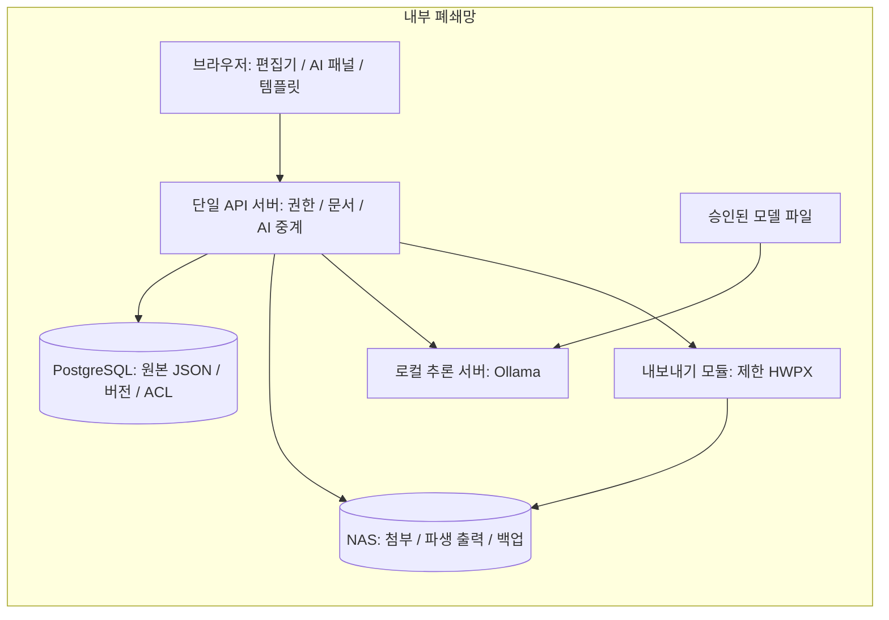
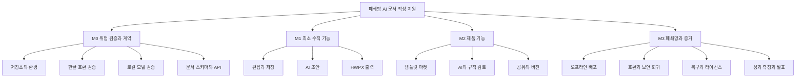
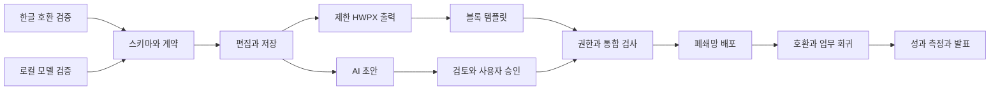

> **이전 버전 보관본 · 초기안 · 현재 실행 기준이 아님**
>
> 원래 자료명: `internal-doc-assistant-plan.md` · 작성일: 2026-09-23.
> 아래 본문은 파일 도구로 확보한 추출 텍스트다. 원본 MD와 바이트 동일성을 보증하지 않는다.
> 유료 API·모델·개발 환경·A/B 역할에 관한 옛 내용은 [현재 기준](../README.md)과 [결정 기록](../decisions-and-open-questions.md)을 우선한다.
> 아래 구현·저장소·진척·외부 출처 설명은 당시 기록이다. 이번에 실행·재검증한 결과가 아니다.
> 원래 ZIP에 속한 상대 경로 링크는 ZIP 미포함으로 열리지 않을 수 있다. 코드를 복원했다는 뜻도 아니다.

---

# 폐쇄망 AI 문서 작성 지원: 통합 설계안

2026-09-23 · 제안 v0.1 · 구현 및 현장 검증 전

# 폐쇄망 AI 문서 작성 지원 — 설계 초안 v0.1

작성 기준일: 2026-09-23 · 개발 인원: 2명 · 상태: 제안 / 개발·검증 전

> 한글을 새로 만드는 대신, 승인된 양식과 문서 블록으로 초안을 작성·검토하고 한글에서 마무리한다.

이 저장소 초안은 **설계·계획 자료**다. 실행 가능한 애플리케이션, 검증된 HWPX 변환기, 모델 파일, 실제 GitHub 저장소/Issues는 포함하지 않는다. 회사 문서·폰트·제3자 소스도 포함하지 않는다.

## 먼저 읽을 문서

| 문서 | 목적 |
|---|---|
| [제품 요구사항](docs/01_PRD.md) | MVP, 제외 범위, 사용자 흐름, 성공 기준 |
| [아키텍처](docs/02_ARCHITECTURE.md) | 문서 구조, 모델 교체, 저장·권한·버전 설계 |
| [WBS](docs/03_WBS.md) | 4단계 마일스톤, 담당자, 의존성, 인수기준 |
| [한글 호환 전략](docs/04_HWP_COMPATIBILITY.md) | 제한 HWPX 내보내기, 검증 관문, 대안 |
| [라이선스 1차 검토](docs/05_LICENSE_REVIEW.md) | 구성요소별 근거와 미확정 사항 |
| [폐쇄망·보안](docs/06_SECURITY_OFFLINE.md) | 외부 통신 차단, 반입, 백업·복구 |
| [Git 운영](docs/07_GIT_WORKFLOW.md) | 보드, 이슈, PR, 진척도 관리 |
| [평가·발표](docs/08_EVALUATION_DEMO.md) | 비교 실험, 품질 검사, 데모 동선 |
| [확정 필요 사항](docs/09_OPEN_DECISIONS.md) | 일정·장비·호환 범위·정책 확인 |
| [출처](docs/SOURCES.md) | 공식 문서 및 라이선스 원문 위치 |

## 첫 번째 의사결정 관문

첫 단계에서 ① 회사가 쓰는 한글 버전에서 샘플 HWPX 열기·편집·저장, ② 로컬 모델로 한국어 초안과 검토 JSON 생성, ③ 외부 통신이 없는 실행을 작게 검증한다. 실패한 전제는 본격 기능 개발 전에 바꾼다.

## 권장 초기 구성

React + TypeScript + Vite / Tiptap OSS / FastAPI / PostgreSQL / 서버를 통한 NAS 저장 / Ollama 로컬 추론. 문서의 원본은 구조화 JSON이며 HWPX와 DOCX는 파생 출력이다. 버전·공유·AI 패널은 별도 구현한다.

클라우드 개발 실험은 승인된 외부 개발 환경과 합성 데이터에서만 수행한다. 폐쇄망 운영 프로필에는 외부 AI 호출과 자동 클라우드 전환을 허용하지 않는다.

## 진행 방식

A는 웹 편집·템플릿·문서 호환 화면, B는 API·AI·저장·폐쇄망 배포를 주로 맡는다. 담당자는 역할 가명이며 실제 계정은 아직 정해지지 않았다. 서로 PR을 검토한다.

`planning/backlog.json`과 `planning/issues/*.md`는 **이슈 생성용 초기 자료**다. 실제 이슈를 만든 뒤의 상태는 사내 이슈 보드 또는 GitHub Projects를 기준으로 관리한다. Markdown WBS가 보드와 자동 동기화되는 기능은 이 묶음에 없다.

마일스톤 M0–M3는 구현 순서이며 달력상 4주를 의미하지 않는다. 주당 개발 가능 시간과 마감일을 확인한 뒤 실제 날짜를 정한다.


---

# 제품 요구사항 — 제안 v0.1

## 문제와 목표

사용자가 제시한 환경: 회사는 망분리 환경이며, 내부망에서 한컴오피스 한글로 문서를 작성한다. 한글 사용이 익숙하지 않은 직원의 작성 부담을 줄이는 것이 목표다. 개발 인원은 2명이며 회사 바이브코딩 챌린지 발표를 준비한다.

프로젝트 정의: **폐쇄망에서 동작하는 표준 양식·문서 블록 기반 AI 작성 보조 서비스**.

핵심 가치는 글 생성 자체가 아니라 표준 서식 선택, 초안 작성, 오류 후보 검토, 공유·복구, 기존 한글 업무로의 전달을 한 흐름으로 묶는 데 있다.

## 대표 사용자 흐름

양식 선택 → 필요한 사실 입력 → 초안 제안 생성 → 사용자 승인 후 편집기에 반영 → 표/문단 템플릿 삽입 → 검토 제안 확인 및 개별 적용 → 저장/공유 → 특정 버전 HWPX 내보내기 → 회사 한글에서 최종 확인.

AI 결과는 자동 제출하거나 자동 결재하지 않는다. 입력에 없는 날짜·숫자·조직명은 추정하지 않고 미입력 항목으로 표시한다.

## MVP

| 영역 | 포함 | 인수기준 |
|---|---|---|
| 시작 양식 | 예시 3종: 회의록, 업무보고, 추진계획 | 합성 내용으로 작성부터 내보내기까지 반복 가능 |
| 기본 편집 | 제목, 문단, 목록, 단순 표, 제한 스타일 | 저장·재열기 후 구조와 허용 스타일 보존 |
| AI 초안 | 양식별 입력폼 + 문단 단위 생성 | 허용 JSON 스키마 검증, 미입력 사실 표시 |
| AI 검토 | 문체·중복·모호함·필수항목 누락 후보 | 원문/이유/수정안 표시, 개별 승인 및 취소 |
| 규칙 검사 | 필수 필드, 날짜 형식, 표 합계 등 정의된 규칙 | 정답을 계산할 수 있는 항목을 별도 검사 |
| 템플릿 마켓 | 초기 문서 3종·블록 10개를 목표로 한 내부 갤러리 | 검색, 미리보기, 삽입, 등록, 승인 게시 |
| 저장·버전 | 자동 저장, 명명된 버전, 이전 버전 복원 | 복원도 새 리비전, 이전 이력 보존 |
| 공유 | 소유자/편집자/열람자 권한 | URL을 알아도 권한 없으면 접근 불가 |
| 한글 연결 | 검증된 양식·지원 요소에 한정한 HWPX 출력 | 대상 한글 버전에서 열기·편집·재저장 확인 |
| 운영 | 내부 서버·로컬 모델·서버 경유 NAS 저장 | 외부 차단 상태에서 핵심 시나리오 통과 |

초기 양식 3종과 블록 10개는 설계상 제안값이며 사용자에게서 제공된 실물 양식 수가 아니다.

## 제외 / 후속 단계

임의 HWP/HWPX 완전 가져오기와 무손실 왕복 편집, 한글과 동일한 페이지 배치, 복잡한 병합표·수식·매크로·도형, 실시간 공동 편집, 외부 마켓·결제·랭킹, 대규모 사내 RAG, 미세조정, 자율 에이전트, Jev 필수 의존성을 MVP에서 제외한다.

실시간 공동 편집이 없어도 문서 공유는 지원한다. 문서 수정은 리비전 비교로 충돌을 검출한다. 다른 사용자의 수정을 조용히 덮어쓰지 않는다.

## 완료의 의미

웹에서 기능이 보이는 것만으로 완료하지 않는다. 테스트 통과, 다른 개발자 리뷰, 권한 확인, 폐쇄망 확인, 선택한 한글 버전의 출력 확인, 사용 설명 반영까지가 완료다.

시간 절감 30%는 발표용 **검증 목표 예시**이지 달성된 성과가 아니다. 정확한 측정 방법은 평가 문서를 따른다.


---

# 아키텍처 — 제안 v0.1

## 배포 경계

여기서 로컬 LLM은 사용자 PC마다 설치한다는 뜻이 아니라 **외부 서비스가 아닌 내부망의 승인된 추론 서버에서 실행**한다는 뜻이다.



초기에는 단일 백엔드와 DB로 충분하도록 설계한다. 별도 큐·벡터 DB·마이크로서비스·쿠버네티스를 필수로 도입하지 않는다. 장시간 작업의 필요가 확인되면 작업 상태 저장과 워커를 추가한다. 외부 개발 모드의 API 공급자는 별도 프로필에서만 활성화한다.

## 문서 구조

원본은 `schemaVersion`을 갖는 제한된 Tiptap/ProseMirror JSON이다. 지원 노드는 제목, 본문, 목록, 단순 표로 시작한다. 모든 편집 블록에는 안정적인 ID를 부여하고 복제 삽입 때 새 ID를 발급한다. 스타일은 승인된 이름·토큰으로 제한한다.

AI가 출력한 자유 HTML 또는 HWPX XML을 원본으로 저장하지 않는다. AI용 단순 DTO를 서버에서 검증한 뒤 편집기 JSON으로 변환한다. 정규 문서 스키마와 내보내기 매핑을 함께 버전 관리한다. 편집기 고유 스키마 의존성이 완전히 사라지는 것은 아니므로 스키마 마이그레이션 테스트를 유지한다.

출력 양식은 허용 슬롯과 요소 목록을 정의한다. 내보낼 수 없는 요소의 삽입을 MVP에서는 막거나 명확한 경고로 처리한다. 출력 과정에서 조용히 내용을 누락하지 않는다.

## 데이터 모델

| 개체 | 주요 필드 / 불변식 |
|---|---|
| documents | id, owner_id, title, current_revision, schema_version |
| document_revisions | doc_id, revision_no, content_json, author_id, created_at, template/theme 버전, hash; 불변 스냅샷 |
| document_permissions | doc_id, principal_id, role; 역할은 owner/editor/viewer |
| templates | id, owner_id, scope, publication_state, current_version |
| template_versions | JSON 블록, 변수 정의, 허용 슬롯, 스타일 토큰, preview 참조, 변경 설명 |
| ai_suggestions | doc_id, base_revision, block_id, 원문 해시, 수정안, 근거, 모델·프롬프트 버전, 상태 |
| audit_events | 사용자, 동작, 문서/버전 식별자, 시각, 결과; 본문 기본 미수집 |
| export_artifacts | doc_id, revision_no, format, template_version, path/key, hash, status |

권한은 문서 본문뿐 아니라 버전, 첨부, AI 처리, 내보내기 및 템플릿에도 적용한다.

## 저장과 공유

브라우저는 NAS에 직접 쓰지 않는다. 브라우저 → API → PostgreSQL/NAS 흐름으로 권한을 단일 지점에서 검사한다. NAS는 서비스 계정만 접근하게 하고 파일명은 사용자 제목 대신 서버가 생성한 식별자를 사용한다.

문서 JSON·리비전·메타데이터의 권위 있는 저장소는 DB다. NAS의 HWPX는 특정 리비전에서 생성된 파생 파일이다. 사용자가 NAS 파일을 한글에서 따로 수정해도 웹 문서에 자동 동기화되지 않는다. MVP는 이 경우 별도 사본으로 취급하며 양방향 동기화는 제외한다.

DB 운영 데이터 디렉터리는 별도 승인된 볼륨에 둔다. NAS는 첨부·출력·백업에 사용한다. 파일 쓰기는 임시 파일 작성, 동일 저장소 내 확정, 상태 기록으로 처리하고 실패 시 재시도·정리한다. DB와 파일 저장이 단일 트랜잭션이라고 가정하지 않는다.

자동 저장에는 짧은 입력 유예를 두고 중복 요청을 식별한다. 모든 키 입력을 영구 버전으로 만들지 않는다. 주기 스냅샷·명시적 버전·AI 적용 전후 버전 기준은 제품 테스트로 조정한다.

## 충돌과 AI 적용

수정 API에 `base_revision`을 포함한다. 현재 리비전과 다르면 충돌을 반환하고 최신 문서를 다시 읽도록 한다. AI 제안은 문서 리비전 및 대상 블록 원문 해시가 동일할 때만 적용한다. 검토 후 문서가 바뀌었다면 재검토한다.

이전 버전 복원은 이력 삭제가 아니라 새 리비전 생성이다. AI 제안의 적용도 문서 업데이트와 새 버전 생성으로 원자적으로 기록한다. 실행 취소와 명시적 버전 복원은 별개 기능이다.

## LLM 교체 경계

```text
업무 로직
  └─ GenerationProvider: draft / review
       ├─ FakeProvider: 화면·계약 테스트
       ├─ OpenAIProvider: 승인된 외부 개발 전용
       └─ LocalProvider: 폐쇄망 Ollama

선택 실험
  └─ DecisionProvider: classify / recommend_template
       ├─ RulesProvider
       ├─ LocalDecisionProvider
       └─ JevProvider: 승인된 외부 실험 전용
```

위 메서드는 **앱 내부 인터페이스 제안**이지 각 공급자의 실제 API 이름이 아니다. 공급자별 요청·응답 형식은 어댑터가 변환한다.

공통 계약은 입력 사실·양식 정의·스키마 버전, 검증 가능한 출력, 타임아웃·취소·오류 코드다. 결과를 서버에서 검증하고 한정된 재시도 후에는 실패를 명확히 표시한다. 잘못된 결과를 강제로 문서에 넣지 않는다.

API 호환은 품질·컨텍스트·구조화 출력·스트리밍·추론 모드의 동등성을 보장하지 않는다. Ollama는 OpenAI API의 부분집합을 지원하므로 실제 모델과 선택한 런타임에서 계약 테스트를 수행한다. [S05]

Qwen/Qwen3-8B는 첫 비교 기준 모델 후보다. 최신·최고 한국어 모델이라는 주장은 하지 않는다. 공식 모델 카드의 라이선스는 Apache-2.0이다. 원본/양자화 파일, 토크나이저, 모델 개정 해시를 함께 고정한다. [S07]

## 초안·검토 방법

초안은 양식의 각 문단을 작은 단위로 생성한다. 필수 항목과 입력 사실을 명시하고 사실이 없으면 `[입력 필요]`를 반환하게 한다. 날짜·금액·담당자 등 보존할 사실은 별도 필드로 전달하고 출력에서 재확인한다.

검토는 구조·필수항목·숫자 계산 같은 결정적 규칙과 문체·모호함 같은 LLM 제안을 분리한다. 근거 문서가 없는 사실의 진위를 AI가 확정했다고 표현하지 않는다. 규정 적합성은 승인된 규정의 출처·버전을 제공할 수 있을 때만 범위를 넓힌다.

전체 에디터 JSON을 작은 모델이 직접 수정하게 하지 않는다. `block_id`, 원문, 개선안, 이유, 검토 유형을 반환하고 앱이 적용한다. 저장·공유·권한 변경은 LLM이 결정하지 않는다.

## 초기 API 계약 후보

| 목적 | 예시 경로 | 중요 조건 |
|---|---|---|
| 문서 생성/조회/수정 | POST /documents; GET/PATCH /documents/{id} | 인증, ACL, base_revision |
| 버전 목록·복원 | GET /documents/{id}/revisions; POST /documents/{id}/restore | 복원은 새 버전 |
| 공유 설정 | PUT /documents/{id}/permissions | owner 권한 |
| 템플릿 조회·게시 | GET/POST /templates; POST /templates/{id}/publish | 승인·범위 검사 |
| 초안·검토 | POST /ai/drafts; POST /ai/reviews | 읽기/편집 권한, 크기 제한, 제안만 생성 |
| 제안 반영 | POST /suggestions/{id}/apply | 최신 리비전·원문 해시 검사 |
| 내보내기 | POST /documents/{id}/exports | 명시적 리비전·출력 형식 |

라우트는 제안이며 OpenAPI 명세 확정 전이다. 필요 이상으로 복잡한 장기 작업 API를 먼저 만들지 않는다.


---

# WBS — 2인 개발 제안

마감일과 개발 가능 시간이 미정이므로 4단계 마일스톤만 제시한다. **4단계 = 4주라는 약속이 아니다.** 상대 크기는 복잡도 비교용 초기 값이며 M0 결과 후 다시 산정한다.

## 담당

A: 편집기·템플릿·한글 호환·사용자 동선. B: API·AI·권한·저장·오프라인 배포. 이슈마다 책임자 1명, 반대편 개발자를 리뷰어로 둔다.

## 단계와 관문

| 단계 | 목표 | 다음 단계 진입 조건 |
|---|---|---|
| M0 | 위험 검증·계약 | 실제 한글 출력 경로·로컬 모델·스키마 검증 |
| M1 | 최소 수직 기능 | 편집 → AI 초안 → 저장 → 한글 출력이 연결됨 |
| M2 | 제품 기능 | 템플릿·검토·공유·복구가 권한과 충돌 정책을 지킴 |
| M3 | 폐쇄망·증거 | 오프라인·호환·복구·라이선스 검토와 발표 측정 완료 |

## 작업 목록

| ID | 단계 | 작업 | 담당 | 크기 | 선행 | 완료 기준 |
|---|---|---|---|---:|---|---|
| WBS-00 | M0 | 저장소·환경·요구사항 확정 | A | 2 | - | 회사 승인 저장소 위치·개발 가능 시간·한글 버전·GPU·반입 절차를 기록하고 PR 규칙을 합의한다. |
| WBS-01 | M0 | 제한 HWPX 호환 기술 검증 | A | 5 | WBS-00 | 합성 양식 1개를 대상 한글에서 열고 편집·저장한다. 제목·본문·단순 표 보존과 제한사항을 증거로 남긴다. |
| WBS-02 | M0 | 로컬 LLM 한국어·JSON 검증 | B | 3 | WBS-00 | 실제 사용할 내부 또는 동등 장비에서 초안·검토 계약을 실행하고 모델 해시·지연·메모리·실패 사례를 기록한다. |
| WBS-03 | M0 | 문서 스키마·API 계약 합의 | B | 3 | WBS-01, WBS-02 | 지원 노드·스타일·리비전·AI 제안 DTO·출력 매핑을 문서화하고 Fake 응답을 A와 함께 검증한다. |
| WBS-04 | M1 | 웹 편집기 기본 기능 | A | 5 | WBS-03 | 제목·문단·목록·단순 표와 제한 스타일이 저장·재열기 후 보존된다. 한국어 IME 입력과 붙여넣기를 시험한다. |
| WBS-05 | M1 | 인증·문서 저장·리비전 API | B | 5 | WBS-03 | 로그인·문서 권한 검사를 적용하고 자동 저장·불변 리비전·base_revision 충돌 처리·다른 계정 접근 거부를 시험한다. |
| WBS-06 | M1 | AI 초안 공급자 어댑터 연결 | B | 5 | WBS-02, WBS-03, WBS-05 | Fake와 Local로 동일 계약을 실행한다. 외부 공급자는 승인된 개발 모드에서만 사용하며 생성 결과는 사용자 승인 후 반영한다. |
| WBS-07 | M1 | 검증 양식 HWPX 출력 | A | 5 | WBS-01, WBS-03, WBS-04, WBS-05 | 지정 리비전의 지원 노드를 HWPX로 출력하고 한글에서 내용·스타일·편집 가능성을 확인한다. 미지원 노드를 조용히 누락하지 않는다. |
| WBS-08 | M2 | AI·규칙 검토와 안전한 적용 | B | 5 | WBS-06 | 규칙 검사와 LLM 제안을 구분한다. 이유·원문·수정안을 제공하고 리비전/블록 해시가 다르면 적용을 거부한다. |
| WBS-09 | M2 | 문서·블록 템플릿 마켓 | A | 5 | WBS-04, WBS-05, WBS-07 | 합성 문서 양식 3종·블록 10개 목표를 검증한다. 검색·미리보기·등록·승인 게시·삽입과 범위별 권한을 시험한다. |
| WBS-10 | M2 | 공유·버전 복원 UI | A | 3 | WBS-05 | owner/editor/viewer UI와 API 결과가 일치한다. 이전 버전 복원은 새 리비전이며 과거 이력을 보존한다. |
| WBS-11 | M2 | 권한·감사·충돌 통합 보강 | B | 3 | WBS-05, WBS-08, WBS-09, WBS-10 | 본문·버전·템플릿·AI·파일 권한을 시험하고 두 세션 수정 충돌 및 최소 로그 정책을 확인한다. |
| WBS-12 | M3 | 폐쇄망 배포 패키지·차단 시험 | B | 5 | WBS-06, WBS-07, WBS-11 | 모델·이미지·패키지·글꼴·고지를 승인 반입하고 외부 차단/콜드 시작에서 핵심 사용자 흐름이 성공한다. |
| WBS-13 | M3 | 한글 호환·업무 E2E 회귀 | A | 5 | WBS-07, WBS-08, WBS-09, WBS-10, WBS-12 | 양식별 열기·편집·재저장, 긴 내용·표 경계·권한 거부·AI 실패·저장 충돌을 체크리스트로 통과한다. |
| WBS-14 | M3 | 사용자 평가·발표 시나리오 | A | 3 | WBS-13 | 합성 과제의 한글 단독/도구 보조 작성 시간을 최종 수정까지 측정하고 표본·장비·제한을 명시한 발표 증거를 만든다. |
| WBS-15 | M3 | NAS 장애·백업 복구 검증 | B | 3 | WBS-05, WBS-07, WBS-11 | 파일 쓰기 실패를 명확히 처리하고 별도 테스트 환경에서 DB·첨부·권한·버전의 일관된 복구를 확인한다. |
| WBS-16 | M3 | 릴리스·라이선스 최종 확인 | B | 2 | WBS-12, WBS-13, WBS-15 | 버전 고정 목록·SBOM·LICENSE/NOTICE·모델 출처·배포 매니페스트·미지원 범위를 기록하고 차단 이슈 없이 태그한다. |

선택: OPT-01 Jev 비교 실험(P2). 필수 범위의 완료율에 포함하지 않는다.

## WBS 구조



## 주요 의존 관계



이 그림은 작업 계획이며 실제 보드 상태와 자동 동기화되지 않는다.

## 진척도 운영

현재 모든 구현 이슈는 미착수다. 이슈와 PR을 만든 뒤 보드를 상태 기준으로 사용한다. 초기 자료는 planning/backlog.json과 planning/issues에 있다. Done은 인수기준·테스트·상호 리뷰·PR 병합이 모두 충족된 상태다. 막힌 작업은 원인과 해소 조건을 적는다.

일정이 줄면 초기 양식 수와 마켓 부가기능부터 줄이고, Jev·실시간 공동 편집·RAG는 제외한다. 로컬 실행·저장 무결성·한글 출력·권한 검증은 기본 목표에서 남긴다.


---

# 한글 파일 호환 전략

## 핵심 결정

웹 리치 텍스트 편집기 도입과 한글 파일 호환은 서로 다른 과제다. 한컴은 HWP/OWPML 형식과 관련 공개 자료를 제공하지만 그것만으로 한글과 동일한 렌더링을 얻는 것은 아니다. 공개 참조 프로젝트 `hwpx-owpml-model`도 파일 모델·필터 예제이며 완성된 웹 편집 엔진이 아니다. [S01, S02]

MVP는 **제한된 양식의 새 문서 작성 → HWPX 단방향 내보내기 → 실제 한글에서 마무리**로 정한다. 기존 임의 문서의 무손실 가져오기·수정·재출력은 보장하지 않는다.

## 지원 수준

| 수준 | 범위 | 결정 |
|---|---|---|
| A | 고정 양식 + 제목/문단/목록/단순 표 + 승인 스타일 | MVP 1차 검증 대상 |
| B | DOCX 내보내기 후 회사 한글에서 열기 | HWPX 경로 실패 시 검증할 대안; 자동 채택 아님 |
| C | 임의 HWP/HWPX 가져오기·정밀 배치·왕복 편집 | MVP 제외 |
| D | 상용 한컴 웹 편집·변환 SDK 연계 | C가 필수라면 구매·폐쇄망·서버 사용 조건 조사 |

한컴의 개발자 사이트는 웹한글 기안기 및 한글 오토메이션 기능을 소개한다. 공개 파일 스펙/공개 참조 코드와 상용 제품의 사용권을 혼동하지 않는다. 데스크톱 한글 보유만으로 서버 자동화·웹 연계 사용권이 포함된다고 가정하지 않는다. 정확한 계약은 확인이 필요하다. [S03, S19]

## 구현 가설

승인된 빈 HWPX 양식과 출력 매핑을 준비하고, 검증된 슬롯에 구조화 데이터를 넣는다. 문서 블록의 스타일 토큰을 양식 스타일 ID에 매핑한다. 동적 표 삽입·스타일 참조·패키지 관계·페이지 흐름은 별도 테스트한다. 단순 문자열 치환만으로 처리 가능하다고 약속하지 않는다.

HWPX 출력은 웹 화면과 픽셀 단위로 일치하는 미리보기가 아니다. 웹 화면에는 내용·구조 중심 미리보기임을 알리고 실제 출력 검증 경로를 둔다. 스코프 바깥 요소는 명시적으로 거절하거나 제한을 안내한다.

## M0 기술 검증

실제 운영 한글 버전/빌드와 출력 요건을 기록한다. 다음을 합성 문서로 먼저 검사한다.

- 제목·본문·목록·기본 표·한글/영문/숫자·특수문자 보존
- 셀 너비·줄바꿈·긴 본문·페이지 경계에서 잘림/누락 없음
- 양식에서 사용하는 글꼴의 설치·서버 이용·재배포 가능 여부
- 파일 열기 → 사용자 편집 → 다른 이름 저장 → 다시 열기
- 특정 리비전에서 재생성할 때 의미와 지정 스타일 일관성

합격은 대상 한글에서 모든 지원 요소의 내용이 보존되고 사전에 정한 레이아웃 허용 범위에 드는 것이다. 열기만 성공했다고 통과 처리하지 않는다. 결과는 화면 증거와 체크리스트로 남긴다.

## 실패 시 의사결정

HWPX 경로가 예산 내 통과하지 못하면 우선 양식/지원 요소를 더 좁힌다. 그래도 불가능하면 DOCX 대안도 동일 한글에서 검증한다. 둘 다 부적합하거나 HWP 정확성이 필수라면 상용 SDK 또는 기존 한글 내부 보조 방식으로 범위를 재설계한다.

이 변경은 핵심 인수기준 변경이므로 조용히 HTML/PDF 출력으로 대체하지 않고 ADR로 명시한다. PDF만 내보내는 것은 사용자가 한글에서 계속 편집한다는 요구의 대체가 아니다.

## 저작권 주의

HWP 공개 스펙 페이지는 해당 스펙을 참고한 개발 결과물에 출처 문구를 제품 구성물에 기재할 것을 안내한다. 적용 대상·정확한 문구·참조한 OWPML 자료 조건을 실제 도입 전에 확인한다. 스펙 파일을 저장소에 그대로 재배포하는 것은 별도로 검토한다. [S01]


---

# 라이선스 1차 검토

검토일: 2026-09-23. **후보 선정 단계의 확인**이며 최종 법무 승인 또는 전체 의존성 감사 결과가 아니다. 패키지 버전·모델 파일·배포 형태가 아직 확정되지 않았으므로, 채택 시 버전별 LICENSE/NOTICE와 의존성을 다시 확인한다. 사내 사용만으로 조건이 모두 면제된다고 보지 않는다.

| 구성요소 | 공식 자료에서 확인한 라이선스/조건 | 설계 판단 | 근거 |
|---|---|---|---|
| React | MIT | 채택 후보 | S08 |
| Vite | MIT | 채택 후보; 번들 의존성 별도 | S09 |
| Tiptap OSS core | MIT | 우선 채택; 확장 패키지별 확인 | S04 |
| FastAPI | MIT | 채택 후보 | S10 |
| PostgreSQL | PostgreSQL License | 채택 후보 | S11 |
| Ollama | MIT | 로컬 런타임 후보; 모델 라이선스와 별개 | S06, S23 |
| Qwen/Qwen3-8B | Apache-2.0 | 첫 비교 기준 모델 후보; 정확한 개정/양자화 출처 고정 | S07 |
| python-docx | MIT | DOCX 대안 경로 선택 시 검토 | S12 |
| hancom-io/hwpx-owpml-model | Apache-2.0 | 구조 참고 후보; 완성 변환기로 취급하지 않음 | S02 |
| CKEditor 5 | GPL 2+ 또는 상용 | 조건 검토 부담을 이유로 MVP 기본안 제외 | S13 |
| TinyMCE 8 | GPLv2+ 또는 상용 | 조건 검토 부담을 이유로 MVP 기본안 제외 | S14 |
| Docker Desktop | 별도 구독 계약 | 회사 규모/공공기관 해당 여부 확인; 무조건 무료 아님 | S15 |
| Jev | 공식 API 사용 문서 확인 | 오픈 가중치·폐쇄망 배포 방법 미확인; API 실험만 별도 검토 | S16, S17 |

## 에디터 관련 함정

Tiptap 전체 제품이 MIT라고 간주하지 않는다. OSS 코어·개별 공개 확장과 Platform/Pro/UI 템플릿의 권리는 구분해야 한다. AI 생성·공유·버전 관리·템플릿 갤러리는 우리 API와 DB로 구현하며 상용 기능을 복사하거나 우회하지 않는다. 과거 Pro 확장 일부가 공개되기도 했으므로 이름만으로 판단하지 말고 **선택한 버전의 파일**을 확인한다. [S04, S20]

GPL 소프트웨어가 상업적/사내 사용에 항상 금지된다는 뜻은 아니다. 통합·수정·전달 형태에 따른 의무를 검토해야 한다는 뜻이다. 이 프로젝트에서는 검토 비용을 줄이기 위해 허용적 라이선스 중심 구성을 우선한다.

## 채택 시 기록할 필드

정확한 패키지/모델 이름, 버전/커밋/해시, 다운로드 출처, SPDX 식별자, LICENSE/NOTICE 경로, 직접·간접 의존성, 수정 유무, 배포 대상, 외부 인증/통신 의존성, 검토자, 승인일, 남은 질문.

SBOM, 라이선스 고지, 변경 내역, 취약점 점검 결과를 반입 묶음과 함께 보관한다. MIT 계열은 저작권·허가 고지를 보존한다. Apache-2.0 적용 구성요소는 실제 LICENSE/NOTICE와 변경 표시 등 관련 조건을 확인한다. 모든 오픈소스가 동일한 고지 방식을 요구하는 것은 아니다.

## 소프트웨어 외 검토

글꼴의 서버 설치·웹 배포·문서 임베딩 권리, 아이콘/이미지, 외부 서식, 샘플 문서, 회사 로고, 학습·평가 데이터의 사용 범위도 확인한다. 한컴오피스에 포함된 폰트를 웹폰트로 자유 재배포할 수 있다고 가정하지 않는다.

Docker Engine/Moby 등 오픈소스 구성과 Docker Desktop 계약을 구분한다. 승인된 Linux 컨테이너 실행 환경 또는 기존 회사 런타임을 먼저 사용하도록 검토한다. [S15]

## 미해결

실제 package lockfile과 운영 이미지가 없어 전이 의존성은 아직 검토하지 못했다. 모델의 한국어 업무 적합성, HWPX 출력 품질, 한컴 상용 SDK 계약도 미검증이다. 라이선스 적합성이 보안성·품질·유지보수성을 보장하지는 않는다.


---

# 폐쇄망·보안 설계 체크리스트

아래 항목은 제안하는 인수기준이며 회사의 실제 보안 규정을 확인했다는 의미는 아니다.

## 개발과 운영 분리

외부 개발: 회사가 승인한 도구와 합성/공개 데이터만 사용한다. 실문서뿐 아니라 제목, 조직도, 경로, 프롬프트, 스크린샷, 로그, API 키, Git 이슈 내용도 반출 검토 대상이다. 비식별 처리만 했다고 자동 승인된 것으로 보지 않는다.

내부 운영: 외부 모델 엔드포인트를 허용하지 않는다. 로컬 실패 시 클라우드로 전환하지 않고 기능 실패를 표시한다. 앱 설정 외에 네트워크 정책으로 외부 통신을 차단한다. 외부용 공급자 자격증명을 운영 배포에서 제거한다.

OpenAI API의 기본 학습 미사용 안내는 외부 전송이 없다는 뜻이 아니다. 로그 보존 등 데이터 통제 조건도 별개다. 회사 반출 승인을 대체하지 않는다. [S18]

## 의존성 반입

모델 가중치/토크나이저/양자화 파일, 실행 이미지, 운영체제 패키지, Python wheels, JavaScript 번들, 글꼴, 마이그레이션, 테스트 데이터, LICENSE/NOTICE를 승인 절차에 따라 반입한다. 버전과 SHA-256 등을 고정하고 내부 공급망 점검 결과를 보존한다.

실행 시 인터넷 다운로드, CDN, 외부 웹폰트, 원격 이미지, 원격 변환 서비스, 외부 오류수집, 원격 라이선스 확인이 필요하지 않도록 한다. 빌드에도 외부 접근이 금지된다면 별도 오프라인 빌드 캐시·사내 레지스트리까지 준비한다. 오프라인 실행과 오프라인 빌드는 구분해서 검사한다.

## 추론 서버

Ollama 공식 문서의 `OLLAMA_NO_CLOUD=1` 또는 대응 설정으로 클라우드 기능을 비활성화할 수 있다. 이를 네트워크 차단과 함께 적용하고 로그로 설정을 확인한다. 로컬 서버 API의 더미 키는 인증 장치가 아니므로 내부라도 브라우저에 직접 추론 포트를 노출하지 않는다. API 서버만 추론 서버에 접근하게 한다. [S05, S06]

## 문서·템플릿 보안

인증된 사용자에게 문서별 최소 권한을 적용한다. 공유 URL 자체는 권한을 부여하지 않는다. 본문, 과거 버전, 첨부, 내보내기, AI 요청, 템플릿 조회에 동일한 권한 검사를 적용한다.

템플릿은 허용 노드/속성/스타일만 저장한다. 임의 JavaScript·원격 리소스·실행 가능한 콘텐츠를 금지한다. XML/압축 파일을 처리할 경우 외부 엔티티, 경로 탈출, 압축 폭탄, 크기/개수 제한을 검사한다. 사용자 제공 경로나 URL을 서버가 임의로 읽지 않게 한다.

템플릿 게시 전 개인정보·실명·실제 계약금액 등 잔여 내용을 검사한다. 공개 범위(개인/팀/사내)를 명시하고 승인 게시한다. 복제 삽입 시 기존 문서는 템플릿 업데이트로 자동 변경되지 않는다.

## AI 안전성

문서 본문과 검색 결과는 명령이 아닌 데이터로 처리한다. 문서 속 ‘이전 지시를 무시하라’ 같은 내용이 시스템 권한을 바꾸지 못하게 한다. AI에 파일시스템·쉘·권한 변경 도구를 주지 않는다. AI 응답은 신뢰하지 않고 스키마와 값 범위를 검사한다.

자동 저장과 사용자 승인 적용을 구분한다. 초안/수정안은 미리보기 뒤 승인한다. 금액·날짜·이름 변경은 눈에 띄게 표시한다. 검토 제안의 낮은 품질이나 실패가 문서 편집·저장을 막지 않게 한다.

## 로그와 복구

기본 운영 로그에는 문서 본문·프롬프트·응답 원문을 넣지 않는다. 사용자, 모델/프롬프트 버전, 문서 리비전 ID, 처리시간, 성공/실패 등 최소 메타데이터를 기록한다. 원문 디버깅이 필요하면 별도 승인·권한·보존 기간을 적용한다.

DB와 NAS 백업은 같은 복구 기준 시점을 갖도록 매니페스트를 남긴다. 사용자 버전 복원과 장애 후 백업 복구를 각각 시험한다. 백업 존재가 아니라 새 테스트 환경에서 문서·권한·첨부·내보내기 이력을 복원한 증거를 인수기준으로 삼는다.

## 필수 시험

외부 DNS/인터넷 차단 후 깨끗한 브라우저에서 시작 → 내부 로그인 → 초안 생성 → 블록 삽입 → 검토 → 저장 → 공유 권한 확인 → 버전 복원 → HWPX 출력. 브라우저와 서버 양쪽의 네트워크 요청/차단 로그를 확인한다.

추가로 두 브라우저 동시 수정 충돌, 로컬 모델 중단, NAS 쓰기 실패, 잘못된 템플릿, 권한 없는 버전·파일 접근, 백업 복구를 검사한다.


---

# Git 운영 및 진척도 관리

## 저장소 위치

회사 소스와 설계의 외부 저장이 허용되지 않으면 기존 사내 Git 서비스를 사용한다. 외부 GitHub는 회사가 승인한 범위의 코드·합성 자료에만 사용한다. 저장소를 공개로 만들거나 실제 문서·모델 가중치·비밀키를 커밋하는 것을 기본값으로 삼지 않는다.

이 설계 묶음은 실제 원격 저장소를 생성하지 않았다.

## WBS / 이슈 / 보드의 역할

WBS Markdown은 범위·분해·의존성을 기록한다. Mermaid는 구조를 보여준다. 이슈는 작업과 인수기준을 기록한다. 보드는 현재 상태의 기준이다. PR은 실제 코드 변경과 리뷰 증거다.

GitHub는 Markdown Mermaid와 Projects의 표/보드/로드맵을 지원한다. 선택한 사내 Git 제품은 지원 범위를 확인하고, 미지원 시 동일 WBS 표와 이슈 링크를 사용한다. [S21, S22]

WBS 그림 자체가 이슈 상태를 자동 반영하지 않는다. 자동화가 필요하면 나중에 사내 승인된 CI/API로 상태를 읽어 생성하도록 구현한다. 현재 자료는 정적 계획 및 이슈 초안이다.

## 권장 보드

열: Backlog → Ready → Doing → Review → Done. 막힌 작업은 `blocked` 표시와 해소 조건·담당자를 추가한다. Doing은 1인당 핵심 작업 1개를 기본으로 한다.

필드: WBS ID, 담당자, 검토자, 마일스톤, 우선순위, 상대 크기, 의존 작업, 이슈 링크, PR 링크, 검증 증거. 상대 크기는 작업 복잡도를 비교하는 제안값이며 시간 견적이나 검증된 속도가 아니다.

보드 보기: 담당자별 Board, 전체 WBS Table, 날짜가 확정된 뒤 Roadmap. 작은 팀에서는 툴을 많이 늘리지 않는다.

## 브랜치와 리뷰

`main`은 데모 가능한 상태로 유지한다. 기능별 짧은 브랜치를 만들고 이슈 하나에 연결한다. 예: `feat/WBS-04-editor`.

PR에는 변경 이유, 관련 이슈, 검증 방법, 화면 또는 테스트 증거, 데이터/API/모델/의존성 변경, 폐쇄망 영향, 라이선스 영향을 기록한다. 실제 이슈 생성 후 `Closes #실제번호`를 사용한다. WBS ID를 GitHub 이슈 번호로 혼동하지 않는다.

두 사람이 서로 검토한 뒤 병합한다. 모델이 만든 코드도 같은 기준을 적용한다. API 계약과 정규 문서 스키마 변경은 서로 먼저 맞춘다. CI가 없으면 필수 테스트 명령과 결과를 PR에 기록한다.

## 완료 기준

인수기준 충족, 테스트 통과, 다른 개발자 리뷰, 문서 반영, 권한/오프라인 확인, 관련 PR 병합이 모두 있어야 Done이다. 부분 완료를 임의의 ‘90%’로 적기보다 남은 인수기준을 하위 이슈로 나눈다.

진척도 예시: Done인 필수 이슈의 상대 크기 합 / 현재 확정된 필수 이슈의 상대 크기 합. 선택 기능은 별도로 집계하고 범위 변경 이력을 남긴다. 숫자는 팀 내부 가시화용이며 개발 생산성 평가 지표가 아니다.

## 초기 자료 사용

`planning/backlog.json`에는 필수 작업 17개와 선택 작업 1개가 있다. `planning/issues/`의 Markdown은 복사하여 이슈 본문으로 사용할 수 있다. `.github/ISSUE_TEMPLATE/task.md`와 PR 템플릿도 포함했다. 이 파일들은 원격 이슈를 생성하거나 자동 임포트하지 않는다.

처음에는 M0만 Ready로 이동하고 나머지는 Backlog에 둔다. 한글 호환·로컬 모델·정규 스키마 결과에 따라 이후 작업 크기와 범위를 수정한다.


---

# 평가·발표 계획

## 검증 가설

‘AI를 붙였다’가 아니라 ‘비숙련 직원이 승인된 양식으로 문서를 완성하는 데 드는 시간과 서식 수정 부담이 줄었다’를 검증한다.

시간 절감 30%, 검증 문서의 지원 요소 보존 100%, 필수 보안 시나리오 통과는 **제안 목표**다. 아직 어떤 성과도 측정하지 않았다.

## 비교 실험

동일 또는 난이도가 비슷한 합성 문서 과제를 한글 단독 작성과 도구 보조 작성으로 비교한다. 3–5명의 파일럿은 실행 가능한 초기 제안이며 통계적 일반화를 보장하지 않는다. 과제 순서를 번갈아 주어 학습 효과를 줄인다.

시간은 초안 생성 시간만이 아니라 최종 한글 수정까지 포함한다. 시작·종료 기준을 고정하고 중간 실패·재시도도 기록한다. 샘플 수, 사용자 숙련도, 장비, 모델 버전, 문서 길이를 결과와 함께 제시한다.

## 측정 항목

| 항목 | 측정 방법 |
|---|---|
| 작성 시간 | 입력 시작부터 한글 최종 확인까지, 중앙값 및 개인별 값 |
| 서식 재작업 | 표/문단/제목 수정 횟수 또는 명시적 체크리스트 |
| AI 사실 보존 | 입력에 없는 숫자·날짜·조직명 생성, 원래 사실 훼손 여부 |
| 검토 품질 | 심어둔 오류 탐지와 잘못 지적한 항목을 함께 집계 |
| 제안 채택 | 사용자가 수락한 수정안 비율; 정확성과 별개 지표로 설명 |
| 파일 호환 | 지원 요소 누락·깨짐·열기/재저장 실패, 한글 버전별 기록 |
| 로컬 성능 | 정해진 입력 길이의 첫 응답·전체 응답 시간, 반복 횟수 |
| 공유·복구 | 권한·충돌·버전 복원·백업 복구 시나리오 결과 |
| 폐쇄망 | 브라우저/서버의 의도하지 않은 외부 요청, 차단 상태 성공 |

모델 평가는 한국어 업무 사례 20–30개 정도로 시작하되 실제 정답/허용 답과 사람 검토 기준을 만든다. 원문, 기대 보존 사실, 오류 유형, 채점 기준, 실제 결과를 분리 저장한다. LLM 자체 평가만을 정답으로 삼지 않는다.

## 모델 전환 시험

Fake / 외부 개발 공급자 / 로컬 공급자에 동일한 업무 계약을 적용한다. 통신 연결 성공 외에 JSON 적합성, 한국어 문체, 사실 보존, 실패 처리, 지연 시간을 비교한다. Qwen3-8B의 품질은 현재 미측정이다.

하드웨어 구매를 먼저 확정하지 않는다. 예산 가설로 8B 4-bit 모델을 16GB급 GPU에서 짧은 문서·낮은 동시성으로 시험할 수 있지만 적합성은 측정해야 한다. 단순 4-bit 가중치 계산은 약 4GB이며 런타임, KV 캐시, 양자화 메타데이터 등 전체 사용량이 아니다. 장문·동시 사용자 증가가 메모리와 지연에 미치는 영향도 별도 확인한다.

## Jev 선택 실험

2026-09-15 공식 발표된 Jev는 자유 문장 생성이 아닌 선택/점수/확률 형태 판단용이다. 공개 문서에서 API 사용은 확인되지만 다운로드 가중치와 폐쇄망 실행 방법은 확인하지 못했다. 비공개 기업 배포 여부는 미확인이다. [S16, S17]

합성 데이터가 있는 별도 외부 실험에서 문서 유형 분류 또는 템플릿 추천을 Rules / Local / Jev로 비교할 수 있다. 실제 문서나 민감한 메타데이터를 보내지 않는다. Jev는 MVP의 성공 조건에서 제외한다.

형식 적합성이 판단의 정확성을 보장하지는 않는다. 확률은 정답 보증이 아니며 한국어 업무 과제에서 별도 검증한다. 회사의 속도·비용 주장만 가져와 실측처럼 발표하지 않는다.

## 발표 동선 제안

1. 한글 비숙련자의 실제 불편을 합성 예제로 보여준다.
2. 승인된 양식을 선택하고 사실 5개를 입력한다.
3. 로컬 AI로 초안을 만들고 사용자가 반영한다.
4. 표 블록을 선택·삽입하고 문서 스타일을 맞춘다.
5. 누락/모호한 문장 제안을 개별 수락한다.
6. 저장·공유·버전 복원을 보여준다.
7. HWPX를 실제 한글에서 열어 확인한다.
8. 측정한 시간/오류 결과와 외부 차단 상태를 제시한다.

발표 자료에는 구현된 기능, 검증한 범위, 미지원 요소, 향후 계획을 명확히 구분한다. 녹화본을 비상용으로 준비하더라도 이를 실시간 처리로 오인시키지 않는다.


---

# 확정 필요 사항과 임시 가정

현재 사용자에게서 확정된 사실은 2인 개발, 회사 망분리·내부망, 한컴오피스 한글 사용, 초안/검토·웹 편집·공유/버전·템플릿 마켓 요구다.

| 미확정 사항 | 현재 임시 설계 | 확정 책임 / 영향 |
|---|---|---|
| 마감일·주당 투입 시간 | M0–M3 순서만 제시, 달력 날짜 미지정 | 팀 / 전체 일정 |
| 한글 버전·최종 제출 확장자 | 제한 HWPX 단방향 출력 검증 | 현업·IT / 최대 기술 위험 |
| 기존 HWP 완전 가져오기 필요성 | MVP 제외 | 현업 / 필수라면 아키텍처 재검토 |
| GPU/VRAM·RAM·운영체제 | 내부 추론 서버 후보, 장비 미확정 | IT / 모델 크기와 응답 시간 |
| 패키지·모델 반입 허용 | 승인된 오프라인 반입 가정 | 보안 / 배포 가능 여부 |
| 외부 AI·Git 사용 허용 | 합성 데이터라도 승인 필요 | 보안 / 개발 도구·저장소 위치 |
| NAS 프로토콜·권한·백업 | API 서버만 파일 저장 | IT / 운영 설계 |
| 사용자 수·동시 편집 필요 | 파일럿, 실시간 공동 편집 제외 | 현업 / 처리량·충돌 정책 |
| 계정/SSO | 문서별 권한 필수, SSO 연계는 후속 검토 | IT / 인증 범위 |
| 회사 표준 양식·스타일 | 합성 3종/블록 10개 제안 | 현업 / 템플릿 설계 |
| 글꼴·SDK 사용권 | 재배포·서버 사용권 미확인 | 법무·구매 / 비용·배포 |

일단 진행할 최소 작업은 비민감 합성 양식 1개, 제목/본문/표 편집, 한글 출력 검증, 로컬 AI 1회 호출, 문서 JSON 스키마 합의다. 미확정 사항이 핵심 인수기준을 바꾸면 ADR로 남기고 범위를 재산정한다.


---

# 공식 출처

확인 기준일: 2026-09-23. 링크의 최신 상태는 변할 수 있다. 실제 채택 버전의 원문·해시·검토일은 별도로 보존한다. 공개 가중치 미확인은 존재하지 않는다는 확정 결론이 아니다.

## S01
한컴 HWP/OWPML 파일 형식 공개 및 사용권 안내

`https://www.hancom.com/support/downloadCenter/hwpOwpml`

## S02
한컴 hwpx-owpml-model 공식 저장소

`https://github.com/hancom-io/hwpx-owpml-model`

## S03
한컴 개발자 사이트: 웹한글 기안기 / 오토메이션

`https://developer.hancom.com/`

## S04
Tiptap OSS 및 MIT 라이선스

`https://tiptap.dev/open-source-to-platform`

## S05
Ollama OpenAI API 부분 호환

`https://docs.ollama.com/api/openai-compatibility`

## S06
Ollama FAQ: 로컬 실행·클라우드 비활성화

`https://docs.ollama.com/faq`

## S07
Qwen/Qwen3-8B 공식 모델 카드

`https://huggingface.co/Qwen/Qwen3-8B`

## S08
React LICENSE

`https://github.com/react/react/blob/main/LICENSE`

## S09
Vite LICENSE

`https://github.com/vitejs/vite/blob/main/LICENSE`

## S10
FastAPI LICENSE

`https://github.com/fastapi/fastapi/blob/master/LICENSE`

## S11
PostgreSQL License

`https://www.postgresql.org/about/licence/`

## S12
python-docx LICENSE

`https://github.com/python-openxml/python-docx/blob/master/LICENSE`

## S13
CKEditor 5 라이선스 공식 안내

`https://ckeditor.com/docs/ckeditor5/latest/getting-started/licensing/license-and-legal.html`

## S14
TinyMCE 8 라이선스 공식 안내

`https://www.tiny.cloud/docs/tinymce/latest/license-key/`

## S15
Docker Desktop 라이선스 공식 안내

`https://docs.docker.com/subscription-billing/desktop-license/`

## S16
TypeSafe 공식 Jev 소개

`https://docs.typesafe.ai/introduction`

## S17
TypeSafe Jev 공식 발표: 2026-09-15

`https://typesafe.ai/blog/introducing-system-one-models-and-jev`

## S18
OpenAI API 데이터 통제 공식 안내

`https://developers.openai.com/api/docs/guides/your-data`

## S19
한컴 SDK 공식 사이트

`https://sdk.hancom.com/`

## S20
Tiptap Pro 라이선스

`https://tiptap.dev/pro-license`

## S21
GitHub Markdown Mermaid 지원

`https://docs.github.com/en/get-started/writing-on-github/working-with-advanced-formatting/creating-diagrams`

## S22
GitHub Projects 소개

`https://docs.github.com/en/issues/planning-and-tracking-with-projects/learning-about-projects/about-projects`

## S23
Ollama LICENSE

`https://github.com/ollama/ollama/blob/main/LICENSE`

## S24
Tiptap LICENSE.md

`https://github.com/ueberdosis/tiptap/blob/main/LICENSE.md`

## S25
TypeSafe 공개 문서 인덱스

`https://docs.typesafe.ai/llms.txt`