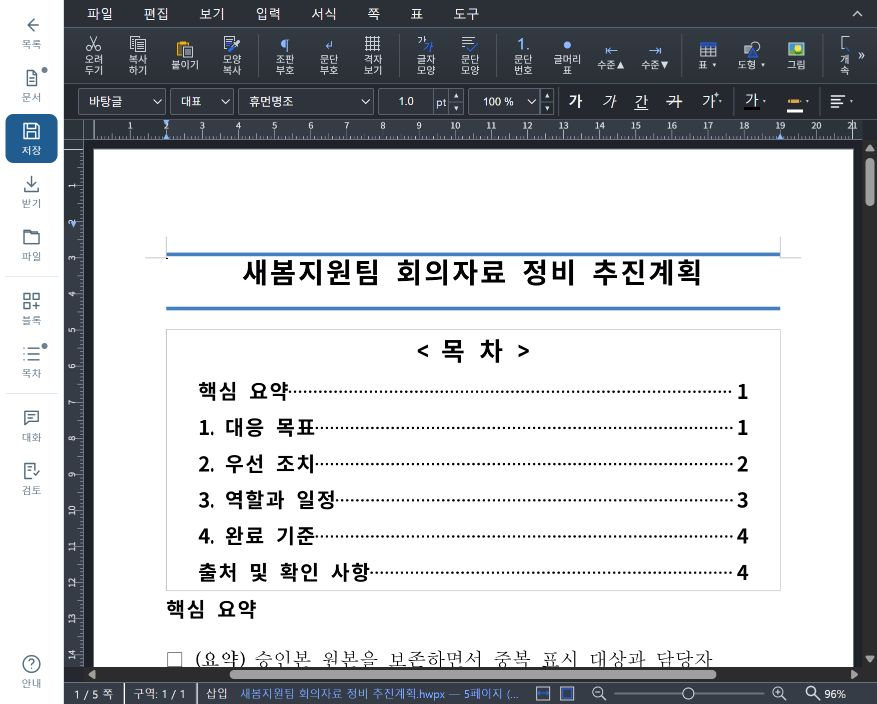

# 편집 화면 높이·스크롤 정리 — 2026-10-18

일반 문서 편집기, 보고서 초안 편집기, 문서 표준 예시 화면에 적용했다. 이전 [편집 화면 정리](editor-review-2026-10-18.md) 이후의 배치 변경이며, 기존 증거와 문서는 보존한다. 검수 앱은 <http://127.0.0.1:15185/>다. 기존 15183·15184 앱은 유지했다.

## 배치와 스크롤

- 일반 문서와 보고서 화면의 앱 메뉴를 64px 왼쪽 레일로 옮겼다. 편집기 자체의 파일·서식 도구는 유지하며, 앱 헤더가 편집기의 높이를 차지하지 않는다. 파일·대화·목차·작성 요청·결과·상태는 필요할 때 여는 패널로 표시한다.
- 표준 편집 화면은 설정·등록·상태를 왼쪽에 모으고 예시가 화면 높이 전체를 사용한다. 좁은 화면은 64px 레일에서 설정 패널을 연다.
- 편집 화면의 루트 높이는 `100dvh`로 고정하고 문서, 패널, 설정, 예시만 각각 내부에서 스크롤한다. 문서함·마켓은 기존 페이지 스크롤을 유지한다.
- 보고서의 기존 최소 680px 편집 높이와 화면 밖 대형 임시 렌더러가 바깥 스크롤 영역을 키울 수 있었다. 최소 높이를 제거하고 임시 렌더러의 배치를 격리했다. 임시 엔진의 측정 크기는 유지한다. 표준 편집기의 좁은 화면 자동 높이·최소 높이도 제거했다.
- 메뉴 전환 중 실제 편집기 iframe의 부모·key를 바꾸지 않는다. 작성 입력·미전송 대화·미저장 편집·목차 갱신·저장 재확인 상태는 유지한다.

변경 위치는 `frontend/src/main.tsx`, `reports.tsx`, `report-preview.tsx`, `report-progress.tsx`, `standard-designer.tsx/css`와 새 `viewport.css`, `editor-workspace.css`, `report-editor-workspace.css`다. 이번 후속 변경에서 백엔드, HWPX 처리, 모델 입력, 엔진은 수정하지 않았다. 작업 트리의 해당 영역 변경은 앞선 기능 작업에서 발생한 것이다.

## 확인 범위

실제 앱 안 브라우저의 877×704 화면에서 일반 편집기 iframe은 이전 `(0,103,877,601)`에서 `(64,0,813,704)`로 바뀌었다. 합성 업무보고 4쪽의 마지막 쪽까지 내려도 바깥 페이지 높이는 704px, 바깥 스크롤은 0이었다. 이전 일반 편집기 관찰에서도 바깥 스크롤은 0이었으므로 모든 화면에서 무한 스크롤을 재현했다고 해석하지 않는다.

관련 실제 rhwp E2E의 고유 7케이스가 통과했다. 일반 편집기 전체 높이·파일 메뉴·400/862/1366px 화면, 단일 패널과 미전송 입력 보존, 보고서 전체 높이·같은 iframe·편집→목차 갱신→저장→일반 편집기 재열기, 기존 자동 목차, 생성 중 내용·재열기, 취소 후 새 요청, 표준 편집기의 설정·예시 독립 스크롤·모바일·등록을 확인했다. 모델 응답은 mock이며 실제 AI 호출은 0회다.

첫 묶음(r1)은 5통과·1실패였다. 실패는 작성 정보 취소 후 입력 폼이 제거될 것이라는 새 시험의 잘못된 예상이었다. 기존 동작은 서버 값으로 되돌린 폼을 유지한다. 예상만 고친 r2에서 해당 시험과 취소 시험이 통과했다. 최종 화면 점검에서 보고서 레일의 단어 중간 줄바꿈이 보여 표시 라벨을 정리하고 전체 accessible name·툴팁을 유지했다. 이 변경의 보고서 전체 높이·기존 목차·취소 3케이스를 r3에서 다시 통과했다. 모든 묶음과 실패 로그를 보존하며 실행 횟수를 고유 시험 수로 더하지 않는다. TypeScript와 진단 빌드·실제 서빙 파일 10개의 해시도 확인했다. 최종 영수증은 [검증 근거](evidence/editor-viewport-2026-10-18.json)에 있다.

원본·과거 버전·기준 HWPX·긴 제목 fixture·기존 frozen 출력은 변경하지 않았다. 일반 편집기 메뉴 전환 전후 출력 SHA와 보고서 저장·재열기 SHA가 같다. 실제 화면 확인은 AI가 수행했으며 사람의 최종 검수, 실제 모델 생성 품질, 새 Hancom 시험, 일반 배포 시험으로 표시하지 않는다.

최종 검수 탭에는 같은 합성 자료의 추진계획 5쪽을 열어 두었다. 본문 입력·서버 저장은 하지 않았다.

브랜치는 `codex/hwp-assistant-progress-2026-10-14`, HEAD는 `5d75900eb71671be696b9201f871c2c310f3878f`다. 앞선 기능과 이번 UI 변경은 미커밋 상태다.
