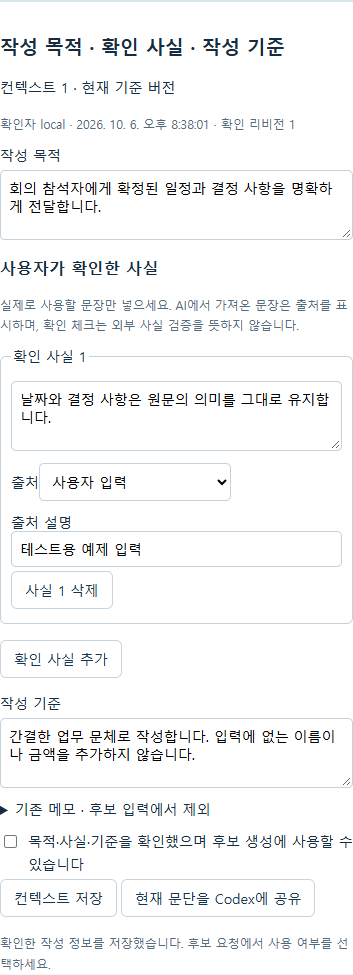

# HWP Assistant 새 기능 테스트 안내

이번 기능은 작성 정보와 후보 생성을 연결하고, 문서함에서 원본을 보존한 사본을 만들어 검토할 수 있게 한다. 기본 AI는 Codex이며, 사용자가 후보 요청 버튼을 눌렀을 때 기존 Codex CLI와 ChatGPT 로그인을 사용한다. 이 개발 대화의 전체 내용을 자동으로 전달하지 않는다.

## 실행

저장소 루트의 PowerShell에서 다음 명령을 실행한다.

```powershell
powershell -NoProfile -File scripts/start-user-review.ps1
```

브라우저에서 **http://127.0.0.1:15180** 을 연다. 터미널을 열어 두고 사용하며, 끝나면 Ctrl+C로 이번 실행의 서버를 종료한다. 시작할 때 현재 소스의 진단 앱 번들을 새로 만들고 엔진 파일의 해시를 확인한다. 모델 요청이나 다운로드는 시작 과정에 없다.

- API 포트는 18180이다. 이미 사용 중인 포트가 있으면 기존 서비스를 중단하지 않고 실행을 거부한다. `-Port 15181 -ApiPort 18181`처럼 다른 포트를 지정할 수 있다.
- 테스트 문서함은 `.cache/user-review/data`에 저장되고 재실행 후에도 유지된다. 이 폴더를 삭제하면 테스트 문서를 잃으므로 필요한 문서는 다운로드한다.
- 기존 `data`와 기본 `frontend/public` 엔진, 인증 설정을 사용하거나 변경하지 않는다. 이 테스트 서버는 루프백 주소에만 열리는 단일 local 사용자 환경이다.
- 설치된 Codex와 기존 로그인으로 실행한다. 후보 요청 단계에서 로그인 또는 실행 파일 오류가 나면 해당 오류를 확인한다. 다른 AI로 자동 전환하지 않는다.
- 기본 배포 빌드의 보호 조건은 그대로다. 이 실행 명령은 별도 진단 엔진을 이용한 수동 테스트용이다.

별도 테스트 문서함에는 작성 정보가 저장된 예제 문서 1개를 준비했다. 대화 이름은 **새 기능 테스트 예제**다. 생성 작업은 0개이며 실제 모델은 호출하지 않았다. 예제를 열거나 자신의 HWPX를 업로드해서 시작할 수 있다. 시작 명령은 포트 15180을 기본으로 사용하며, 예제 준비 때 임시로 사용한 15181 서버는 종료된다.

## 문서함에서 사본 만들기

1. HWPX를 업로드하거나 새 문서를 만든 뒤 저장한다.
2. 목록에서 **저장본 복제**를 누르고 사본 이름을 입력한다.
3. 복제 완료 안내의 **사본 열기**를 누른다. 문장을 수정하고 저장한다.
4. 원본을 다운로드해 유지됐는지 확인한다. 사본의 첫 버전은 복제한 저장본과 같은 바이트이며 이후 편집은 사본의 새 버전으로 쌓인다.
5. **문서 정렬**에서 최근 등록순, 오래된 등록순, 이름순을 바꿔 본다. 파일명 검색과 함께 사용할 수 있다.

복제 대상은 버튼을 누를 때 목록이 가리킨 저장 버전이다. 편집기의 미저장 내용, 원본의 권한·대화·버전 이력은 복제하지 않는다. 사본의 소유자는 복제한 사용자다. 복제 응답이 끊겼다면 **같은 사본 생성 결과 재확인**을 사용한다. 새로운 사본을 계속 만들지 않는다.

## 작성 정보를 후보 입력에 사용하기

1. 문서를 열고 저장한다. 수정할 본문 문단에 커서를 둔다.
2. **대화 · AI 열기 → 공유 대화 만들기**를 누른다.
3. **작성 목적**과 **작성 기준**을 입력한다. **확인 사실 추가**로 모델에 전달할 사실 문장을 넣는다.
4. 사실마다 사용자 입력, 문서 저장 버전, AI 문장을 사용자가 확인 중에서 출처를 지정한다. 출처 설명도 입력할 수 있다. AI에서 가져온 내용은 AI 출처를 유지한다.
5. **목적·사실·기준을 확인했으며 후보 생성에 사용할 수 있습니다**를 체크하고 **컨텍스트 저장**을 누른다. 확인자와 리비전이 표시된다.
6. 후보 요청 영역의 **저장한 작성 정보 사용**을 체크한다. 개선 지시를 입력하고 **실제 Codex로 후보 2개 요청**을 누른다.
7. 후보의 **이 후보에 전달한 작성 정보**를 펼쳐 실제 요청에 포함된 목적·사실·기준·출처를 확인한다.
8. 원문과 후보를 비교하고 원하는 후보의 **승인·적용·저장** 버튼을 누른다. 저장 완료와 적용 이력의 저장 버전을 확인한다.

작성 정보 사용 체크를 해제하면 선택 문단과 개선 지시만 전달한다. 일반 대화 메시지와 기존 자유 메모는 자동 포함하지 않는다. 이전에 저장해 둔 메모는 별도 영역에 보존되며, 사용할 문장은 확인 사실 또는 작성 기준으로 직접 옮긴다.

작성 정보를 수정하면 확인 체크가 풀린다. 저장 버전이 바뀌면 내용을 다시 확인해 현재 기준으로 저장해야 한다. 목적과 작성 기준은 각각 4,000자, 사실은 최대 20개이며 각 2,000자까지다. 출처 설명은 각 500자까지다. 요청 전체에는 별도의 크기 한도가 있다.

사용자 확인은 입력에 포함할 의사를 기록하는 절차다. 사실성이나 회사 규정 적합성을 외부 검증했다는 뜻은 아니다. 모델의 문체 기준은 원문의 사실을 임의로 바꾸는 권한이 아니다.



## 후보 비교와 요청 복구

- **후보 변경 부분 강조**를 켜면 추가된 표현이 밑줄로 표시된다. **원문에서 바뀐 부분 확인**을 펼치면 삭제된 표현을 취소선으로 볼 수 있다. 강조를 꺼도 후보 내용과 승인할 텍스트는 같다.
- **후보 복사**는 후보 문장만 클립보드에 복사한다. 문서 적용이나 서버 저장을 수행하지 않는다.
- **요청한 개선 지시 → 개선 요청 불러오기**로 이전 지시를 입력칸에 다시 넣을 수 있다. 새 생성은 별도로 요청한다.
- 생성 접수 응답이 끊기면 **보관한 생성 요청 재확인**을 사용한다. 나중에 지시나 작성 정보를 편집했어도 보관한 ID·원문·입력으로 접수 결과를 확인한다. 이후 입력은 유지된다.
- 작성 정보 저장 응답이 끊기면 **작성 정보 저장 결과 재확인**을 사용한다. 같은 저장 ID로 확인하므로 리비전이 중복 증가하지 않는다. 응답 유실 뒤 추가로 입력한 내용은 아직 저장하지 않은 편집으로 남는다.

## 여러 창에서 작성 정보가 달라졌을 때

다른 창에서 먼저 저장하면 현재 입력을 덮어쓰지 않고 충돌을 표시한다. **대화 새로고침**을 눌러 서버의 최신 내용을 확인한다. 비교 화면에서 최신 내용과 현재 입력을 검토한 뒤 **최신 내용을 확인하고 내 입력 계속 편집**을 선택할 수 있다. 내용은 자동 병합하지 않으며, 다시 확인하고 저장해야 한다. **작성 정보 편집 취소**는 명시적으로 현재 입력을 버리고 불러온 서버 내용으로 되돌린다.

확인한 작성 정보가 바뀌면 아직 승인하지 않은 이전 후보는 새로 승인할 수 없다. 그 후보에 전달했던 정보와 후보 자체는 남는다. 이미 승인한 출력의 영수증·저장 재확인은 유지된다. 완료된 저장을 이후 컨텍스트 변경 때문에 취소하지 않는다.

## 이번에 확인할 사용자 판단

자동 시험은 모의 AI 응답과 실제 rhwp 편집기를 사용한다. 실제 Codex가 작성 목적과 기준에 맞게 표현을 개선하는지, 이름·날짜·금액·부정 의미가 보존되는지, 실제 사람이 고른 후보가 적절한지는 직접 확인해야 한다.

AI 적용 범위는 기존과 같이 단일 본문 문단이다. 페이지 수가 바뀌는 적용은 엔진이 거부할 수 있다. 거부되면 이유를 확인하고 비교를 종료하거나 현재 문단으로 새 후보를 요청한다. 표 셀은 수동 편집 대상으로 유지한다. 한컴에서 다운로드 파일을 열어 확인하는 과정도 별도로 수행한다.
