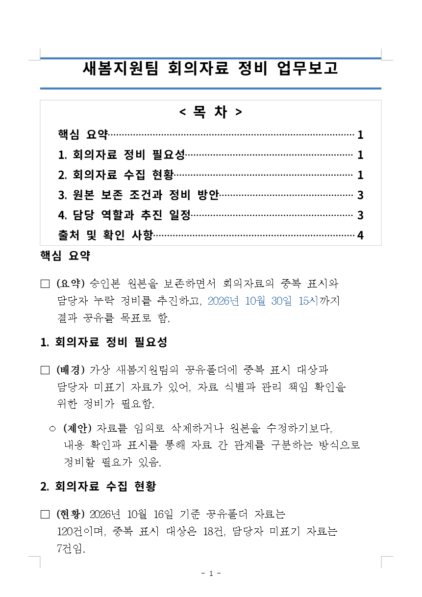
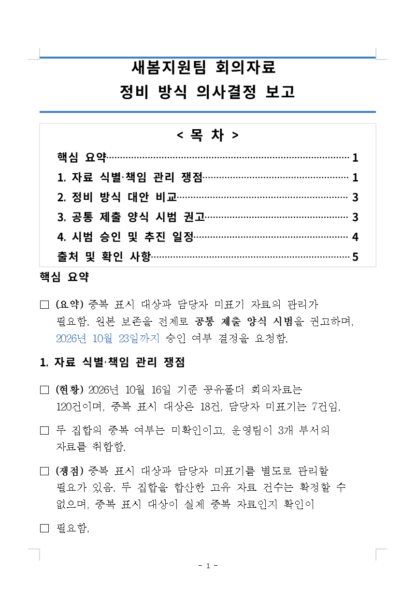
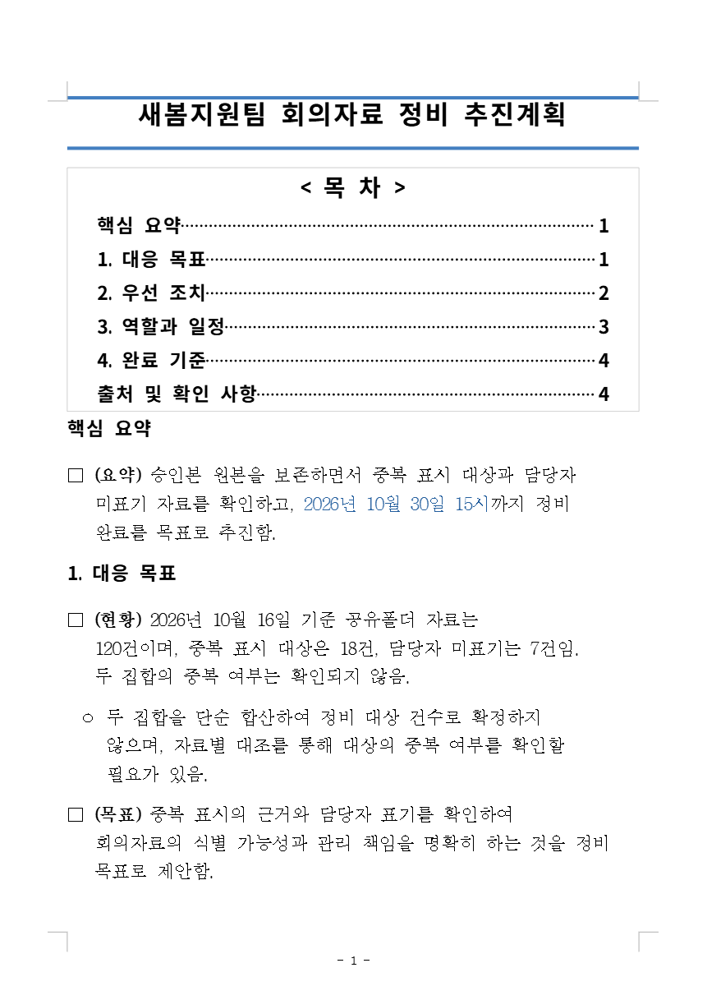

# HWP Assistant 구현 현황·사용자 검수

**검토일: 2026-10-18 · 핵심 기능 검증 후 업무 품질을 확인하는 단계**

[현재 상태](#현재-상태) · [구현 현황](#구현-현황) · [검수할 문서](#검수할-문서) · [사용자 검수표](#사용자-검수표) · [개발 우선순위](#개발-우선순위) · [Codex 실행 프롬프트](#codex-실행-프롬프트) · [검증 근거](#검증-근거)

| 기준 | 내용 |
|---|---|
| 개발 브랜치 | `codex/hwp-assistant-progress-2026-10-14` |
| 검토한 구현 | [`5d75900eb71671be696b9201f871c2c310f3878f`](https://github.com/m4r4m01m/hwp-assistant/commit/5d75900eb71671be696b9201f871c2c310f3878f) — 업무용 절 제목 작성 지시 보완까지 |
| 검토 방법 | 해당 커밋의 코드·문서·저장된 실행 증거 대조. 이 문서 작성 중 제품 시험이나 사용자 PC 앱 실행을 새로 수행하지 않음 |
| 사람 검수 | **우선 9개 + 추가 6개, 모두 미검수**. 아래 표의 결과를 실제 확인 뒤 갱신 |

## 현재 상태

**문서 편집, 승인 기반 AI 문단 수정, 세 보고서 프로필, 생성 단계 자동 목차, 저장·재열기까지 구현·검증 근거가 있다.** 이제 정상 업무 샘플의 내용과 화면을 사람이 확인하고, 이미 발견한 본문 분할 품질 문제를 고칠 차례다. 일반 배포 환경은 준비가 더 필요하다.

| 영역 | 현재 판단 | 다음 확인 |
|---|---|---|
| 문서·AI·보고서 핵심 흐름 | 🟢 구현 및 범위별 시험 근거 있음 | 실제 업무 내용, 조작의 이해도, 수정 결과 검수 |
| 업무용 제목·목차 가독성 | 🟡 간결한 제목 지시 반영, 정상 샘플 3종 확보 | 제목의 구별성·조건 보존·본문 읽기 품질 |
| Hancom 2018 호환 | 🟡 두 사본의 내용 왕복 확인, 제목선 색상 차이 남음 | 사용자 한글 환경에서 업무상 허용 가능 여부 |
| 일반 배포·사내 운영 | ⚪ 일반 빌드 실패 기록, Docker/WSL·SSO·폐쇄망 운영 미완료 | 개발 측 빌드·실행 환경 준비 |

상태는 기능별로 읽는다. 전체 완료율을 산정할 공통 기준이 없어 임의의 백분율은 붙이지 않는다. 실제 모델 호출, 자동 시험의 승인, 사람의 업무 승인, 운영 배포도 각각 구분한다. 근거: [10월 17일 인수인계][handoff]·[기능 마감 증거][final]·[업무용 제목 증거][headings].

## 구현 현황

아래의 **구현**은 해당 범위가 코드에 연결됐다는 뜻이다. 모든 사용자 문서·모델·운영 환경의 검수 완료를 뜻하지 않는다. `R01`~`R15`는 아래 사용자 검수표와 같은 번호다.

| 기능 | 구현된 범위 | 확인 근거와 남은 경계 | 사람 검수 |
|---|---|---|---|
| 문서함·사본 | HWPX 업로드, 새 문서, 이름 변경, 검색·정렬, 저장본 복제 | 복제는 저장된 버전으로 별도 문서를 생성. 미저장 버퍼·대화·권한·이력을 함께 복제하지 않음 | R07 |
| 웹 문서 편집 | 실제 rhwp에서 본문·표 편집, 저장본·복구용 파일 다운로드 | 실제 편집·재열기 근거 있음. 사용자 문서의 복합 서식은 별도 확인 | R04, R07 |
| 저장·버전·복원 | 수동 저장, 변경이 있을 때 20초 주기 자동 저장, 이력·과거 버전 복원 | 복원도 새 버전. 최초 원본·과거 blob 보존. 미확정 보고서 초안은 별도 명시적 저장 필요 | R07, R10 |
| AI 문단 수정 | 선택한 단일 본문 문단의 후보 2개, 차이 비교·복사, 승인·적용·저장 | 실제 Codex 검증 있음. 비대상 미저장 문구 보존. 표 셀·필드 등은 같은 수정 범위로 일반화하지 않음 | R08 |
| 문서 대화·작성 정보 | 목적·확인 사실·출처·작성 기준과 리비전 저장, 선택한 작성 정보 전달 | 저장한 작성 정보 사용은 명시적 선택. ChatGPT 전체 대화를 자동 전달하는 기능은 아님 | R08 |
| 보고서 생성·진행 | 실제 Codex 생성 단계 표시, 검증된 완성 초안의 HWPX 적용, 직접 편집·확정 저장 | 최신 제목 작업은 요청 4회 중 완료 3건·검증 거부 1건. 거부 원인은 미확인 | R01, R06 |
| 보고서 프로필 3종 | 표준 업무보고, 경영진 의사결정 보고, 대응·추진계획 보고 | 같은 표준 서식 안에서 목적·작성 기준·내용 흐름이 다름 | R01, R02 |
| 표준 서식·표·흐름도·강조 | 15pt 본문, 계층·내어쓰기·괄호 말머리, 파란 상하 제목선, 표와 편집 가능한 흐름도 | 본문 끝말이 별도 항목으로 분리되는 결함이 남음 | R03, R04 |
| 생성 단계 자동 목차 | 새 보고서의 제목과 실제 물리 쪽수 연결, 편집 후 명시적 갱신 | 실제 rhwp의 긴 제목 20쪽 경계가 2회에 수렴. 최대 3회 한도 유지 | R05, R06, R11 |
| 일반 문서 목차 | 1·2계층 제목 선택, 목차 미리보기·검증·반영·명시적 갱신 | 최대 30개 제목. 새 보고서 미리보기와 버튼·절차가 다름 | R05, R07 |
| 업무용 제목 가독성 | 새 초안에 구별 가능한 짧은 명사형 제목과 조건·설명의 본문 이동 지시 | 대상 시험 14개·실제 정상 샘플 3종. 모든 향후 모델 출력의 보장은 아님 | R02, R03, R05 |
| 템플릿 마켓 | 고정 저장 버전 등록, 검색·분류·즐겨찾기, 미리보기, 새 문서 생성, 정보 수정 | 현재 원본 문서 접근 권한을 따름. 임의 HWPX를 AI 보고서 프로필로 변환하는 기능은 후속 범위 | R12 |
| 표준 블록 | 제목·요약 문단·담당/기한 조치표 3종의 미리보기·삽입 | 10MB 이하·단일 구역·단일 단의 지원 본문 위치. 임의 양식 조각 추출이나 범용 블록 편집기는 후속 범위 | R13 |
| 공유·권한·인증 | 토큰 로그인, owner/editor/reader, 권한 부여·회수, 단일 편집 임대 | 문서 권한자는 해당 문서의 모든 대화·후보·이력 열람. 실시간 동시 공동 편집·SSO·회원가입 UI는 미구현 | R14 |
| Hancom HWPX 왕복 | 앞선 실제 Codex 4쪽·합성 20쪽 사본을 한글에서 별도 저장·재열기, rhwp 재가져오기 | 내용 보존 확인. 제목선 색상 차이 있음. 최신 간결 제목 3종 전체의 Hancom 검증은 아님 | R09 |
| 일반 배포 준비 | 고정 엔진·빌드 보호와 진단 실행 경로 있음 | 일반 빌드의 provenance 누락 실패, Docker/WSL·사내 운영 검증은 남음 | 개발 측 확인 |

근거: [문서·AI 기능 설명](features-implemented-2026-10-06.md), [현재 문서함 UI](../frontend/src/main.tsx), [협업·인증](collaboration-and-mcp.md), [템플릿 마켓](template-market-2026-10-08.md), [표준 블록](template-blocks-2026-10-11.md), [일반 목차](toc-2026-10-11.md), [보고서 프로필·자동 목차][toc], [인수인계][handoff]. 과거 설명 문서의 시험 수를 최신 커밋의 재실행 결과로 사용하지 않는다.

## 검수할 문서

### 정상 업무 샘플 3종

먼저 아래 세 문서의 요약·목차·절 제목·첫 본문을 읽는다. 세 프로필은 시각 양식 3개를 바꾸는 기능이 아니라, 같은 표준 서식에서 보고 목적을 달리하는 기능이다.

| 프로필 | 검수 질문 | 실제 절 제목의 흐름 | 기록된 렌더링 |
|---|---|---|---|
| 표준 업무보고 `standard-business` | 현재 상황과 필요한 조치를 이해할 수 있는가? | 회의자료 정비 필요성 → 회의자료 수집 현황 → 원본 보존 조건과 정비 방안 → 담당 역할과 추진 일정 | 전체 4쪽, 목차 1페이지·6항목·각 1줄 |
| 경영진 의사결정 보고 `executive-decision` | 무엇을 어떤 근거로 승인·보류해야 하는가? | 자료 식별·책임 관리 쟁점 → 정비 방식 대안 비교 → 공통 제출 양식 시범 권고 → 시범 승인 및 추진 일정 | 전체 5쪽, 목차 1페이지·6항목·각 1줄 |
| 대응·추진계획 보고 `response-plan` | 누가 어떤 순서로 언제까지 무엇을 완료해야 하는가? | 대응 목표 → 우선 조치 → 역할과 일정 → 완료 기준 | 전체 5쪽, 목차 1페이지·6항목·각 1줄 |

목차의 6항목은 각 4개 절과 공통 요약·출처 항목을 포함한다. 목차 1페이지·항목별 1줄은 이번 샘플의 관찰값이며 모든 보고서의 필수 한도는 아니다. 근거: [업무용 제목 증거][headings].

<details>
<summary><strong>Git에 보관된 실제 화면 3장 보기</strong></summary>

#### 표준 업무보고



#### 경영진 의사결정 보고



의사결정 화면 하단의 `□ 필요함.`은 이미 기록된 본문 분할 결함이다. 아래 개발 우선순위 1번에서 다룬다.

#### 대응·추진계획 보고



</details>

### 합성 업무 자료에서 확인할 사실과 조건

이 값들은 이번 합성 샘플을 대조하기 위한 기준이다. 다른 업무 보고서에 고정값으로 넣는 규칙이 아니다.

| 구분 | 보존돼야 할 내용 | 잘못된 해석의 예 |
|---|---|---|
| 공통 현황 | 기준일 `2026-10-16`, 전체 120건, 중복 표시 후보 18건, 담당자 표기 누락 7건 | 18건과 7건의 중복 여부가 미확인인데 25개의 서로 다른 문제 건으로 합산 |
| 공통 역할·보존 | 운영팀·3개 부서, 승인본 원본 보존, 사본을 확인한 뒤 중복 표시 | 원본 삭제·변경을 승인받은 것으로 표현하거나 사본 확인 조건 생략 |
| 표준 업무·대응 계획 목표 | `2026-10-30 15:00` 공유 목표, 아직 완료되지 않음 | 목표를 이미 달성한 결과로 표현 |
| 의사결정 | 비용·소요시간 실측 없음, 10월 23일까지 승인 요청, 승인될 경우에만 10월 26일부터 2주간 시범 | 비용·효과 수치 창작, 승인 전 전면 시행 확정 |
| 대응 계획 | 목록 확인 → 부서 담당자 확인 → 운영팀 취합 | 선행 확인을 생략하거나 순서 뒤집기 |

제목에서 옮긴 조건은 관련 첫 본문과 바로 이어지는 보조 항목을 함께 읽어 확인한다. 모든 사실을 첫 `□` 한 문단에 몰아넣을 필요는 없다. 본문뿐 아니라 요약·표·흐름도도 대조한다. 근거: [각 샘플의 `wording_review`][headings].

### 앱과 HWPX의 위치

| 용도 | 2026-10-17에 기록된 로컬 앱 | 사용자 PC 저장소 기준 파일 위치 |
|---|---|---|
| 최신 업무용 샘플 3종 | [15183 확인용 앱](http://127.0.0.1:15183/) | `reports/business-headings-2026-10-17/`의 `standard-business.hwpx`, `executive-decision.hwpx`, `response-plan.hwpx` |
| 기능 마감·긴 제목·Hancom 사본 | [15181 확인용 앱](http://127.0.0.1:15181/) | `reports/final-review-2026-10-17/`의 `short-rich-3-pages.hwpx`, `long-toc-20-pages.hwpx`, `short-actual-codex-report.hwpx`, `short-hancom-saved.hwpx`, `long-hancom-saved.hwpx` |

저장소 위치는 `C:\Users\alsdu\Documents\ChatGPT\hwp-assistant`다. 위 HWPX는 Git ignored 로컬 파일이며 GitHub 다운로드 링크가 아니다. 앱 URL도 당시 실행 기록으로, 현재 프로세스가 켜져 있는지는 이 검토에서 확인하지 않았다. 15183은 일반 `app.main`에 기존 진단 프런트엔드·엔진 번들을 연결한 확인용 앱이다. [인수인계][handoff]·[실행 증거][headings]

앱이 열리지 않으면 검수를 **보류**하고 개발 측에 실행 복구를 요청한다. [`scripts/start-user-review.ps1`](../scripts/start-user-review.ps1)의 기본값은 15180 포트와 `.cache/user-review/data`이므로 무인자 실행만으로 최신 3개 샘플이 나타나지는 않는다. Codex가 기존 15183 실행 기록의 실제 포트·데이터 경로를 확인해 연결해야 한다.

## 사용자 검수표

**추천 순서: 정상 샘플 읽기 R01~R05 → 새 생성·사본·AI 수정 R06~R08 → 실제 한글 R09.** 나머지 R10~R15는 해당 사용 범위와 준비된 환경에 맞춰 이어서 확인한다.

결과는 `미검수 / 통과 / 수정 필요 / 보류` 중 하나로 적는다. 실행 환경이 없어 확인하지 못한 항목은 보류다. 알려진 결함은 아래에 미리 표시했으며, 아직 하지 않은 사람 검수를 통과로 기록하지 않는다.

### 우선 검수 9개

| ID | 무엇을 확인할지 | 합격 기준 | 결과 |
|---|---|---|---|
| R01 | 정상 샘플 3종의 요약·목차·절 첫 본문 비교 | 현황·추진, 대안·승인, 역할·절차·완료 기준이라는 목적의 차이가 읽힘 | 미검수 |
| R02 | 위 사실·조건 표와 요약·본문·표·흐름도 대조 | 날짜·숫자·역할·부정·선행조건 보존. 사실/제안, 목표/완료, 확인/미확인을 구분 | 미검수 |
| R03 | 제목 구별성, 본문 기호·계층·내어쓰기·쪽 경계 | 제목에서 줄인 설명이 본문에 남고, 항목이 한 논점을 전달. `□ 필요함.`·`□ 아님.` 같은 외톨이 끝말 없음. **기존 결함 관찰됨** | 미검수 |
| R04 | 표·흐름도를 읽고 사본의 셀 또는 단계 문구 하나 수정 | 비교·선후관계가 유용하고 본문 조건과 일치. 실제 한글 개체를 수정할 수 있음 | 미검수 |
| R05 | 정상 샘플 3종의 목차·본문 제목·물리 쪽수 대조 | 각 절을 빠르게 찾을 수 있고 누락·잘림·겹침·잘못된 쪽수 없음. 필요한 두 줄 제목은 허용 | 미검수 |
| R06 | 새 보고서 1건 생성 → 직접 편집 → 목차 갱신 → 확정 저장 → 재열기 | 실제 상태가 이해되고, 편집 후 갱신 필요를 알림. 갱신·저장 뒤 직접 입력한 검수 문구 유지 | 미검수 |
| R07 | 저장본 복제 → 사본 편집 → 일반 목차 갱신 → 저장·재열기 | 원본과 사본이 구분되고 원본 보존. 사본의 수정 문구와 목차가 저장본에 유지 | 미검수 |
| R08 | 작성 정보 저장·선택 → 실제 Codex 문단 후보 2개 → 비교·승인·저장 | 전달 정보가 보이고 요청에 맞는 후보 생성. 승인 문단·사실·부정 의미와 비대상 미저장 문구 보존 | 미검수 |
| R09 | 정상 샘플 사본을 사용자 한글에서 열고 수정·별도 HWPX 저장·닫기·재열기 | 본문·표·흐름도·강조를 업무에 사용할 수 있고 수정 유지. 글꼴·줄바꿈·제목선 색상 차이를 판단 | 미검수 |

### 추가 검수 6개

| ID | 무엇을 확인할지 | 합격 기준 | 결과 |
|---|---|---|---|
| R10 | 검수 사본의 버전 기록 확인·과거 버전 복원 | 과거 파일 유지, 복원 결과는 새 버전, 원본과 후속 이력 구분 가능 | 미검수 |
| R11 | 보존된 긴 제목 20쪽 파일의 목차·뒤쪽 제목 확인 | 긴 제목과 12·15·18·20 등 두 자리 쪽수가 읽힘. **목차는 물리 2쪽의 한 페이지** | 미검수 |
| R12 | 저장 버전 양식 등록 → 마켓 검색·분류·즐겨찾기 → 미리보기 → 새 문서·편집·저장 | 고정 등록 버전으로 독립 문서를 생성하고, 원본 후속 편집과 구분됨 | 미검수 |
| R13 | 지원 본문 위치에서 제목·요약·조치표 블록 미리보기·삽입·저장·재열기 | 선택한 위치에 확인한 블록을 삽입. 지원하지 않는 위치의 안내를 이해할 수 있음 | 미검수 |
| R14 | 준비된 토큰 계정 2개로 열람 → 편집 → 권한 회수 확인 | reader 편집 차단, editor 임대 적용, 회수 효과 확인. 권한자의 문서 대화 열람 범위 이해 | 미검수 |
| R15 | 보고서·목차·AI·마켓의 버튼 위치와 안내 문구 확인 | 구현 기능과 안내가 일치하고 다음 조작을 찾을 수 있음. **마켓의 낡은 자동 목차 안내 확인 필요** | 미검수 |

R14는 `local` 단일 사용자 모드로 대체할 수 없다. 서버에 등록된 A·B 계정을 서로 다른 브라우저 프로필이나 일반/시크릿 창에서 사용하고, A가 소유한 별도 검수 문서를 B에게 공유한다. 두 계정이 준비되지 않았다면 보류한다. 데이터베이스·파일 해시 검사, 네트워크 장애 주입, 전체 회귀 반복은 사용자 검수에 포함하지 않는다.

### 헷갈리기 쉬운 실제 조작 경로

<details>
<summary><strong>R06 — 새로 생성한 미확정 보고서</strong></summary>

1. **보고서 작성 → 보고서 템플릿**에서 프로필을 선택하고 합성 요청으로 새 초안을 생성한다.
2. 편집 가능한 상태가 되면 본문에 구별할 수 있는 검수 문구를 한 문장 넣는다.
3. **목차 쪽수 갱신**으로 변경된 문서의 쪽수를 확인한다.
4. **초안 확정·서버 저장**을 누르고 저장 완료를 확인한다.
5. 저장 문서를 다시 열어 직접 쓴 문구·목차·본문을 확인한다.

생성 실패가 나면 작업 ID와 오류 문구를 남긴다. 이번 제목 검증에서도 4회 중 1회의 완성 응답 검증 거부가 있었으므로, 다시 생성해 성공한 사실과 최초 실패의 원인 해결은 구분한다.

</details>

<details>
<summary><strong>R07 — 이미 저장된 문서의 목차 갱신</strong></summary>

1. 문서함에서 **목차가 있는 정상 샘플 한 건**을 선택하고 **저장본 복제 → 사본 열기**로 검수용 사본을 만든다.
2. 본문을 수정한 뒤 **목차 관리 → 현재 문서의 목차·제목 확인**을 선택한다.
3. **목차 쪽수 갱신 미리보기 → 검증한 목차 반영**을 실행한다.
4. 일반 편집기의 **저장**을 누르고 문서를 다시 연다.

15183의 정상 샘플 3종은 이미 저장된 문서이므로 이 경로를 사용한다. 새 생성 화면의 `초안 확정·서버 저장` 버튼을 찾을 필요가 없다.

</details>

<details>
<summary><strong>R08 — 작성 정보를 쓰는 실제 Codex 문단 수정</strong></summary>

1. 사본에서 수정할 일반 본문 문단을 선택하고 **대화 · AI 열기 → 공유 대화 만들기**를 연다.
2. **작성 목적 · 확인 사실 · 작성 기준**을 입력하고, **목적·사실·기준을 확인했으며 후보 생성에 사용할 수 있습니다**를 체크한 뒤 **컨텍스트 저장**을 누른다.
3. **저장한 작성 정보 사용**을 선택한 뒤 **실제 Codex로 후보 2개 요청**을 실행한다.
4. **이 후보에 전달한 작성 정보**, 원문과 두 후보의 차이를 함께 읽는다.
5. 원하는 **후보 1/2 승인·적용·저장**을 누르고 저장 결과·재열기를 확인한다.

별도의 `AI 검토 열기` 패널은 설정된 로컬·사내 모델 연결 경로다. 기본 Codex 두 후보 요청은 `대화 · AI`에서 찾는다.

현재 생성 경로가 **Codex**이고 현재 앱 사용자에게 실행이 허용된 환경에서 확인한다. 로컬·사내 모델 경로로 표시되거나 로그인·실행 설정이 준비되지 않았으면 실제 Codex 검수는 보류한다.

</details>

R09는 다운로드한 검수 사본을 사용한다. 한글에서 수정한 파일은 다른 이름의 HWPX로 저장하고 창을 닫은 뒤 재열며, 필요하면 웹에 별도 검수 문서로 업로드한다. 페이지가 바뀌면 목차도 다시 확인·갱신해야 한다. 현재 목차를 Hancom의 자동 갱신 필드로 가정하지 않는다.

버튼·범위 근거: [사용자 시험 안내](features-user-test-2026-10-06.md), [일반 목차](toc-2026-10-11.md), [보고서 미리보기 UI](../frontend/src/report-preview.tsx), [문서 협업 UI](../frontend/src/collaboration.tsx), [작성 정보 UI](../frontend/src/context.tsx), [후보 요청 UI](../frontend/src/rewrite.tsx), [보고서 목차 계약][toc].

### 검수 결과 기록

표의 결과를 바꾸고, 수정 필요·보류 항목은 아래 한 블록을 복사해 남긴다. 개인 업무 자료나 인증 정보는 Git에 올리지 않고 재현 가능한 합성 문구로 기록한다.

```text
검수 ID / 일시 / 검수자:
결과: 통과 / 수정 필요 / 보류
파일·프로필 / 확인한 앱·커밋:
위치: 물리 쪽수 / 절 / 문단·셀·단계
한 조작:
기대한 내용:
실제 내용:
화면 또는 재현용 문구:
환경: 브라우저 / 한글 버전 — 화면 차이가 있을 때
```

사실·조건 변경, 내용 손실, 잘못된 저장, 편집 불가는 먼저 처리한다. 문체 선호나 배치 의견은 문제가 있는 위치와 원하는 결과를 함께 적으면 된다. 현재 이 문서에는 실제 사람 검수 결과가 접수되지 않았다.

## 제목·목차 개선 판단

긴 시험용 제목 문제와 일반 작성 지시 문제를 구분한다. 보존된 20쪽 경계 파일은 목차 8항목 중 6개 절 제목이 93~97자·각 3줄이다. 목차는 **물리 2쪽에 있는 한 페이지**이며, 길이가 큰 시험 제목을 빠짐없이 표시하는 것이 시험 목적이다. 이를 일반 업무 문장 품질의 대표값으로 보지 않는다.

일반 작성 지시에는 간결한 제목·설명 이동 기준이 필요했고, `5d75900`에 반영됐다. 실제 정상 샘플 3종에서 별도 목차 표제 없이 6개 항목이 각각 한 줄로 렌더링됐다. 긴 경계 파일과 정상 샘플은 입력이 달라 같은 입력에 대한 모델 A/B 비교는 아니다. [인수인계][handoff]·[업무용 제목 증거][headings]

| 방식 | 현재 구조와의 관계 | 판단 |
|---|---|---|
| 본문 제목을 의미 있게 간결화 | 하나의 제목을 본문·목차가 공유. 설명·조건은 관련 본문에 보존하며 UUID·원문 해시 연결 경로 재사용 | **현재 채택한 방식 유지.** 정상 샘플 검수와 본문 품질 보완을 먼저 진행 |
| 목차 전용 짧은 표제 | 별도 문구·원문 제목의 연결, 사용자 변경, 갱신·충돌·검증 규칙을 추가로 관리해야 함 | 본문에 긴 정식 명칭을 유지해야 하는 실제 사례가 확인되면 재검토. 현재 미구현이며 우선 도입 근거 부족 |

업무용 제목은 한 논점, 구별되는 명사형, 같은 수준의 일관된 표현을 사용한다. 필요한 기간·대상·범위는 남기고 배경·나열·조건은 관련 본문으로 옮긴다. 한 줄을 목표로 하되 필요한 두 줄은 허용한다. 작성 예시와 기존 기준은 [문서작성 표준][standard]에 둔다.

유지할 계약은 **제목 UUID·원문 텍스트 해시 → 같은 export SHA·epoch/revision의 실제 물리 쪽수 → 명시적 갱신 → 사용자 편집을 포함한 저장**이다. 목차 글자 수 자르기, 말줄임, 글꼴 축소, 항목 누락, 검증 한도 완화로 문제를 덮지 않는다. 이미 생성·승인된 문서와 동결된 미리보기는 새 지시로 재작성하지 않고, 긴 제목 경계시험도 그대로 보존한다. [목차 계약][toc]·[작성 기준][standard]

## 개발 우선순위

아래는 검토에 따른 **추천 작업 순서**다. 새 WBS나 완료 처리된 개발 내역이 아니다. 현재 제목·목차 개선은 구현돼 있으므로 정상 샘플의 사람 검수를 진행하면서 남은 품질 문제를 해결한다.

### 1순위 — 본문 끝말이 외톨이 항목으로 분리되는 문제

| 항목 | 내용 |
|---|---|
| 이유 | 실제 의사결정 샘플에서 `□ 필요함.`이 단독 항목이 됨. `아님.`도 관찰돼 판단·부정의 연결을 읽기 어렵게 함. 문자 보존과 별개인 업무 품질 결함 |
| 변경 범위 | 기존 [`report_outline.py`](../backend/app/report_outline.py)의 `split_bullet`과 직접 관련 시험. 새 초안의 분할 경계만 최소 수정하고 기존 동결 계획·저장본 보존 |
| 완료 기준 | 저장된 재현 원문으로 외톨이 끝말이 발생하지 않고 사실·수치·조건·부정 의미·문자와 공백 보존. 긴 항목의 기존 처리와 지원 한도 유지. 실제 rhwp의 본문·목차·수동 편집·저장·재열기로 대표 결과 확인 |
| 필요한 시험 | 수정 전 재현 시험, `필요함.`·`아님.` 및 정상 짧은 문장·긴 항목·기호 계층·경계의 집중 시험. 기존 frozen preview 결과 유지 확인. 대표 합성 보고서 1건의 실제 엔진 편집·목차 갱신·저장·재열기 |

원인 위치와 재현 가능성은 [업무용 제목 증거의 `quality_review.body_outline_followup`][headings]에 기록돼 있다. 같은 모델을 반복 호출해 우연히 문제가 없는 문구를 얻는 방식으로 완료하지 않는다.

### 후속 1 — 완성 응답 검증 거부의 진단 근거 보존

| 항목 | 내용 |
|---|---|
| 이유 | 최신 실제 요청 4회 중 1회가 완성 JSON 검증에서 거부됐으나 원문·정확한 예외가 남지 않아 원인 확인 불가 |
| 변경 범위 | [`report_runner.py`](../backend/app/report_runner.py)와 완료 응답 검증·작업 오류 기록의 직접 연결 경로. 현재 실행 구조와 초안 적용 차단 유지 |
| 완료 기준 | 다음 거부에서 작업 ID·실패 단계·검증 위치와 원인을 재현 가능한 범위로 확인 가능. 공개 Git 증거에는 합성·선별 정보만 기록. 이전 거부의 원인을 복구했다고 주장하지 않음 |
| 필요한 시험 | 잘못된 완성 응답의 거부·진단 기록, 유효한 세 프로필 응답의 기존 성공 흐름, 거부 결과의 draft/preview 미생성과 미적용. 기록 실패가 잘못된 초안 적용으로 이어지지 않는지 확인 |

전체 원문·토큰·DB·trace를 Git에 기록하지 않는다. 필요한 진단의 보관 위치·최소 내용·접근 범위는 기존 로컬 기록 정책에 맞춘다. 새 요청 성공을 최초 오류 수정으로 집계하거나 검증을 완화하지 않는다. [최초 거부와 제한 기록][headings]

### 후속 2 — 일반 배포 빌드의 재현 가능한 실행 경로

| 항목 | 내용 |
|---|---|
| 이유 | 확인용 진단 앱은 있지만 기본 빌드가 `Missing pinned core/bundle provenance`로 실패. 다른 PC나 운영 환경에 전달하려면 먼저 해소해야 함 |
| 변경 범위 | 기존 Docker/WSL 준비 상태와 고정 엔진 빌드 경로·실행 안내. 실제 오류가 확인된 부분만 수정 |
| 완료 기준 | 준비된 환경에서 고정 소스·도구의 일반 코어/번들을 생성하고 provenance 가드를 유지한 일반 빌드 성공. 제공되는 앱·엔진이 해당 산출물임을 확인하고 대표 문서 열기·저장·재열기 통과 |
| 필요한 시험 | 일반 엔진·앱 빌드와 기존 빌드 보호 시험, 실제 제공 파일 일치, 대표 문서 최소 실행 확인. Docker/WSL을 사용할 수 없다면 정확한 미충족 조건을 기록하고 미완료로 유지 |

진단 산출물 허용으로 일반 빌드 성공을 만들지 않는다. 전체 회귀 확대는 변경 영향이나 실패로 필요성이 생길 때 결정한다. SSO·폐쇄망 운영 전체를 이 한 작업의 완료로 묶지 않는다. [빌드 안내](engine-empty-fill-fix.md)·[일반 빌드 실패 기록][final]

### Hancom 색상과 작은 안내 수정의 순서

| 남은 항목 | 권장 처리 |
|---|---|
| Hancom 2018 제목선 색상 | R09에서 사용자 환경의 업무상 허용 여부부터 판단. 기본 순서는 본문 품질·생성 실패 진단 이후로 두되, **제목선의 실제 파란 표시가 납품 필수 조건이면 배포 준비보다 먼저** 처리 |
| 목차 가독성 | 간결한 제목 개선을 유지하고 R02·R03·R05로 확인. 긴 경계 샘플 축약이나 별도 표제 도입을 먼저 하지 않음 |
| 마켓 안내 문구 | 다음 UI 문구 정리 때 [`template-market.tsx`](../frontend/src/template-market.tsx)의 “자동 목차와 사용자 양식을 이용한 AI 생성은 후속 구현 범위입니다.”를 현재 마켓 제한에 맞게 명확히 함. 보고서 자동 목차·일반 목차의 미구현 근거로 사용하지 않음 |

Hancom 제목선은 기준 원본·생성본·Hancom 저장본의 XML에 파란색이 보존돼도 주황/황색으로 보이는 차이다. 앞선 두 사본의 내용 왕복 성공과 완전한 시각 호환은 구분한다. 긴 Hancom 저장본의 rhwp 재가져오기는 내용 손실 0이지만 빈 `lineseg` 배열 경고 120개가 있었다. [Hancom 실행·시각 제한][final]

## Codex 실행 프롬프트

<details>
<summary><strong>다음 코딩 에이전트에게 전달할 1순위 작업 프롬프트</strong></summary>

```text
HWP Assistant의 본문 분할 품질 문제를 기존 구현 안에서 수정하라.

저장소: C:\Users\alsdu\Documents\ChatGPT\hwp-assistant
개발 브랜치: codex/hwp-assistant-progress-2026-10-14
검토 기준 구현: 5d75900eb71671be696b9201f871c2c310f3878f

먼저 AGENTS.md, docs/implementation-status-and-user-review-2026-10-18.md,
docs/development-handoff-2026-10-17.md,
docs/evidence/business-headings-2026-10-17.json,
docs/document-writing-standard.md를 읽어라.
현재 브랜치/HEAD/미커밋 변경과 이 기준 이후 차이를 확인하고 현재 작업을 보존하라.
과거 검토 SHA로 reset하거나 기존 작업을 덮어쓰지 마라.

목표:
실제 의사결정 샘플에서 backend/app/report_outline.py::split_bullet이
문장 끝의 '필요함.'을 별도 □ 항목으로 나누는 문제를 재현하고 최소 수정한다.
'아님.' 같은 부정 종결도 함께 검토하라.
저장된 합성 원문과 quality_review.body_outline_followup 기록을 출발점으로 삼고,
원문을 사용할 수 없으면 확인한 분할 조건에 맞는 명시적 합성 재현을 작성하라.

완료 기준:
- 수정 전 실패하는 재현을 확보하고 외톨이 종결이 생기지 않도록 분할 경계를 보완한다.
- 원문의 문자·공백·사실·수치·날짜·조건·부정 의미와 기호 계층을 보존한다.
- 기존 짧은 항목·긴 항목·지원 한도와 동결된 preview/저장본의 호환성을 유지한다.
- 제목 UUID·원문 해시·실제 쪽수·최대 3회 목차 수렴·명시적 갱신 계약을 유지한다.
- 대표 합성 보고서 1건을 실제 rhwp에서 확인하고 직접 편집, 목차 갱신,
  서버 저장·재열기까지 필요한 범위만 검증한다.

제약:
글자 수 자르기, 글꼴 축소, 내용 삭제, 검증 한도 완화, 반복 모델 호출로 회피하지 마라.
새 WBS·별도 목차 표제·전체 구조 재작성은 하지 마라.
긴 제목 20쪽 경계 fixture, 원본·과거 blob·동결 계획·기준 자산·이전 증거를 보존하라.
한컴 제목선 색상, Docker/WSL, 검증 거부 진단 보완은 이번 수정에 섞지 마라.
전체 회귀는 이 변경의 구체적 위험이나 실패로 필요성이 확인될 때만 확대하라.

검증과 보고:
재현 및 의미 있는 경계 시험, frozen 결과 보존, 대표 실제 엔진 흐름을 기록하라.
실제 모델 호출·모의 응답·자동 승인·사람 검수를 각각 구분하라.
원인, 최소 변경 범위, 실행한 시험과 미실행 이유, 남은 제한을 간결히 정리하라.
생성 HWPX·DB·토큰·전체 cache·raw 응답·trace는 Git에 포함하지 마라.
현재 요청에 허용된 범위로만 커밋·원격 작업을 수행하고 main 병합·배포는 별도 지시에 따른다.
```

</details>

## 검증 근거

다음 수치는 **이미 저장된 실행 기록**이다. 이 문서 추가를 제품의 새 시험 실행으로 집계하지 않는다.

| 검증 범위 | 기록된 결과 | 해석 |
|---|---|---|
| 10월 17일 기능 마감 backend | 425 passed / 0 failed / 0 skipped | manifest의 소스 집합 `a19cdc…` 대상 |
| 같은 기능 마감 Node | 37 passed / 0 failed / 0 skipped | 독립 명령의 결과 |
| 같은 기능 마감 TypeScript | exit 0 | 타입 검사 |
| 같은 기능 마감 source E2E | 61 passed / 0 failed / 5 skipped, 총 66개 | 최종 R3 결과. 앞선 실패·native 종료 기록은 보존 |
| 같은 기능 마감 진단 built E2E | 37 passed / 0 failed / 1 skipped, 총 38개 | 진단 번들 시험이며 일반 배포 성공을 뜻하지 않음 |
| 취소 경계 단독 확인 | 1 passed | 전체 실행 수에 중복 합산하지 않음 |
| 일반 배포 빌드 | exit 1, `Missing pinned core/bundle provenance` | 가드 유지, 미완료 |
| 이후 업무용 제목 보완 | 14 passed / 0 failed / 0 skipped | 생성 지시·입력 경로의 대상 시험. 전체 pytest/E2E·새 빌드 미실행 |
| 기능 마감의 실제 Codex | 보고서 1회 + 문단 후보 1회 | 실제 생성·자동 테스트 승인·저장·재열기. 사람 업무 승인과 구분 |
| 업무용 제목의 실제 Codex | 요청 4회: 완료 3건·완성 JSON 검증 거부 1건 | 최초 거부 원인 미보존. 거부본은 HWPX 미적용, 새 요청 성공은 원인 수정의 증거가 아님 |
| 긴 제목 경계 | 목차 전 18쪽 → 삽입 후 20쪽, 2회 수렴 | 목차는 물리 2쪽의 한 페이지. 글꼴·폭·기존 최대 3회 한도 유지 |
| Hancom 2018 왕복 | 앞선 실제 Codex 4쪽·합성 20쪽 두 사본의 저장·재열기·rhwp 재가져오기 | 내용 보존. 최신 간결 제목 3종 전체·완전 시각 호환·회사 운영 검증으로 확대하지 않음 |

source의 제외 5개는 장시간 soak 1개와 별도 녹화 fixture 4개, built의 제외 1개는 soak다. 필수 프로필·목차·20쪽·stream·rich 시험은 포함됐다. 앞선 source R2의 Windows worker `0xC0000409` 종료 근본 원인은 미확인으로 남고, 최종 R3에서는 native 오류 없이 통과했다. **425와 14를 더해 최신 커밋의 전체 439개 통과로 표현하지 않는다.** [기능 마감 증거][final]·[manifest][manifest]·[제목 보완 시험 범위][headings]

| 자료 | 읽을 내용 |
|---|---|
| [10월 17일 개발 인수인계][handoff] | 기능 마감·추가 제목 보완·실행·저장·Hancom·남은 제한 |
| [기능 마감 실행 증거][final] | 명령별 결과·실제 Codex·Hancom·진단 환경·실패 이력 |
| [기능 마감 manifest][manifest] | 해당 실행의 소스·lock·시험·엔진 파일 해시 |
| [업무용 제목 검증][headings] | 3종 샘플·4회 요청·실제 제목/쪽수·의미 검토·본문 분할 문제 |
| [문서작성 표준][standard] | 짧은 제목과 조건 보존의 기준·전후 예시 |
| [보고서 프로필·자동 목차][toc] | 제목 연결·실제 쪽수·갱신·동결 미리보기 계약 |

이후 사람 검수나 구현이 진행되면 해당 결과의 날짜·앱/커밋·범위를 함께 추가한다. 10월 17일 증거와 그 시험 수는 당시 기록으로 유지한다.

[handoff]: development-handoff-2026-10-17.md
[final]: evidence/final-verification-2026-10-17.json
[manifest]: evidence/final-manifest-2026-10-17.json
[headings]: evidence/business-headings-2026-10-17.json
[standard]: document-writing-standard.md
[toc]: report-template-toc-2026-10-12.md
