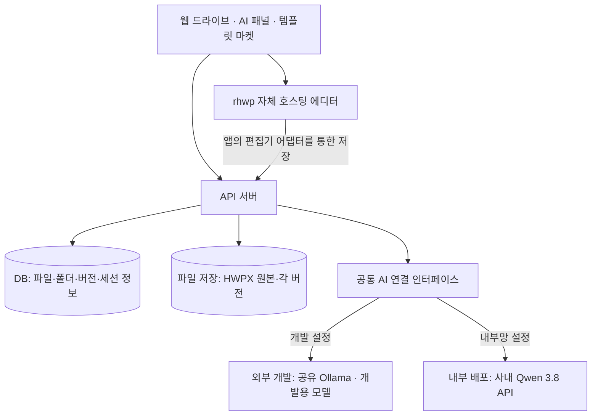

# 사내 HWPX 드라이브 + AI 문서 작성 지원

통합 설계 기준선 v0.4 · 2026-09-23 · 2인 / Codex 개발

**문서 상태: 요구사항·설계·작업 계획. 애플리케이션 구현이나 실행 검증의 완료 보고가 아니다.**

> 공중망에서 추가 비용을 최소화해 개발하고, 외부 서비스에 의존하지 않도록 구성해 내부망으로 이식할 수 있는 HWPX 웹 드라이브와 AI 문서 작성 지원 서비스.

## 1. 배경과 목표

회사는 망분리 환경에서 한컴오피스 한글로 문서를 작성한다. 한글 편집에 익숙하지 않은 직원의 작성 부담을 줄이고, 반복되는 문서 양식과 표·문단을 재사용할 수 있게 하는 것이 목표다. 회사의 바이브코딩 챌린지에서 개발·발표한다.

핵심 가치는 세 가지다. **기존 한글 문서를 웹에서 안전하게 이어서 편집**, **브라우저에서 파일·폴더·공유·버전 관리**, **AI와 재사용 템플릿으로 작성·검토 부담 감소**다. 단순한 챗봇이나 한글 전체를 새로 만드는 프로젝트가 아니다.

## 2. 합의된 전제와 변경 이력

| 항목 | 현재 기준 |
|---|---|
| 개발 인원·도구 | 2명이 Codex로 구현. ChatGPT는 설계·작업 분해·검토 지원 |
| 개발 장소 | 회사 외부의 일반 공중망. 회사 폐쇄망에 직접 연결하지 않아도 됨 |
| 비용 | 외부 개발에서 신규 API 비용·클라우드 임대·유료 구독·장비 구매를 가능한 피함 |
| 회사 자원 | 사용자가 전달한 정보에 따르면 AI 전용 GPU 서버와 Docker 기반 클라우드 등이 이미 있음 |
| 운영 AI | 사용자가 전달한 사내 배포 모델 **Qwen 3.8** 사용을 기준으로 함 |
| 모델 식별 | 세부 모델 ID·크기·양자화·API 규격은 연결 시 확인. Qwen3-8B 등으로 임의 치환하지 않음 |
| 외부 개발 AI | 기존 장비의 Ollama를 공유하는 구성을 기본안으로 함. 실행할 정확한 모델은 별도 확정 |
| 편집기 | `edwardkim/rhwp` 우선 기반. 자체 호스팅·버전 고정·실물 호환 검증 후 통합 |
| 파일 형식 | HWPX 우선. 한글↔웹 가져오기·내보내기·재편집이 가장 중요한 품질 기준 |
| 문서 원본 | HWPX 파일의 불변 버전. JSON·텍스트·미리보기는 파생 데이터 |
| 공동 작업 | 실시간 공동 편집 제외. 공유·버전 관리와 덮어쓰기 방지는 포함 |
| 권한 | 공용 작업공간으로 시작. 세부 ACL·SSO·부서별 권한은 후속 |
| 챌린지의 배포 목표 | 실제 회사 스펙별 구축이 아니라 설정 분리·자체 실행·외부 통신 없는 동작을 통한 이식 가능성 입증 |

v0.3의 ‘운영에서도 반드시 Ollama’, ‘회사 장비를 먼저 실측’, ‘초기 모델은 Qwen3-4B/8B로 확정’ 같은 전제를 적용하지 않는다. 초기 OpenAI 유료 API 계획은 계속 철회 상태다. Tiptap/HTML/JSON을 원본으로 삼는 설계, NAS 필수 연동, 단방향 HWPX 출력 중심 설계도 폐기 상태다.

추가 현금 지출 최소화가 전체 비용 0원이라는 뜻은 아니다. 기존 장비·전력·개발 시간·이미 확보한 한글 및 개발 도구 사용권은 전제로 구분한다. 유료 자원을 새로 도입하려면 이유와 대안을 설명하고 먼저 동의를 받는다.

## 3. 첫 버전의 기능 범위

| 영역 | 포함 기능 | 핵심 인수기준 |
|---|---|---|
| HWPX 편집 | 기존 파일 열기, 문단·제목·표 편집, 저장·자동 저장·다른 이름 저장 | 실제 한글에서 내용·서식·편집 가능성 확인 |
| 드라이브 | 파일·폴더 목록, 정렬·파일명 검색, 업로드·다운로드, 이름 변경·이동·복제 | 모든 관리 동선을 웹에서 수행 |
| 삭제·복구 | 휴지통, 복원 | 파일을 즉시 영구 삭제하지 않음 |
| 공유·버전 | 공용 공간 문서 링크, 버전 목록·다운로드·복원, 새 버전 업로드 | 과거 버전 불변, 복원은 새 버전 생성 |
| 충돌 방지 | 문서당 한 편집 세션, 기준 버전 검사 | 오래된 탭이나 늦은 업로드가 최신 내용을 덮어쓰지 못함 |
| AI 초안 | 양식·사실 입력 기반 섹션별 초안 | 미입력 사실은 임의 생성하지 않고 입력 필요 표시 |
| AI 검토 | 선택 문단 개선, 문체·중복·모호성 검토 | 문제 위치·이유·수정안을 제시하고 사용자 선택 적용 |
| 규칙 검토 | 필수 항목·날짜 형식·정의된 표 계산 | 코드로 검증 가능한 것은 모델의 판단과 분리 |
| 템플릿 마켓 | 문서 양식·표·제목·문단의 등록·검색·미리보기·삽입·공유 | 삽입 후 HWPX 왕복에서 스타일·리소스 보존 |
| 배포 준비 | 자체 호스팅, 환경 설정, 컨테이너 구성, 반입 목록·실행 안내 | 준비된 격리 환경에서 인터넷 없이 전체 흐름 성공 |

문서 양식 3종(회의록·업무보고·추진계획), 블록 10개 정도를 데모 구성의 초기 제안으로 둔다. 사용자가 수량을 확정한 것은 아니다. 핵심은 종류보다 완결된 업무 흐름이다.

공유는 첫 버전에 동일한 공용 작업공간의 링크 공유로 단순화한다. 세부 권한을 구현하지 않은 상태를 개인 문서가 보호되는 서비스처럼 표현하지 않는다. 외부 개발 서버는 기본 인증 또는 제한된 접속 경로로 보호하고 합성 문서만 사용한다.

## 4. 제외·후순위

실시간 공동 편집·동시 커서·문서 자동 병합, HWP 전체 기능 완전 호환, 모든 파일 형식 웹 편집, 로컬 폴더 자동 동기화 프로그램, 전자결재·SSO·세부 권한, 모델 학습·미세조정·대규모 사내 RAG, 실제 사내 GPU·클라우드 구축과 운영 최적화는 필수 범위에서 제외한다.

Jev는 비용·폐쇄망 목표와 핵심 기능 대비 우선순위를 고려해 보류한다. 무료 Colab을 상시 개발용 모델 서버로 사용하는 것은 기본안이 아니다. 이번 버전에서 해당 서비스의 성능 비교나 추가 통합을 진행하지 않는다.

HWP와 기타 허용 파일은 보관·다운로드를 우선하며 편집 지원을 별도 표시한다. HWPX의 핵심 요구를 DOCX/PDF 출력으로 조용히 대체하지 않는다.

## 5. 사용자 흐름

**기존 문서:** HWPX 업로드 → 원본 보관·지원 상태 확인 → 웹 편집 → AI 제안 선택 적용 → 서버에 새 버전 저장 → 다운로드 → 한글에서 수정·저장 → 웹의 같은 문서에 ‘새 버전 업로드’ → 다시 웹 편집.

**새 문서:** 양식 선택 → 사실 입력 → AI 초안 → 표·제목·문단 블록 삽입 → 검토·수정 → 저장·공유 → 필요시 한글에서 마무리.

같은 파일명이라는 이유만으로 같은 문서로 간주하거나 덮어쓰지 않는다. 한글에서 수정한 파일은 대상 문서와 기준 버전을 선택해 다시 등록한다. 로컬 수정의 자동 감지·동기화는 없다.

## 6. 제안 아키텍처

프런트엔드는 React/TypeScript, API는 FastAPI, DB는 PostgreSQL, 파일은 서버의 영속 볼륨을 사용하는 것을 초기 제안으로 한다. 채택은 작업 시작 시 버전·라이선스와 함께 고정한다. React는 서비스 화면을 위한 것이며 문서 엔진을 대체하지 않는다.

NAS·S3 제품·벡터 DB·Kubernetes를 필수 구성으로 추가하지 않는다. 애플리케이션만 파일 저장소에 접근하고 사용자는 웹 API로 관리한다. 파일명과 내부 저장 키를 분리한다.

AI 모델 서버는 앱과 별개의 자원으로 취급한다. 내부에 Ollama를 새로 설치하도록 요구하지 않는다. 사내 서버가 우리 연결 규격과 같으면 설정으로 전환하고, 다르면 작은 어댑터만 추가한다. 회사 API의 실제 규격과 연결 성공을 미리 가정하지 않는다.

## 7. HWPX 보존과 호환성

rhwp는 HWP/HWPX 웹 편집·내보내기 경로가 있는 오픈소스 기반이다. SDK의 파일 로드·HWPX 출력·저장 완료 통지 경로를 통합 후보로 검토한다. 다만 로드맵은 한컴과 같은 조판을 만드는 작업을 진행 중이라고 설명하므로, ‘엔진 채택 = 완전 호환 확보’가 아니다. [S01–S03]

최초 업로드 원본과 과거 버전은 불변으로 저장한다. 편집 결과는 새 HWPX 버전이 되며, AI·검색용 JSON으로 문서 전체를 재생성하지 않는다. export가 끝났다는 이유만으로 저장 성공을 표시하지 않고 파일·DB의 확정 이후에 완료를 표시한다. SDK에서도 출력과 저장 통지를 구분한다. [S02]

| 시험 | 확인 내용 |
|---|---|
| 원본 보관 | 엔진을 거치지 않은 업로드·다운로드 파일의 해시 동일 |
| 무편집 왕복 | 웹에서 읽고 실제로 다시 저장한 파일을 한글에서 열어 내용·배치 확인 |
| 편집 왕복 | 문단·표 편집 뒤 한글에서 요청 변경과 비대상 요소 보존 확인 |
| 역방향 | 한글에서 수정·저장한 파일을 웹에서 다시 열고 편집 |
| 반복 왕복 | 여러 차례 왕복 후 누적 누락·서식 손상·개체 손상 확인 |
| AI·템플릿 | 초안 적용과 다른 문서의 블록 삽입 후 같은 검증 수행 |
| 실패·충돌 | 저장 실패·세션 만료·오래된 탭에서 원본과 최신 버전 보호 |

시험은 외부에서 이용 가능한 적법한 한글 환경을 사용하고 버전·OS·브라우저·폰트를 기록한다. 회사의 정확한 장비를 복제할 필요는 없지만 실제 한글 검증 없이 범용 호환을 주장하지 않는다. 회사별 최종 적합성은 추후 확인 대상으로 남긴다.

원본 그대로 내려받기와 엔진 무편집 왕복은 다른 시험이다. 편집 후 전체 파일 바이트가 달라도 의미·서식이 보존되면 정상일 수 있다. 글이 늘어 쪽수가 변하는 것과 의도하지 않은 배치 손상을 구분한다.

미지원 요소는 사전에 표시한다. 확인된 손실·손상은 정상 버전 게시를 막고 원본·복구 후보를 보존한다. 읽기 전용·차단은 안전 대책이지 호환 성공이 아니다. 목표는 대표 문서군의 내용 누락·파일 손상·수정 미반영 0건이며 실제 결과는 아직 없다.

## 8. AI 모델·공유·교체

**운영 대상은 사용자가 전달한 사내 Qwen 3.8이다.** 외부 개발에서 같은 세부 모델을 실행할 수 있으면 맞추되, 배포 파일·라이선스·엔진 지원·장비 조건이 맞지 않으면 별도 개발용 오픈 모델로 계약과 기능을 검증한다. 정확한 개발 모델은 미정이다. 작은 개발 모델의 결과를 사내 Qwen 3.8 실측 결과로 표현하지 않는다.

각 개발자는 앱·DB를 독립 실행하고, 모델만 기존 장비 한 대에서 공유하는 구성을 제안한다. Ollama는 HTTP 바인딩 주소를 바꾸어 공유할 수 있지만 로컬 API에는 기본 인증이 없다. 무인증 인터넷 공개가 아니라 두 개발자만 접근 가능한 암호화된 경로·인증을 적용한다. 회사 폐쇄망과 외부 개발망을 연결하지 않는다. [S05,S07]

공유 호스트·접속 방법은 아직 확정되지 않았다. 새 클라우드 GPU나 서버 구매를 전제로 하지 않으며 24시간 운영도 필수가 아니다. 공유 장비를 사용할 수 없을 때는 화면·계약 테스트용 Replay 응답을 명시적으로 사용한다. 실제 AI 데모를 몰래 대체하지 않는다.

앱 내부에는 `LlmProvider` 경계를 두고 모델명·주소·인증·문맥/출력 한도·프롬프트를 설정으로 분리한다. 문서 컨텍스트·출력 스키마·대화 상태는 앱이 소유한다. OpenAI 호환 규격을 사용해도 호출 대상이 사내 또는 로컬 서버라면 OpenAI 유료 서비스를 호출하는 것이 아니다. Ollama의 호환 범위는 일부이므로 필요한 기능을 검증한다. [S06]

AI는 내용 제안만 수행한다. XML 전체·스타일 ID·파일 경로·쉘 명령을 생성해 실행시키지 않는다. 제안에 대상 문단·기준 리비전·원문 검증 정보를 연결하고 사용자가 승인한 내용만 엔진 명령으로 적용한다. 그 사이 원문이 바뀌면 재검토한다.

입력에 없는 이름·금액·일정을 만들어 넣지 않도록 하고 누락은 입력 필요로 표시한다. 형식 검사와 사실 검사를 구분한다. AI 장애가 파일 편집·저장을 중단시키지 않게 한다. 회사 규정·법률 적합성을 보장하는 기능으로 표현하지 않는다.

## 9. 폐쇄망 이식 가능성의 완료 기준

이번 범위는 자체 실행·설정 분리·반입 준비와 격리 실행 증거까지다. 회사 스펙별 배포, 회사 보안 심사 통과, 운영용 인증 연동·튜닝은 완료 조건이 아니다.

웹 에디터·WASM·스크립트·적법한 글꼴을 자체 제공한다. rhwp SDK의 기본 Studio는 외부 주소이므로 자체 주소를 지정해야 하며, 외부 웹폰트를 끄는 빌드 설정도 문서화되어 있다. [S02] Ollama를 사용하는 격리 시험에서는 cloud 기능을 끄고 실제 외부 통신도 차단한다. [S05]

실행 이미지와 의존성은 버전·해시를 기록한다. 런타임에 자동 패키지 설치나 모델 다운로드를 수행하지 않는다. 모델 파일·DB 데이터·문서 파일·비밀 설정은 애플리케이션 이미지와 구분해 반입 목록을 작성한다. 개발 중 인터넷을 쓰는 것과 내부 실행에 인터넷이 필요한 것은 구분한다.

**시험 흐름:** 필요한 이미지·모델 사전 준비 → 시험 환경의 외부 통신 차단(앱·DB·모델 사이 내부 통신은 유지) → 새로운 브라우저 세션 → HWPX 열기·편집 → 실제 로컬 AI 호출 → 템플릿 삽입 → 저장·다운로드·버전 복원.

시험 중 모델도 격리 환경 안에 있어야 한다. 외부 공유 Ollama를 계속 호출하거나 캐시·Replay만으로 성공한 것을 폐쇄망 AI 동작으로 판정하지 않는다. 실행 결과와 남은 한계를 발표에 구분한다.

## 10. 라이선스와 비용

| 구성 | 공식 자료 1차 확인 | 적용 원칙 |
|---|---|---|
| rhwp | MIT [S04] | 코드 고지 유지, 의존성·폰트는 별도 점검 |
| Ollama | MIT [S08] | 실행 엔진과 모델 사용권을 분리 |
| React | MIT [S09] | 실제 채택 버전과 하위 의존성 기록 |
| FastAPI | MIT [S10] | 실제 채택 버전과 하위 의존성 기록 |
| PostgreSQL | PostgreSQL License [S11] | 배포 고지·버전 기록 |
| 사내 Qwen 3.8 | 세부 모델 ID 미확인 | 다른 Qwen 모델의 라이선스를 그대로 적용하지 않음 |
| 폰트·이미지·템플릿 | 파일별 확인 필요 | 회사/개발자 사용권이 웹 재배포 권리까지 뜻한다고 가정하지 않음 |
| 개발 도구·컨테이너 실행 도구 | 기존 적법한 사용 범위 확인 | Codex 추가 크레딧·유료 도구 구매를 자동 전제하지 않음 |

이 표는 전체 라이선스 감사·법률 검토의 완료 보고가 아니다. 버전 고정 후 실제 배포 파일의 LICENSE/NOTICE·모델 출처·SBOM을 남긴다. 샘플 회사 문서·비밀키·모델 가중치·폰트 파일을 저장소에 임의 업로드하지 않는다.

## 11. 2인 개발 WBS와 Git

| 단계 | A 중심 | B 중심 | 통과 기준 |
|---|---|---|---|
| M0 기반 검증 | rhwp 자체 실행·한글 왕복 시험 | 파일·AI 계약, 공유 개발 모델 경로 | HWPX 경로와 AI 교체 경계 확인 |
| M1 웹 드라이브 | 목록·폴더·편집·저장·버전 UI | DB·파일·버전·편집 잠금 API | 업로드→편집→저장→한글 수정본 재업로드·복원 |
| M2 AI·템플릿 | AI 제안 UI, 블록 삽입·마켓, 호환 회귀 | 초안·검토 공급자, 템플릿·변수 저장 | AI·템플릿 결과도 HWPX 보존 |
| M3 배포·발표 | 한글 최종 검증·사용자 평가·데모 | 컨테이너·설정·반입·접근·백업·라이선스 | 인터넷 차단 상태 핵심 흐름과 측정 근거 |

단계는 기간 약속이 아니다. 마감일·가용 시간이 정해지면 일정을 부여한다. A/B는 역할 구분이며 아직 실명 배정은 없다. 서로 PR을 검토한다.

Git에는 요구사항·설계·WBS·검증 증거·Codex 규칙을 둔다. 이슈에는 담당·의존성·범위·인수기준을, PR에는 변경과 실제 테스트 결과를 기록한다. 상태는 Backlog → Ready → Doing → Review → Done으로 운영하고 Blocked는 별도 표시한다.

WBS 그림은 의존성 설명용이고 실제 진척도는 이슈/보드를 기준으로 한다. Markdown Mermaid를 지원하는 환경에서는 그림으로 볼 수 있으며 GitHub는 이를 지원한다. [S12] 그림과 이슈가 저절로 동기화되지는 않는다. 저장소·원격 이슈는 아직 생성하지 않았다.

첫 작업은 A가 합성 HWPX의 실제 왕복을, B가 공통 AI 인터페이스와 공유 Ollama의 개발 경로를 확인하는 것이다. 본 패키지에는 이를 위한 두 작업 지시서를 포함한다.

## 12. 평가와 현재 상태

발표는 ‘파일 업로드 → AI 초안/검토 → 표 블록 삽입 → 저장·공유 → 버전 복원 → 한글에서 열기·편집 → 웹 재업로드’ 흐름을 보여준다. 별도 격리 실행 시험으로 내부망 이식 가능성을 설명한다.

작성 시간은 한글에서 최종 마무리하는 시간까지 측정한다. 서식 재작업, 내용 누락, 잘못된 AI 제안, 버전 복구, 외부 통신 여부도 기록한다. 검증 전 시간 단축 수치나 사내 모델 성능을 성과로 주장하지 않는다.

현재 완료: 대화상 요구사항 정리, 공개 자료 1차 확인, 설계·WBS·Codex 작업 자료 작성.

현재 미완료: 앱 구현, rhwp 자체 빌드·실행, 실제 한글 왕복, 외부 모델 실행·공유, 사내 Qwen 연결, 컨테이너·격리 시험, 원격 Git 저장소·이슈 생성.

미확정 항목은 마감일·가용 시간, 공유 모델 호스트·접속 방식·개발용 모델, 사내 배포 모델 ID·API 규격, 시험용 한글 버전·대표 합성 문서다. 회사 장비 정보를 전부 알아야 개발을 시작할 수 있는 것은 아니다.

**최종 기준: HWPX 문서가 망가지지 않는 웹 드라이브를 중심으로, 저비용 외부 개발과 사내 Qwen 연계를 분리하고, AI·템플릿의 업무 개선과 폐쇄망 실행 경로를 검증한다.**

---

# WBS v0.4

19개 필수 작업 + 2개 보류 작업. 실제 이슈 생성·상태 동기화는 하지 않았다. 기존 v0.3 ID를 유지했다. 기간은 아직 정하지 않았다.

| ID | 단계 | 작업 | 담당 | 선행 | 상태 |
|---|---|---|---|---|---|
| WBS-00 | M0 | 저장소·외부 개발 기준·공통 계약 준비 | A | — | Backlog |
| WBS-01 | M0 | rhwp 자체 호스팅·저장/선택 bridge 확인 | A | WBS-00 | Backlog |
| WBS-02 | M0 | HWPX 무편집·편집 왕복 스모크 | A | WBS-01 | Backlog |
| WBS-03 | M0 | 파일 원본·리비전·편집기·AI 계약 | B | WBS-00 | Backlog |
| WBS-04 | M0 | 저장 손실 보고·호환 출시 관문 | B | WBS-01, WBS-03 | Backlog |
| WBS-16 | M0 | 외부 공용 Ollama·개발 모델 연결 검증 | B | WBS-00, WBS-03 | Backlog |
| WBS-05 | M1 | DB·파일 저장소·원본 업로드 | B | WBS-02, WBS-03, WBS-04 | Backlog |
| WBS-06 | M1 | 웹 드라이브 목록·폴더·업로드·다운로드 | A | WBS-03, WBS-05 | Backlog |
| WBS-07 | M1 | 단일 편집 lease·리비전 충돌 | B | WBS-05 | Backlog |
| WBS-08 | M1 | 에디터 서버 저장·Ctrl+S·실패 복구 | A | WBS-01, WBS-04, WBS-05, WBS-07 | Backlog |
| WBS-09 | M1 | 버전 목록·다운로드·복원·재업로드 | B | WBS-05, WBS-07 | Backlog |
| WBS-10 | M1 | 이름·이동·복제·휴지통·링크 UI | A | WBS-06, WBS-08, WBS-09 | Backlog |
| WBS-11 | M2 | 교체 가능한 모델 공급자·구조화 응답 검증 | B | WBS-03, WBS-08, WBS-16 | Backlog |
| WBS-12 | M2 | AI 초안·선택 검토·승인 적용 UI | A | WBS-08, WBS-11 | Backlog |
| WBS-13 | M2 | HWPX 템플릿 원본·목록·공유 저장 | B | WBS-05, WBS-09 | Backlog |
| WBS-14 | M2 | 제목·문단·표 블록 삽입·마켓 UI | A | WBS-08, WBS-13 | Backlog |
| WBS-15 | M2 | 대표 HWPX·폰트 호환성 회귀군 | A | WBS-02, WBS-08, WBS-10 | Backlog |
| WBS-17 | M3 | 컨테이너·설정·반입·라이선스·격리 실행 준비 | B | WBS-09, WBS-11, WBS-12, WBS-16 | Backlog |
| WBS-18 | M3 | 최종 회귀·업무 시간 측정·발표 | A | WBS-10, WBS-14, WBS-15, WBS-16, WBS-17 | Backlog |
| OPT-01 | Later | 세부 권한·SSO·승인 절차 확장 | B | WBS-18 | Deferred |
| OPT-02 | Later | Jev 등 부가 모델 실험 — 보류 | B | WBS-18 | Deferred |

단계 그림은 계획 설명이고 세부 의존성은 backlog.json과 이슈 파일을 기준으로 한다. Mermaid는 자동 진척도 집계가 아니다. A/B는 역할이며 실명 배정 전이다.

HWPX 구현 위험이 확인되면 실패를 숨기지 않고 원본 보존·보강·범위 영향 결정을 먼저 한다. 실제 사내 모델 접속 불가를 외부 개발 중단 사유로 삼지 않는다.

---

# 1차 확인 출처

확인일 2026-09-23. URL의 main·웹 문서는 바뀔 수 있으므로 구현 시 실제 commit/패키지 버전을 고정한다.

| ID | 공식/작성자 자료 | 확인 용도 |
|---|---|---|
| S01 | [rhwp 저장소 README](https://github.com/edwardkim/rhwp) | Rust/WASM 기반 HWP/HWPX 편집·임베드 설명 |
| S02 | [rhwp editor SDK README](https://raw.githubusercontent.com/edwardkim/rhwp/main/npm/editor/README.md) | loadFile/exportHwpx/notifySaved, studioUrl, 자체 빌드·외부 웹폰트 설정 |
| S03 | [rhwp ROADMAP](https://raw.githubusercontent.com/edwardkim/rhwp/main/ROADMAP.md) | 한컴 동일 조판은 진행 중 과제; 지원 한계 |
| S04 | [rhwp LICENSE](https://raw.githubusercontent.com/edwardkim/rhwp/main/LICENSE) | MIT 코드 라이선스 |
| S05 | [Ollama FAQ](https://docs.ollama.com/faq) | HTTP 바인딩·cloud 비활성화·요청 처리 |
| S06 | [Ollama OpenAI compatibility](https://docs.ollama.com/api/openai-compatibility) | 호환 엔드포인트·기능 범위 |
| S07 | [Ollama Authentication](https://docs.ollama.com/api/authentication) | 로컬 API 기본 인증 없음 |
| S08 | [Ollama LICENSE](https://github.com/ollama/ollama/blob/main/LICENSE) | MIT 실행 도구 라이선스 |
| S09 | [React LICENSE](https://github.com/react/react/blob/main/LICENSE) | MIT |
| S10 | [FastAPI LICENSE](https://github.com/fastapi/fastapi/blob/master/LICENSE) | MIT |
| S11 | [PostgreSQL License](https://www.postgresql.org/about/licence/) | PostgreSQL License |
| S12 | [GitHub Creating diagrams](https://docs.github.com/en/get-started/writing-on-github/working-with-advanced-formatting/creating-diagrams) | Mermaid 렌더링 |
| S13 | [Codex AGENTS.md](https://developers.openai.com/codex/guides/agents-md) | Codex 프로젝트 지침 파일 |

사내 자원과 Qwen 3.8 배포는 사용자 전달 정보이며 외부 자료로 확인한 사내 현황이 아니다. Qwen 공식 3.8 소개 검색 결과도 확인했지만 동적 본문과 실제 사내 배포를 식별하는 근거는 확보하지 않았다. 특정 모델 크기·라이선스·성능은 본 계획에서 확정하지 않았다.

본 패키지는 제3자 문서 전문·모델·폰트 파일을 포함하지 않는다. 계획/인수기준/아키텍처는 이 프로젝트를 위한 설계 제안이다.

