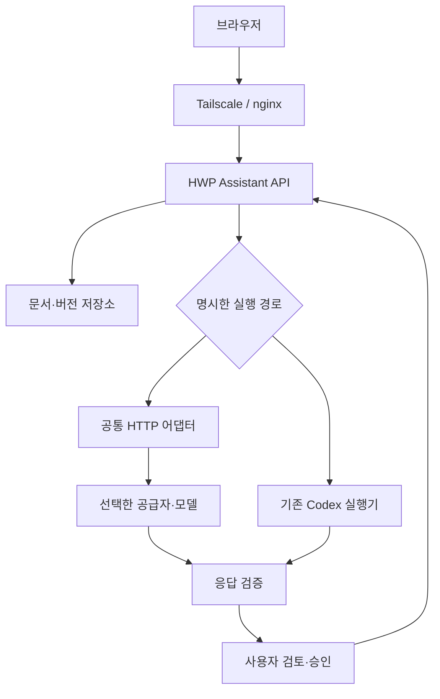

# 홈서버 LLM API 연결 검토 초안

검토 기준: 최신 `main`의 `e5b0ee5d6ad2a9537f2393a4bf5d345acde1ea47`에서 분기한 `review/llm-provider-draft-2026-10-24`. 게시된 이미지 배포 개선(PR #27)을 포함한다. 이 문서는 검토 브랜치의 구현과 제안이다. 실제 API 키 연결, 모델 품질 평가, 홈서버 배포를 완료했다는 뜻이 아니다.

## 1. 제안하는 방향

**문서 서비스의 기본 추론 연결은 OpenAI 호환 HTTP API로 통일하고, 첫 검증은 OpenRouter, NVIDIA Build는 비교 시험용으로 진행한다.** 기존 Codex 실행기는 별도 선택 경로로 유지한다. OpenAI 직접 API도 같은 어댑터의 명시적인 선택지다.

현재 서비스는 모델이 문서 파일을 직접 수정할 필요가 없다. 모델은 답변, 문단 후보 또는 `ReportDraft`를 반환하고, 앱이 검증·사용자 승인·HWPX 서식·저장을 담당한다. 따라서 일반 문서 작성에는 매번 파일·셸 도구를 가진 에이전트를 띄우는 것보다 기존 `LlmProvider`를 확장하는 편이 구현과 운영의 연결이 단순하다. 이는 현재 코드와 요구에 근거한 설계 판단이며 모델의 한국어 품질 순위에 대한 결론은 아니다.

| 선택지 | 적합한 용도 | 이 프로젝트에서의 판단 |
|---|---|---|
| 홈서버 Codex CLI / app-server | 기존 Codex 대화·문단 수정·검색 보고서, 도구 실행이 필요한 개인 작업 | 기술적으로 가능. 서버의 실행기·인증·사용자 연결·작업 정리가 추가로 필요하다. 기존 경로를 유지하되 일반 HTTP API와 구분한다. |
| OpenAI 직접 API | 선택한 OpenAI 모델을 직접 사용하고 싶은 경우 | 별도 API 사용량 과금. 이번 구현은 Chat Completions 지원 모델에 한정한다. Responses 전용 기능·모델은 별도 어댑터가 필요하다. |
| OpenRouter | 여러 모델을 같은 문서 작업으로 비교하고 공급자를 바꿔 보는 초기 단계 | 첫 검증 대상으로 제안한다. 모델 ID를 고정하고 자동 대체를 끈다. 실제 추론 공급자까지 고정하려면 공급자 제한도 설정한다. |
| NVIDIA Build / 호스팅 NIM API | 공개 모델의 한국어·JSON 응답 품질 비교, 프로토타입 | 시험 대상으로 제안한다. 개발자용 접근을 지속적인 운영 서비스 보장으로 해석하지 않는다. 운영 전환 조건을 별도로 확인한다. |
| 기존 로컬·사내 OpenAI 호환 서버 | 문서가 외부 공급자에 전달되면 안 되는 작업 | 기존 연결을 유지한다. 실제 네트워크 경계와 정책은 운영자가 확인한다. |

OpenRouter는 단일 API에서 여러 모델을 제공하고 공급자 라우팅을 제어할 수 있다. NVIDIA의 공식 FAQ는 API 카탈로그를 통한 프로토타이핑과 NIM 운영 전환을 구분하고, 운영 전환에 NVIDIA AI Enterprise 라이선스를 안내한다. 가격, 모델 목록, 계정별 한도는 변경될 수 있으므로 여기서는 특정 가격이나 무료 운영량을 확정하지 않는다. [OpenRouter 시작하기](https://openrouter.ai/docs/quickstart) · [공급자 선택](https://openrouter.ai/docs/guides/routing/provider-selection) · [NVIDIA 공식 FAQ](https://docs.api.nvidia.com/nim/docs/product)

OpenAI는 새 텍스트 생성 앱에 Responses API를 권장한다. 이번 초안은 기존 코드와 여러 공급자의 공통 계약을 우선해 Chat Completions를 사용한다. 추후 OpenAI 고유 도구나 Responses 전용 모델을 채택한다면 별도 어댑터와 검증을 추가한다. [OpenAI 모델·API 선택 안내](https://developers.openai.com/api/docs/guides/text#choosing-models-and-apis)

## 2. Codex를 홈서버에서 쓸 수 있는가

가능하지만 두 연결을 구분해야 한다.

1. **Codex CLI / SDK / app-server**: 홈서버에서 Codex 프로그램을 실행하고 지원되는 인증 방식으로 로그인한다. 헤드리스 환경에는 `codex login --device-auth`가 제공되며 계정에서 해당 로그인을 허용해야 한다. ChatGPT 구독 로그인과 API 키 인증은 별도 방식이다.
2. **OpenAI Platform API**: 서버의 API 키로 HTTP 요청을 보낸다. ChatGPT 구독의 사용량이 일반 API 호출량으로 이전되는 구조가 아니며 API 키 사용은 별도로 청구된다.

이 저장소의 기존 Codex 실행기는 ChatGPT 로그인과 `HWP_CODEX_USER`로 연결된 앱 사용자를 전제로 한다. `compose.deploy.yaml`의 운영 API 이미지에는 Codex CLI나 개인 로그인 파일을 넣지 않는다. 따라서 현재 배포에 API 키만 추가해서 기존 Codex 경로가 바로 동작하지는 않는다. 이번 초안은 그 실행기를 바꾸지 않고 `llm` 경로를 확장한다.

추후 Codex를 홈서버에서도 사용한다면 전용 OS 사용자 또는 격리된 작업 실행기에 CLI·인증·작업 디렉터리를 두고, 앱의 사용자 권한과 기존 승인 흐름을 연결하는 별도 작업으로 다룬다. app-server는 일반 `/chat/completions` 추론 API가 아니다. 공식 문서상 WebSocket 전송은 실험적이므로 이번 연결에서는 공개 원격 실행 서버로 추가하지 않는다. [Codex 인증](https://learn.chatgpt.com/docs/auth) · [Codex app-server](https://learn.chatgpt.com/docs/app-server) · [Codex SDK](https://learn.chatgpt.com/docs/codex-sdk)

## 3. Tailscale과 모델 호출의 관계

현재 서비스의 브라우저 진입 경로는 Tailscale Funnel → 호스트 nginx → `/hwp-assistant/` → `127.0.0.1:23000` → 웹/API다. 호스팅 LLM 연결은 **API 컨테이너에서 공급자의 HTTPS 주소로 나가는 요청**이다. 일반적인 아웃바운드 HTTPS가 가능한 환경이면 모델 호출용 인바운드 포트나 새로운 Funnel 경로를 만들 필요가 없다.



API 키는 서버 환경변수에만 두며 브라우저가 직접 공급자를 호출하지 않는다. Tailscale로 앱에 접속한다는 사실은 문서가 외부 LLM에 전송되지 않는다는 뜻이 아니다. 화면에는 현재 공급자·모델과 기능별 전송 범위를 표시한다.

## 4. 초안에서 구현한 범위

### 공통 HTTP 어댑터

`backend/app/llm_config.py`는 불변 설정 스냅샷을 만들고 `backend/app/llm.py`가 `/chat/completions` 호출을 공통 처리한다. 기존 문단 검토·대화·문단 후보와 문서 도우미가 같은 설정·출력 제한·오류 처리를 사용한다.

| `LLM_PROVIDER` | 기본 API 주소 | 명시적으로 필요한 설정 |
|---|---|---|
| `openrouter` | `https://openrouter.ai/api/v1` | 모델 ID, 서버 키, `LLM_ALLOW_EXTERNAL=true` |
| `nvidia` | `https://integrate.api.nvidia.com/v1` | 모델 ID, 서버 키, `LLM_ALLOW_EXTERNAL=true` |
| `openai` | `https://api.openai.com/v1` | Chat Completions 지원 모델 ID, 서버 키, `LLM_ALLOW_EXTERNAL=true` |
| `openai-compatible` | 운영자가 지정한 `LLM_BASE_URL` | 모델 ID와 해당 서버의 인증 설정; 외부 연결은 `LLM_ALLOW_EXTERNAL=true`와 HTTPS·키 사용 |

호스팅 프리셋은 공식 HTTPS 주소를 사용한다. 프리셋에서 `LLM_BASE_URL`을 비우면 기본 주소가 선택되고, 다른 프리셋의 주소가 남아 있으면 오류로 처리한다. 주소의 인증정보·쿼리·프래그먼트는 거부하고 리다이렉트 및 환경 프록시는 사용하지 않는다. 사용자 요청으로 URL·키·모델을 임의로 바꿀 수 없다.

**사용자 지정 주소의 한계:** `openai-compatible`과 `LLM_ALLOW_EXTERNAL=false`는 기존 사내·로컬 연결을 보존하기 위한 운영자 선언이다. 이 값이 DNS/IP를 검사하거나 인터넷 접속을 차단하는 네트워크 보안 경계는 아니다. UI도 이 경우 “관리자가 설정한 AI 서버”로 표시한다. 사내 전용 운영에는 별도 egress 정책과 주소 검토가 필요하다. 알려진 OpenAI·OpenRouter·NVIDIA 호스팅 주소를 사용자 지정 모드로 우회하는 설정은 거부한다.

출력 모드는 모델별로 선택한다. `text`에서는 프롬프트로 JSON을 요청하고 앱에서 완성 응답을 검증한다. `json_object` / `json_schema`는 해당 모델과 엔드포인트가 지원할 때만 설정한다. 지원하지 않는 옵션을 자동으로 제거하거나 다른 모델로 다시 요청하지 않는다. `finish_reason=stop`인 완성된 텍스트만 수용하고, 잘린 응답·거절·도구 호출·잘못된 JSON은 적용하지 않는다.

### 기능별 연결

| 기능 | 선택 설정 | HTTP 경로의 결과와 전송 범위 |
|---|---|---|
| 문단 검토 | `LLM_*` | 선택 문단 → 수정문·이유. 기존 승인·선택 위치 검증 유지 |
| 작성 정보 대화 | `LLM_*` | 질문·저장한 작성 정보·최근 대화 → 답변 |
| 문서 AI 도우미 | `HWP_DOCUMENT_ASSISTANT_PROVIDER=llm` | 질문·현재 문서 텍스트 발췌·선택 문단·최근 대화 → 답변/문단 수정 제안 |
| 문단 후보 두 개 | `HWP_REWRITE_PROVIDER=llm` | 선택 문단·수정 지시·선택적으로 확인한 작성 정보 → 비교 가능한 후보 두 개 |
| 보고서 작성·보완 | `HWP_REPORT_PROVIDER=llm` | 작성 요청·작성 기준·보완 시 이전 초안과 의견 → 검증된 `ReportDraft` |

보고서 기본값은 계속 `codex`다. HTTP 보고서를 사용하려면 `HWP_REPORT_PROVIDER=llm`을 명시한다. 운영 Compose는 기존처럼 문단 후보를 `llm`으로 실행하고, 문서 도우미 기본값도 `llm`이다. 개발 Compose의 문단 후보 기본값은 `codex`, 문서 도우미는 생략 시 문단 후보 설정을 따른다.

### HTTP 보고서의 의도적인 제한

- 공개 웹 검색을 지원하지 않는다. UI의 자료 검색 선택은 비활성화되고 서버도 `research=true` 요청을 생성 전에 거부한다.
- 새 보고서는 `sources=[]`를 요구한다. 보완은 이전 초안의 출처 목록을 그대로 유지해야 하며 새 출처 추가·기존 출처 변경을 거부한다. 이는 본문의 사실성이 자동 검증되었다는 보장은 아니다.
- 응답을 기다린 뒤 전체 JSON·출처 조건·제한사항을 검증한다. 실제 토큰 스트리밍을 구현하지 않았으므로 실시간 본문인 것처럼 표시하지 않는다.
- 기존 내용 검토 → 보완 → 서식 미리보기 → 명시적 서버 저장 흐름을 사용한다. 문서 표준 원본·편집 적용 범위·저장 재시도 규칙을 유지한다.
- 보완 작업은 이전 초안과 설정 지문을 고정한다. 그 사이 공급자·모델·주소·생성 설정이 바뀌면 보완을 거부한다. API 키만 교체하는 것은 허용한다.
- 요청 취소 후 늦게 도착한 결과를 적용하지 않는다. 작업 생성 중복 확인과 실제 새 생성 요청을 구분한다.

## 5. 검토 환경 설정 예시

아래는 **별도 검토 환경**에서 사용할 예시다. 실제 운영 환경파일을 이번 변경으로 수정하지 않는다. 모델과 키의 자리표시자는 해당 계정에서 확인한 값으로 바꿔야 한다. 키를 저장소·채팅·프런트엔드에 넣지 않는다.

```dotenv
LLM_PROVIDER=openrouter
LLM_BASE_URL=https://openrouter.ai/api/v1
LLM_MODEL=EXACT_MODEL_ID_FROM_CATALOG
LLM_API_KEY=SERVER_SIDE_KEY
LLM_ALLOW_EXTERNAL=true

HWP_REWRITE_PROVIDER=llm
HWP_DOCUMENT_ASSISTANT_PROVIDER=llm
HWP_REPORT_PROVIDER=llm
HWP_LLM_ALLOWED_USERS=YOUR_APP_USER_ID

LLM_TIMEOUT_SECONDS=90
LLM_MAX_OUTPUT_TOKENS=8000
LLM_RESPONSE_FORMAT=text
LLM_TEMPERATURE=0.2
LLM_TOKEN_LIMIT_PARAMETER=
LLM_OPENROUTER_PROVIDERS=
LLM_OPENROUTER_ZDR=false
HWP_AI_REQUESTS_PER_MINUTE=20
HWP_REWRITE_MAX_ACTIVE=2
```

공급자를 바꿀 때는 `LLM_PROVIDER`, `LLM_BASE_URL`, `LLM_MODEL`, `LLM_API_KEY`를 함께 확인한다. NVIDIA는 `LLM_PROVIDER=nvidia`, `LLM_BASE_URL=https://integrate.api.nvidia.com/v1`을 사용한다. 모델 ID를 다른 공급자의 ID에서 추정하지 말고 해당 카탈로그에서 확인한다. NVIDIA 모델의 파라미터 지원은 개별 모델 문서를 따른다. [NVIDIA LLM API 참조](https://docs.api.nvidia.com/nim/reference/llm-apis)

### 공통 옵션

| 설정 | 기본값 / 범위 | 의미 |
|---|---|---|
| `LLM_ALLOW_EXTERNAL` | `false` | 호스팅 프리셋의 명시적 외부 전송 허용. 사용자 지정 주소에 대한 네트워크 차단 장치는 아님 |
| `LLM_TIMEOUT_SECONDS` | 앱·개발 30초, 운영 Compose 60초; 0 초과 240 이하 | 전체 응답 제한 시간. 모델·보고서 길이에 맞춰 검증 후 조정 |
| `LLM_MAX_OUTPUT_TOKENS` | 8000; 256~32768 | 각 작업의 자체 상한과 이 값 중 작은 값을 요청에 사용 |
| `LLM_RESPONSE_FORMAT` | `text` | `text`, `json_object`, `json_schema`. 모든 모드에서 앱 스키마 검증 |
| `LLM_TEMPERATURE` | `0.2`; 0~2 또는 `omit` | 이 파라미터를 받지 않는 모델은 `omit`으로 생략 |
| `LLM_TOKEN_LIMIT_PARAMETER` | 빈 값 | OpenAI 프리셋은 `max_completion_tokens`, 나머지는 `max_tokens`. 모델에 맞춰 명시 가능 |
| `HWP_LLM_ALLOWED_USERS` | 빈 값이면 기존 인증 사용자 정책 | 쉼표로 구분한 앱 사용자 ID. 검토는 본인 ID부터 권장 |
| `HWP_AI_REQUESTS_PER_MINUTE` | 20; 1~120 | 사용자별 분당 HTTP AI 요청 제한. 같은 사용자의 생성은 한 번에 하나 |
| `HWP_REWRITE_MAX_ACTIVE` | 2; 1~64 | HTTP 호출과 백그라운드 작업이 공유하는 전역 실행 제한 |

현재 제한기는 기존 단일 API 프로세스 배포를 전제로 한다. 여러 워커나 여러 API 복제본으로 확장하면 공유 저장소 기반 제한기로 바꿔야 한다. 출력 토큰 상한·분당 요청 수는 월별 지출 한도가 아니다.

### OpenRouter 추가 설정

모든 OpenRouter 생성 요청에 아래를 보낸다.

```json
{
  "provider": {
    "allow_fallbacks": false,
    "require_parameters": true,
    "data_collection": "deny"
  }
}
```

`LLM_OPENROUTER_PROVIDERS`에 쉼표로 구분한 공급자 ID를 넣으면 `provider.only`로 제한한다. 빈 값에서는 최초 추론 공급자가 요청마다 달라질 수 있으므로 실제 전달처까지 고정하려면 지원되는 공급자 하나를 지정한다. `LLM_OPENROUTER_ZDR=true`는 `provider.zdr=true`를 추가한다. `data_collection=deny`와 Zero Data Retention은 다른 조건이며, 해당 옵션만으로 모든 보관·법적 요구가 해결되었다고 보장하지 않는다.

`openrouter/` 자동 라우터, `@` 프리셋 별칭, `:online` 검색 접미사는 이 초안에서 거부한다. 다른 모델·공급자로의 자동 재시도는 구현하지 않는다. 조건에 맞는 엔드포인트가 없으면 실패를 보여준다. 계정 수준의 추가 정책과 실제 공급자의 데이터 취급은 별도로 확인한다. [공급자 라우팅·데이터 정책 옵션](https://openrouter.ai/docs/guides/routing/provider-selection)

## 6. 운영과 오류 처리

설정된 모델 목록 조회는 유료 생성 시험이 아니다. 호스팅 프리셋은 `model_configured=true`, `model_available=null`, `connectivity=unchecked`를 반환한다. UI는 “설정된 모델”과 “실제 연결·사용 권한”을 구분한다. 사용자 지정 OpenAI 호환 서버는 기존 `/models` 확인 경로를 유지한다.

API 키와 원문 공급자 오류 본문은 사용자 응답·작업 실행 메타데이터에 넣지 않는다. 공통 어댑터는 인증 실패, 속도·사용량 제한, 응답 시간 초과, 모델/옵션 오류를 구분한다. 즉시 응답 API는 이 안내를 전달하며 보고서·문서 도우미 같은 백그라운드 작업은 안전한 일반 오류 안내를 제공한다. 현재 모델이 실패해도 다른 유료 모델이나 Codex로 자동 전환하지 않는다.

문단 후보·문서 도우미·보고서의 백그라운드 HTTP 작업도 공유 사용자 제한을 사용한다. 동일 작업 ID 확인은 새 생성으로 계산하지 않고, 전역 용량 부족으로 거절된 요청은 사용자 횟수를 소비하지 않는다. 취소나 완료 표시만으로 제한을 풀지 않고 실제 실행·연결 정리가 끝날 때 해제한다. 전송 취소가 공급자 측 과금을 되돌린다는 보장은 없다.

실제 운영 전에는 공급자 계정의 예산·크레딧 제한도 설정한다. 이번 초안은 월별 비용 집계, 관리자 청구 화면, 기능별 모델 라우팅, UI 모델 카탈로그 선택기를 구현하지 않는다. 보고서가 응답한 사용량 숫자는 제한된 메타데이터로 보관하지만 모든 기능을 합산하는 과금 원장은 아니다.

## 7. 검증 범위와 다음 검토

자동 시험은 합성 응답과 모의 HTTP 전송으로 설정·권한·출력 검증·실행 정리·UI 행동을 확인한다. 공급자 모델에 실제 요청하지 않는다. 실제 한국어 품질·요금·계정 사용 권한·홈서버 아웃바운드·실제 rhwp 엔진·한컴 왕복 시험과 구분한다.

이번 검토에서 확인한 결과:

| 시험 | 결과 |
|---|---|
| 백엔드 전체 회귀 | 919개 통과. 이후 대화 API 제한 순서 보완과 회귀 1개 추가 후 관련 14개 재검증 통과 |
| 모의 브라우저 UI | 전체 실행 22개 통과·안내 문구 1개 실패 → 조사 수정 후 해당 1개 재검증 통과 |
| TypeScript | 타입 검사 통과 |
| 프런트엔드 단위·빌드 스크립트 | 단위 시험 5개 파일 및 프런트엔드 빌드 스크립트 시험 통과 |
| 배포 설정·CI 계약·호스트 사전 진단 | 각각 13개·14개·4개 통과 |
| 최신 main의 게시 이미지 배포 계약 | 24개 통과 |

위 결과에 실제 모델 호출, 컨테이너 이미지 빌드·게시, 홈서버 배포 또는 실제 편집 엔진/한컴 왕복 검증은 포함하지 않는다. PR CI 결과는 해당 PR에서 별도로 확인한다.

주요 검증 명령:

```bash
python -m pytest -q
python scripts/deploy/test_deployment.py
python scripts/deploy/test_ci_contracts.py
python scripts/deploy/test_host_preflight.py
node --test scripts/build-frontend.test.mjs
cd frontend
npm exec tsc -- --noEmit
npm run test:unit
npm run test:ui
```

새 회귀 시험은 공급자별 요청 형식, 명시적 외부 허용, 잘린 JSON·거절·도구 응답 거부, 프리셋 라우팅 제한, API 키 노출 방지, 설정과 연결 상태 구분, HTTP 보고서 출처·보완 경계, 취소·중복·공유 실행 제한을 다룬다. 브라우저 시험은 API 보고서의 검색 선택 비활성화, 실제 요청의 `research=false`, 응답 대기 표시와 전송 범위 안내를 확인한다.

실제 키를 넣은 다음에는 같은 합성 한국어 문서로 후보 모델 두 개만 먼저 비교한다.

| 검토 항목 | 확인할 내용 |
|---|---|
| 문단 수정 | 이름·숫자·금액·날짜·부정 표현·결정 사항 보존, 후보 간 유용한 차이 |
| 구조화 응답 | 완성 JSON 성공률, 스키마 준수, 잘린 응답에서 적용 차단 |
| 보고서 | 주어진 자료만으로 작성, 확인하지 않은 사실 표시, 출처 조작 방지, 기존 표준 서식 흐름 |
| 실제 사용성 | 첫 완료까지 시간, 긴 입력 실패, 취소·다시 열기·중복 클릭 |
| 비용 | 입력/출력 사용량과 공급자 청구 확인, 허용 사용자·크레딧 제한 |

검토가 끝난 후에만 실제 모델 ID·출력 모드·시간 제한을 확정하고 운영 반영을 결정한다. Codex 검색 보고서를 홈서버에 추가하는 작업은 이 HTTP 연결 검토와 독립적으로 판단할 수 있다.
