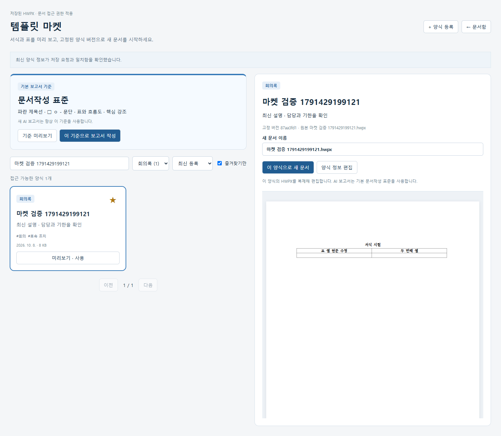

# 템플릿 마켓 1차 · 2026-10-08

문서함에서 **템플릿 마켓**을 열어 저장된 양식을 검색·분류·즐겨찾기하고, 실제 한글 서식을 미리 본 뒤 새 문서로 사용할 수 있다. 문서함의 **양식 등록**은 입력 폼으로 연결한다.

등록은 선택한 서버 저장 버전을 고정한다. 원본 문서를 나중에 편집해도 양식의 `version_id`와 HWPX 바이트는 바뀌지 않는다. 미저장 편집은 등록에 포함되지 않는다. 미리보기는 분리된 임시 rhwp 엔진으로 앞 6쪽을 렌더링하며 문서·버전·편집 임대를 생성하지 않는다. 원본·과거 버전에는 쓰지 않는다.

등록 양식은 원본 문서의 현재 접근 권한을 상속한다. reader는 조회·즐겨찾기·새 문서 생성을 할 수 있고, editor/owner는 등록·정보 수정을 할 수 있다. 검색·분류별 수량에는 현재 열람 가능한 양식만 포함한다. 개인 즐겨찾기는 다른 사용자와 분리된다.

기본 보고서 기준 카드는 해시로 고정한 `reference.hwpx`를 미리 보고 기존 보고서 입력 화면으로 연결한다. 사용자가 등록한 임의 양식을 AI 보고서의 기본 서식으로 바꾸는 기능은 이번 범위에 포함하지 않는다. 블록 삽입·변수 치환·일반 자동 목차는 후속 WBS다.

## 변경과 안전 경계

| 경로 | 동작 |
|---|---|
| `GET /api/template-market` | 이름·설명·태그 검색, 5종 분류, 개인 즐겨찾기, 최신/이름/관련도 정렬, 페이지 조회 |
| `GET /api/template-market/{id}` | 현재 권한의 상세·고정 버전 정보 |
| `GET /api/template-market/{id}/file` | 최신 권한·버전 연결·경로·크기·SHA·HWPX 검증 후 읽기 전용 파일 제공 |
| `PUT /api/template-market/{id}` | 현재 편집 권한과 `expected_revision`을 확인해 메타데이터만 수정 |
| `PUT /api/template-market/{id}/favorite` | 개인 즐겨찾기를 원하는 상태로 설정 |
| `POST /api/templates` | 기존 등록에 선택 UUID·분류·최초 입력 해시를 추가해 같은 등록 재확인 |
| `POST /api/templates/{id}/apply` | 검증된 고정 버전으로 별도 문서 생성. 기존 게시·멱등 저장 경계 재사용 |

`TemplateCatalog`, `TemplateFavorite` 테이블을 추가한다. 기존 문서·버전 테이블과 HWPX를 재작성하지 않는다. 기존 양식은 분류를 이름·태그에서 추론하고 리비전 0으로 관리한다. 새 등록은 리비전 1이다.

등록·새 문서 생성은 응답이 유실되면 동일 ID·동일 입력을 유지하고 **같은 요청 재확인**을 제공한다. 결과가 미해결이면 화면에서 다른 작업·문서함 이동을 막는다. 메타데이터 저장 재확인은 현재 권한으로 최신 값을 읽고 요청과 일치하는지 확인한다. 불일치하면 리비전 충돌 검사를 유지한다. 적용 재확인은 이미 만든 사본을 반환하므로 사본의 후속 편집·이름 변경을 되돌리지 않는다.

미리보기는 서버와 브라우저 양쪽에서 파일 SHA를 검사한다. SVG는 image 문맥으로 표시하며 활성 요소·외부 리소스를 거부한다. 선택 변경·화면 종료 시 fetch를 중단하고 임시 엔진과 Blob URL을 정리한다. 작업 응답이 403/404이면 기존 선택·미리보기를 제거한다.

## 검증 기록

최종 변경셋: `docs/evidence/template-market-manifest-2026-10-08.json`.

- HEAD `1e0538781e02ac85d095bb3c72bf844943c305b3`, 기존 미커밋/미추적 변경 유지.
- 실행 소스 집합 `f90bd96238b4b46f87c4f84c08f0dfcf201d85af0cc75c0480656efc93d0c3bb`: 소스·lock·시험 133개, 엔진 파일 83개.
- 이전 rich-report 최종 manifest와 비교해 실행 파일 9개 변경(그중 신규 4개). 엔진·고정 보고서 기준서·기존 보고서 생성/승인/저장 소스는 그대로다.
- 백엔드 targeted: 신규 21개+기존 협업 9개, 30 passed / 0 failed / 0 skipped.
- 실제 rhwp source targeted: 신규 마켓 3개+기존 양식 재사용 1개, 4 passed / 0 failed.

브라우저 시험은 등록·정보 저장·새 문서 생성의 commit 뒤 응답 유실, 같은 요청 재확인, 원본 후속 버전과 양식 고정 버전 분리, 미리보기의 문서/버전 생성 없음, 표 편집·변경분 저장·재열기, 분류·즐겨찾기·페이지, 기준서 해시와 보고서 입력 진입을 확인한다. 브라우저의 권한 거부 화면은 합성 403으로 시험하며 실제 권한 회수는 인증된 백엔드 시험에서 확인한다.

최초 targeted 브라우저 실행의 실패 2건은 상태 메시지 선택자 중복과 등록 배열/이름 정렬 순서가 다른 시험의 잘못된 route 대상이었다. 선택자와 실제 선택된 ID로 시험을 수정했고 후속 실행이 통과했다. UTF-8 surrogate 입력 시험의 500 응답은 입력 단계 422 검사로 보완했다.

마켓 시험은 실제 엔진·합성 문서이며 실제 모델 호출·사람 승인·한컴 검수는 수행하지 않는다. 이전 보고서 생성·602초/1시간 시험은 역사적 증거로 유지하며 이번 결과에 합산하지 않는다.

| 최종 고정 소스의 명령·실행 | 결과 |
|---|---|
| 전체 `pytest -q --basetemp=.cache/template-market-2026-10-08/pytest-final` | 287 passed / 0 failed / 0 skipped, 149.98초. Starlette/AnyIO deprecation warning 1개 |
| `tsc --noEmit --project frontend/tsconfig.json` | 통과 |
| `node --test scripts/engine-build.test.mjs` | 11 passed / 0 failed |
| `npm run build` | 기존 pinned core/bundle provenance 누락으로 보호 가드가 차단(exit 1). 가드를 낮추지 않음 |
| source 전체 R1, `.cache/template-market-source-final-2026-10-08` | 48 수집 / 37 passed / 1 failed / 10 skipped. 인증 대화 생성 요청 한 건 `ECONNRESET` |
| 동일 소스 source 전체 R2, `.cache/template-market-source-final-r2-2026-10-08` | 48 수집 / 38 passed / 0 failed / 10 skipped, 4.0분. 인증 시험 포함 |
| 새 진단 번들, `.cache/template-market-built-final-2026-10-08` | 마켓·기존 양식 실제 엔진 4 passed / 0 failed, 31.7초. 서비스별 제공 바이트 10개 일치 |

R1 인증 시험은 업로드와 첫 대화 생성 200 뒤 두 번째 대화 생성 요청의 HTTP 응답을 받지 못했다. 해당 요청의 완료/access 기록과 DB commit이 없고, API traceback·비정상 종료 증거도 없다. 원인은 확정하지 않았으며 첫 실패·trace·합성 DB를 보존한다. 코드 수정 없이 새로운 환경에서 전체 R2를 실행했다. 이전 통과와 후속 통과를 합산하지 않는다.

Source 10개 skip은 장시간 시험 1개와 별도 보고서 mock/recorded 환경이 필요한 9개다. 이번에 모델을 다시 호출하거나 이 skip을 실모델·사람 승인 성공으로 계산하지 않는다. 모든 격리 시험 프로세스는 종료 후 listener 0을 확인한다.

최종 요약: [template-market-2026-10-08.json](evidence/template-market-2026-10-08.json). 원본·과거 HWPX 69개 해시 동일, 사용자 문서 12개·저장 버전 14개·권한 12개·보고서 작업 7개 보존. 버전·권한·보고서 작업 DB 행의 해시가 동일하며 문서의 ID·이름·현재 버전·생성일도 동일하다. 문서 행 전체 해시는 바뀌어 편집 임대의 일시 필드와 영속 필드를 구분했다. 사용자 브라우저를 새로고침하거나 버퍼를 직접 조작하지 않았다.

확인용 진단 서비스는 `http://127.0.0.1:15180/`에 새 번들로 갱신했다. 제공 바이트 10개 검증과 마켓 API 정상 응답을 확인했으며 JS/CSS 해시는 실제 엔진 마켓 E2E를 통과한 번들과 동일하다. 기존 사용자 데이터 경로를 유지했고 시작 시 모델을 호출하지 않았다. 미저장 편집은 저장한 뒤 새로고침하고 **템플릿 마켓**을 선택하면 새 화면을 확인할 수 있다.

원격 commit/push/merge·모델 설치·유료 전환은 하지 않았다. 실문서·DB·토큰·인증 파일·전체 cache는 제공 대상에 포함하지 않는다.
