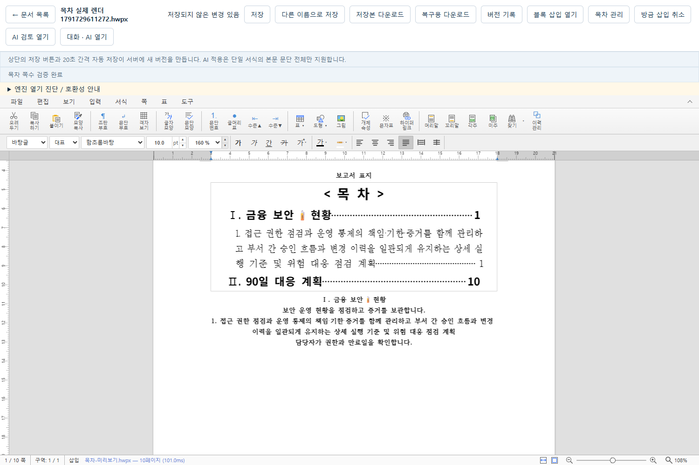

# 일반 편집기의 실제 쪽수 목차 · 2026-10-11

TM-09의 첫 구현 범위는 저장된 문서를 여는 일반 편집기에서 제목을 선택하고 관리 목차를 추가·명시적으로 갱신하는 기능이다. 동일 최종 변경셋의 백엔드·TypeScript·엔진 보호·source와 새 앱 bundle 자동 검증, 확인용 서비스 반영 뒤 보존 대조를 완료했다. 사람·한컴 검수는 후속이다. 보고서 초안 생성기의 자동 목차와 등록한 임의 HWPX 조각 이식은 이번 완료 범위에 포함하지 않는다.

[기존 블록 구현 기록](template-blocks-2026-10-11.md)과 [당시 WBS](wbs-progress-2026-10-11.md)는 이전 상태로 보존한다. 이 문서의 후속 현황은 [목차 WBS](wbs-progress-toc-2026-10-11.md)로 연결한다.

## 사용자 흐름

1. 서버에 저장된 문서를 일반 편집기로 연다. 미저장 편집 내용도 현재 문서에서 유지된다.
2. `목차 관리` → `현재 문서의 목차·제목 확인`으로 현재 HWPX의 지원 문단과 관리 목차를 분석한다.
3. 새 목차는 포함할 제목, 1·2계층, 목차를 넣을 문단 뒤를 직접 선택한다. 고정 표준과 같은 서식은 계층 제안에만 사용하며 최종 선택은 사용자가 한다.
4. `선택한 제목으로 목차 미리보기` 또는 `목차 쪽수 갱신 미리보기`에서 별도 실제 rhwp가 배치·재내보내기·물리 쪽수 확인을 수행한다. 최대 세 번 안에 현재 목차의 숫자와 측정 쪽수가 같아야 한다.
5. 실제 목차가 시작하는 쪽부터 최대 세 쪽의 이미지와 제목별 측정 쪽수를 확인한 뒤 `검증한 목차 반영`을 누른다.
6. 현재 권한·임대·기준 버전과 원문을 다시 검사한 뒤 검증한 편집기를 채택한다. 반영 자체는 서버 저장이 아니다. 기존 수동·자동 저장으로 새 버전을 만든다.
7. 본문을 수정하면 `목차 갱신 필요`로 표시한다. 변경한 현재 문서에서 다시 분석·미리보기·반영해야 쪽수를 갱신한다.

준비 중 기존 문서에서 직접 편집할 수 있다. 그 편집은 보존되지만 고정 입력과 달라진 경우 반영을 거부한다. 미해결 저장·AI 생성·후보 비교·승인 적용은 먼저 마무리해야 한다. 네트워크 응답이 유실되면 같은 입력·요청 ID·해당 배치 결과를 재확인하며 새 생성이나 자동 재실행을 시작하지 않는다.

## 실제 지원 범위

| 항목 | 이번 구현 |
|---|---|
| 대상 | 일반 편집기에서 연 저장된 HWPX. 현재 미저장 export를 입력으로 고정 |
| 문서 구조 | 단일 구역·단일 단, 본문 폭 20,000~100,000 HWPUNIT, 10MB 이하 |
| 제목 | 본문 직속의 지원 텍스트 문단 1~30개, 각 1~300 Unicode scalar, 본문 순서 유지 |
| 계층 | 1·2계층. 첫 제목은 1계층. 새 목차에서 수동 선택 |
| 줄바꿈 | 지원 soft break는 native `\n`으로 텍스트 해시·길이에 포함. 표시용 제목에서는 제거 |
| 미지원 제목 | 표·그림·개체 내부, 필드·제어·지원하지 않는 inline 구조가 있는 제목 |
| 미지원 문서 | 필드 포함 문서, 다중 구역·다단 및 확인할 수 없는 서식/리소스 구조 |
| 관리 목차 | 문서당 한 개. 기존 위치·선택한 제목 ID 목록 유지, 명시적 갱신 |
| 숫자 기준 | 표지와 목차를 포함한 문서 전체의 1부터 시작하는 실제 물리 쪽수. 별도 본문 시작 번호는 미지원 |
| 수렴 | 실제 엔진 배치 최대 3회. 미수렴·내용 손실·보존 불일치이면 반영 거부 |
| 즉시 취소 | 반영 결과가 그대로이고 후속 편집·저장을 시작하지 않은 경우 기존 `방금 삽입 취소`로 이전 버퍼 복귀 |
| 후속 | 보고서 초안 생성 단계의 자동 목차, 임의 양식의 자동 제목 판단·조각 이식, 한컴 검수 |

계층 제안은 `document_standard.py`의 고정 제목·소제목 글자/문단 서식과 비교한다. 내용 추론·모델 호출·새 글 작성은 하지 않는다. 기존 AI exact command와 페이지 수 보호를 완화하지 않는다.

## 제목 ID와 문서 내부 기록

정책 ID는 `managed-native-toc-v1`이다. 엔진이 재내보내기 때 재부여하는 숫자 문단 ID를 영속 제목 식별자로 사용하지 않는다. 제목 UUID와 계층, 목차 UUID 및 항목 연결을 새 문단 스타일 이름에 보관한다.

- 제목: `HWP Assistant TOC heading:<제목 UUID>:<계층>`
- 목차 상자: `HWP Assistant TOC box:<목차 UUID>`
- 목차 제목: `HWP Assistant TOC root:<목차 UUID>`
- 항목: `HWP Assistant TOC entry:<목차 UUID>:<제목 UUID>`

root 스타일의 `engName`에는 정책·목차 UUID·순서 있는 제목 UUID 목록·현재 숫자·비대상 본문 fingerprint·관리 목차 fingerprint를 canonical JSON으로 기록한다. root metadata는 최대 8KB다. 기존 글자·문단 모양과 스타일 정의는 보존하고 관리용 스타일을 추가한다. 갱신에서는 의미가 같은 host·entry 스타일을 재사용하며 변경되는 root 기록에는 새 스타일을 사용한다.

스타일 ID는 엔진의 u8 계약인 0~255를 검사한다. 256을 새로 발급하거나 기존 스타일이 중복/범위를 벗어나면 거부한다. 기존 정의를 지워 슬롯을 확보하지 않으므로 슬롯 부족은 사용자 문서를 보존하는 중단 사유다. 스타일 이름·ID 연결을 파괴하는 외부 편집까지 자동 복구하는 기능은 없다.

제목 삭제·미지원 구조 전환·UUID 중복·표나 개체 내부로 관리 표식 복사, 고아 root/entry·상자 연결 손상을 거부한다. 갱신 요청에서 기존 제목 UUID의 전체 순서가 달라져도 거부한다. 남은 제목만으로 목록을 자동 축소하거나 손상된 관리 목차를 새 목차로 덮어쓰지 않는다. 관리 목차의 문구·숫자·서식·구조를 직접 고친 경우 fingerprint 불일치로 갱신을 거부하고 수동 내용을 보존한다.

## 실제 페이지 조회와 서식

새 downstream bridge는 표시 중인 SDK iframe의 동일 native 문서 handle을 읽는다. 별도 parser 인스턴스나 개발 전용 전역 객체를 페이지 근거로 사용하지 않는다. 제목 UUID에 연결된 section/paragraph, native CP 길이·텍스트 SHA를 대조하고 `getPageOfPosition`의 0부터 시작하는 물리 페이지를 1부터 시작하는 표시 숫자로 변환한다. 동일 페이지의 `getPageTextLayout`에서 제목 시작 TextRun 좌표·텍스트도 확인한다. 조회 실패를 1쪽으로 대체하거나 커서를 이동하지 않는다.

조회 전후 export SHA·epoch·revision·changeSeq·전체 쪽수를 비교한다. 실제 export와 증거 해시가 같아야 서버의 제목 descriptor·출력·쪽수 연결 검증을 통과한다. 배치 결과의 숫자와 현재 측정값을 매 회 비교하며 세 번째에도 다르면 원래 편집기를 유지한다. 증거 조회는 최대 제목 30개·제목 길이 300 scalar·물리 2,000쪽을 지원한다.

목차는 고정 기준서의 회색 상자, 가운데 `< 목 차 >`, 20pt 목차 제목과 16pt/14pt 항목·계층 들여쓰기를 사용한다. 숫자는 native `RIGHT` 탭과 `DASH` leader로 오른쪽에 배치한다. `HwpUnitChar` case와 기존 이중 단위 fallback을 유지하며 점·공백 문자열로 정렬하지 않는다. 새 목차 테두리의 비활성 대각선만 pinned 엔진이 내보내는 생략 표현에 맞춘다. 기존 테두리 정의는 바꾸지 않는다.

## 검증 완료와 기록 일치의 구분

문서를 다시 열었을 때는 `목차 확인 필요`다. 분석에서 본문·관리 목차 fingerprint가 저장 기록과 같아도 이는 `목차 기록 일치`이며 현재 엔진에서 새로 쪽수를 측정했다는 뜻은 아니다. 현재 미리보기의 실제 페이지 검증과 수렴을 완료하고 반영한 뒤에만 `목차 쪽수 검증 완료`로 표시한다. 이후 문서 변경은 보수적으로 오래된 목차로 표시하고 명시적 갱신을 요구한다.

본문 fingerprint는 관리 목차를 제외한 문단·표·개체·서식 참조·문서 설정과 리소스를 연결한다. root metadata 자체가 자기 해시를 바꾸지 않도록 해당 값만 fingerprint 계산에서 정규화한다. 실제 엔진 출력은 기존 블록 삽입의 전체 의미 보존 검사도 통과해야 한다.

## 기존 버퍼·저장·원본 보호

`toc-analyze`·`toc-preview`·`toc-verify`·`toc-check`는 현재 권한·편집 임대·저장 기준 버전을 검사한다. 계산 API는 결과 전송 전에도 다시 검사하며 문서·버전·blob을 게시하지 않는다. 순수 HWPX 조합은 새 바이트를 만들고 원본·과거 blob에 쓰지 않는다.

기존 live 편집기는 결과 로드 대상으로 사용하지 않는다. 별도 staging에만 결과를 로드하며 이미 mount된 안정된 host 사이에서 adapter와 가시성만 바꾼다. iframe의 부모를 옮기거나 패널 닫기로 채택된 iframe을 없애지 않는다. 반영 직전 비동기 권한 조회가 끝난 뒤 owner·문서 ID·임대 token·기준 버전·adapter identity·native epoch/revision·SDK 상태·전체 export 바이트와 가능한 선택 스냅샷을 동기적으로 비교한다.

취소·닫기·실패·늦은 응답은 자신의 준비 작업만 정리하며 임시 엔진과 이미지 URL을 해제한다. 미리보기 준비는 자동 저장을 보류하지만 기존 미저장 내용은 유지한다. 일반 저장의 `baseBytes`, frozen 출력·저장 키·미해결 승인 출력·영수증은 목차 코드에서 변경하지 않는다. 서버 저장 commit 후 응답 유실은 기존 고정 출력/키로 재시도하며 그 뒤의 사용자 편집은 별도로 유지한다.

최종 회귀와 확인용 서비스 반영 후 manifest 대조에서 소스 145개·새 엔진 82개·기존 엔진 83개·native core 4개의 변경 감지 목록이 모두 비어 있다. 기존 원본·과거 파일 69개와 표준 reference/profile의 해시가 유지됐다. 두 DB의 모든 테이블에서 정규화한 행 해시와 개수가 기준과 같으며 문서 heartbeat의 `lease_token`/`lease_until`만 비교에서 제외한다. `data/metadata.db`의 문서 33개·버전 55개, 확인용 DB의 문서 12개·버전 14개·보고서 작업 7개를 보존했다. `.cache/toc-2026-10-11/preservation-after.json`에 최종 대조를 남겼다.

## TM-10 후속 설계 · 미구현

보고서 생성 단계의 자동 목차와 템플릿 선택은 다음 순서로 연결하는 설계만 확인했다. 이번 TM-09에서 이 경로를 구현하거나 기존 frozen 초안 계약을 바꾸지 않았다.

1. 검증된 보고서 프로필을 선택할 때 ID·리비전·실제 값·입력 해시를 함께 고정한다. 이후 템플릿 변경을 같은 생성 입력으로 취급하지 않는다.
2. `ReportPreview`에도 stable live/staging host와 owner·native epoch/revision·전체 export fence를 적용한다. 준비 실패와 늦은 응답에서 현재 초안 버퍼를 유지한다.
3. exact 적용 영수증 확인 → rich layout 완료 뒤 제목 UUID를 연결한다. 일반 문서 API의 임대 계약을 그대로 우회하지 않고 보고서 owner/preview 계약 안에서 순수 TOC compose/verify를 재사용한다.
4. 최초 `ready` 이전에 같은 실제 엔진에서 최대 3회 쪽수를 수렴시키고 최종 preview·layout·출력에 연결한다. 미수렴은 완료로 표시하지 않는다.
5. 수동 편집 뒤에는 stale을 표시하고 현재 export를 바탕으로 명시적으로 갱신한다. 관리 목차 외 편집과 기존 frozen 초안은 보존한다.
6. `pendingSave`·`savingBody` 동안 layout·템플릿 변경을 막고 동일 preview/layout/output/save ID로 저장을 재확인한다. 후속 미저장 편집은 기존 고정 저장 출력과 분리해 유지한다.

구현 완료 조건은 장제목·두 자리 쪽수·표/그림 배치·늦은 응답·수동 편집·응답 유실을 각각 실제 엔진 E2E로 검증하는 것이다. 이 설계 검토의 제품 소스 변경은 0개이며 TM-10은 미구현 상태다.

## 변경셋과 검증 기록

후속 출발점은 블록 변경셋 `f38b9066e7356a02e9be887fd51564ddd839e3f5483397b7eccdc538648283ba`이고 HEAD는 `1e0538781e02ac85d095bb3c72bf844943c305b3`다. 목차 최종 소스 집합은 `dc20addeba04c978a4dcbcfdd5ab3fc651140a9c260b5646f8a068665acaaa2f`다. [최종 manifest](evidence/toc-manifest-final-2026-10-11.json)는 README를 포함한 소스·lock·시험 145개, 새 엔진 82개, 보존한 기존 엔진 83개와 native core 4개의 개별 해시를 기록한다. f38에서 변경·추가된 소스 경로는 15개다. HEAD만으로 현재 미커밋 변경을 식별하지 않는다.

기존 f38의 326개 전체 pytest, source 42 passed/10 skipped 및 bundle 13 passed는 블록 단계의 역사적 증거다. 목차 최종 실행에 합산하지 않는다. 기존 602초/1시간 시험도 이번 짧은 회귀 결과로 재분류하지 않는다.

| 중간 소스의 실행 | 결과와 해석 |
|---|---|
| `.cache/toc-source-first-r1-2026-10-11` | 수집 0개. 시험 helper의 async 매개변수 문법 오류로 실행 전 실패. 기능 시험 통과가 아님 |
| `.cache/toc-source-first-r2-2026-10-11` | 실제 엔진 시험 1개 실패. 새 목차 대각선 NONE의 엔진 생략 차이를 보존 검사가 거부하여 live 반영을 차단. 이후 새 목차 정의만 보완 |
| `.cache/toc-source-first-r3-2026-10-11` | 실제 엔진 시험 1개 실패. 반영·갱신·저장까지 진행한 뒤 재열기용 `문서 목록` locator가 현재 버튼과 달라 timeout. 시험 locator 보완 전 증거 |
| 백엔드 targeted 중간 실행 | 45 passed. 최종 전체 회귀와 별도이며 아래 일괄 결과에 합산하지 않음 |
| `.cache/toc-source-targeted-r5-2026-10-11` | 4개 수집: 2 passed / 2 failed. 저장 응답 유실용 route가 쿼리 있는 요청과 맞지 않아 유실이 재현되지 않은 오류, reader 화면에서 편집기 저장 상태를 기다린 오류. 시험 경계를 보완한 뒤 재실행 |
| `.cache/toc-source-targeted-r6-2026-10-11` | 같은 4개 targeted 시험 4 passed / 0 failed / 0 skipped, 32.7초. 일반·인증 전체 최종 회귀로 합산하지 않음 |
| `.cache/toc-2026-10-11/frontend-callbacks-final.log` | 콜백/표시 node 시험 24개: 15 passed / 9 failed. 기존 callback harness에 `blockHold` ref가 빠져 콜백이 API 요청 전에 실패. f38 검토 ZIP과 현재 `requestRewrite`/`cancelRewrite` 추출본의 SHA 접두사 `8d69a498…`가 같음을 대조했으며 제품 콜백 회귀로 단정하지 않음. 시험 harness만 보완하고 최종 변경셋에서 별도 재실행 |
| `.cache/toc-2026-10-11/pytest-final.log` | 전체 pytest 첫 실행 371 passed / 0 failed / 0 skipped, 1 warning, 110.27초, exit 0. 시작에 `ctypes` 라이브러리 로드 thread의 Windows access violation 진단이 출력됨. 진단 없이 통과했다고 표현하지 않으며 새 최종 manifest·독립 basetemp의 단독 R2 결과를 아래에 별도로 기록 |

초기 [목차 manifest](evidence/toc-manifest-2026-10-11.json)의 소스 집합은 `09a1ea9ccb781e6109aa511fc67e127ef769b5882d0adaaef8d12016a04b800f`다. 이 manifest에는 README가 빠졌고 중간 엔진 디렉터리의 파일 88개가 포함됐다. 기존 manifest를 보존하고 README·수정된 시험 harness 및 새로 만든 `.cache/toc-engine-final-2026-10-11/public/rhwp`의 엔진 파일 82개를 위의 새 최종 manifest로 고정했다. 위 첫 pytest·기존 harness 실패를 새 최종 manifest의 일괄 결과로 재분류하지 않는다. harness 보완으로 TOC 제품 소스나 생성·취소 제품 콜백을 수정하지 않았다.

| 같은 최종 변경셋의 명령/검증 | 최종 결과 |
|---|---|
| `.venv/Scripts/python -m pytest -q --basetemp=.cache/toc-2026-10-11/pytest-final-v2` | 371 passed / 0 failed / 0 skipped, 119.49초, exit 0. 기존 Starlette DeprecationWarning 1개. 최종 실행에는 Windows native 진단 없음 |
| `cd frontend; npm run build`의 `tsc --noEmit` 단계 | 통과 |
| `node --test scripts/engine-build.test.mjs scripts/rewrite-request.test.mjs scripts/context-save.test.mjs scripts/text-diff.test.mjs` | 일괄 37 passed / 0 failed / 0 skipped, 1,153.7ms, exit 0. 엔진 보호 13개+콜백/저장/표시 24개이며 중복 합산하지 않음 |
| `cd frontend; npm run build` — 기본 배포 provenance 가드 확인 | TypeScript 이후 기존 pinned core/bundle provenance 누락으로 exit 1. 기본 보호 유지 |
| `scripts/test-isolated.ps1 -EnginePublic .cache/toc-engine-final-2026-10-11/public -OutDir .cache/toc-source-final-2026-10-11` — source 일반·인증 전체 E2E | 56개 수집: 46 passed / 0 failed / 10 skipped, 4.0분, script exit 0. 장시간·보고서 모의/recorded 미설정의 기존 skip을 통과로 계산하지 않음 |
| `scripts/test-isolated.ps1 -EnginePublic .cache/toc-engine-final-2026-10-11/public -OutDir .cache/toc-built-final-2026-10-11 -BuiltApp -ReportMock -TestPattern 'REAL .*TOC\|block insert\|template market\|REAL HWPX template\|MOCK report'` — 새 진단 앱 bundle·관련 E2E | 17개 수집: 17 passed / 0 failed / 0 skipped, 1.8분, script exit 0. 실제 rhwp·모의 보고서이며 실제 모델 호출 0회 |
| 최종 source/engine/native/기존 bundle manifest 대조 및 원본·과거 파일·두 DB 보존 | 회귀·서비스 반영 후 모든 drift와 변경 목록 0개. 기존 파일 69개·두 DB 정규화 행 해시/개수 일치 |
| 확인용 서비스·served bundle 대조 | API `18180`·web `15180` 각각 HTTP 200. 시험한 fresh built JS/CSS와 바이트 일치, 엔진 포함 served 10개 파일 확인. Codex 기본·시작 시 자동 생성 없음·활성 report/rewrite 작업 0개 |

위 pytest는 최종 소스 집합 `dc20addeba04c978a4dcbcfdd5ab3fc651140a9c260b5646f8a068665acaaa2f`에서 새 basetemp로 단독 실행했다. `.cache/toc-2026-10-11/pytest-final-v2.log`에 결과를 남겼으며 초기 진단이 있는 첫 실행과 합산하지 않는다. 일반·인증 source 전체 E2E의 `.cache/toc-source-final-2026-10-11/run.json`·`e2e.log`에는 최종 새 엔진 bridge/WASM 해시와 46 passed/10 skipped가 기록됐다. `.cache/toc-built-final-2026-10-11`의 별도 실행은 17 passed이며 두 실행 모두 종료 후 잔여 listener가 0개다. source와 진단 앱 bundle의 시험 개수는 합산하지 않는다.

새 앱은 현재 소스로 만든 `assets/index-5xjMZoOj.js`·`assets/index-DUJRO6_X.css`를 사용한다. built 실행의 `general-served.json`·`auth-served.json`·`local-served.json`에서 각 앱 JS/CSS·index 및 엔진 7개, 총 10개 served 파일의 해시를 확인했다. 기존 미리 만든 앱을 최종 소스 검증으로 계산하지 않는다. 일반·인증 목차 E2E는 실제 물리 1/10쪽·계층/긴 제목·미저장 내용·명시적 갱신·재열기, 응답 유실/고정 입력·저장 후 편집 분리, stale/닫기 뒤 늦은 응답·staging 정리, 현재 ACL 회수와 reader 화면을 검증했다.

이 화면은 실제 native 엔진에서 검증한 합성 10쪽 fixture이며 사용자 실문서가 아니다. 회색 목차 상자·계층 들여쓰기·3줄의 긴 하위 제목·native leader와 오른쪽 물리 쪽수 1/10을 확인했다. 화면 확인을 한컴 검수나 실제 사람 승인 시험으로 계산하지 않는다.

새 bridge와 Studio bundle은 별도로 만든다. 중간 bundle 경로는 `.cache/toc-engine-2026-10-11/public`, 최종 bundle 경로는 `.cache/toc-engine-final-2026-10-11/public`다. 엔진의 Rust/WASM·기존 exact 적용 계약은 바꾸지 않았다. native WASM SHA는 기존과 같은 `0e81cdeb4a61de8dd12be6d79d3bf06a8c1153525883e4112f4dcb1257d68195`다. 새 bridge·bundle 해시는 최종 manifest로 따로 식별한다. 진단 core의 `wasm_opt=false`와 별도 출력 규칙, 기본 배포 provenance 가드는 유지한다. 진단 bundle 성공은 정상 배포 완료가 아니다.

검증은 합성 문서·실제 자체 호스팅 rhwp·자동 API/브라우저 시험이다. 이번 목차 구현의 실제 모델 호출은 0회, 실제 사람 승인은 0회다. 클릭 자동화는 사람 승인 증거가 아니다. 한컴에서의 렌더링·재저장과 사람의 문서 검수, 실제 격리 배포 검증은 후속이다. `report-preview`의 기존 frozen 배치·승인·저장 계약은 이번 범위에서 변경하지 않는다.

확인용 서비스는 [http://127.0.0.1:15180/](http://127.0.0.1:15180/)이며 실행 기록은 `.cache/user-review/runs/20261011-234437-071f4812`다. 시험한 JS SHA는 `7622111f25bcd68d62d18bb546deafd3080da822684bcbc431bc0dfd7309333b`, CSS SHA는 `5f953af3dced06eeaa02aedda04be320a4432133c78584c791f16425159c1058`이며 실제 응답 바이트와 같다. 기존 열린 사용자 브라우저는 자동 새로고침하지 않았다. 이전 화면에서 이 기능을 확인하려면 미저장 내용을 먼저 저장한 뒤 새로고침하고 일반 문서의 `목차 관리`를 연다. 이것은 확인용 진단 앱 서비스이며 정상 배포 provenance 완료를 의미하지 않는다.

직접 검토용 [비민감 요약 JSON](evidence/toc-2026-10-11.json)과 [검토 묶음](evidence/toc-review-2026-10-11.zip)에 새 검증 문서·개별 해시 manifest·git diff HEAD 및 미추적 핵심 소스/시험을 분리해 포함한다. git diff만으로 미추적 신규 파일을 포함했다고 가정하지 않는다. 실문서·DB·인증·token·전체 `.cache`·브라우저 trace·엔진 binary는 제공 묶음에서 제외한다. commit/push/merge는 하지 않는다.
