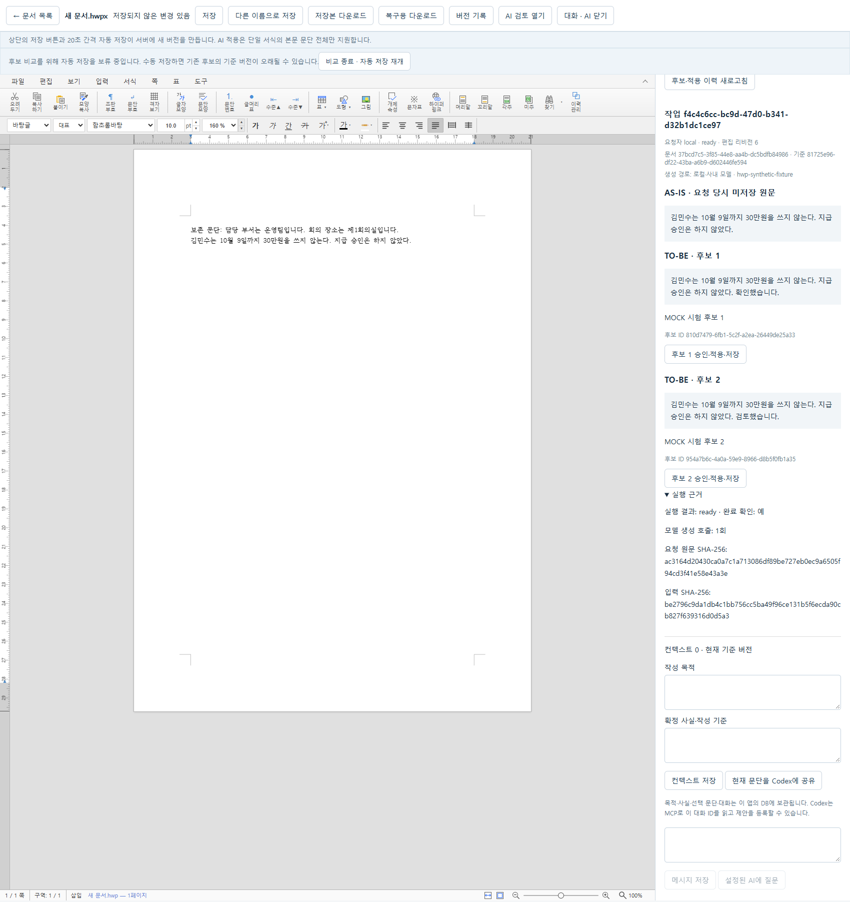
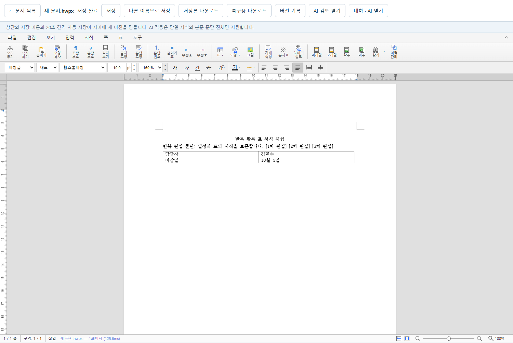

# 2026-10-06 로컬 후보 경로와 후속 검증

이번 작업은 로컬·사내 OpenAI 호환 모델을 기존 **미저장 문단 → 후보 2개 → 사용자 승인 → rhwp 적용 → 서버 저장 → 이력**에 연결했다. 후속으로 응답 유실 복구, 중단/만료, 반복 웹 왕복, 읽기 전용 저장소 점검을 보강했다. 실제 모델·사람 승인·한컴 결과를 모의 시험에 합산하지 않는다.

작업 시작은 `2026-10-06 05:40:56 UTC` (`14:40:56 KST`), 최종 증거 확정은 `07:41 UTC` (`16:41 KST`)로 2시간 이상 진행했다. 장기 비교 시험과 최종 보존 확인은 별도 절에 기록한다. 9/27의 날짜별 검증·JSON·화면은 수정하지 않았다.

## 시작 상태와 선택한 설계

- 시작 HEAD: `main`, `1e0538781e02ac85d095bb3c72bf844943c305b3`. 사용자 첨부의 기준과 일치했다.
- 선행 원격 비교: `main`과 `codex/initial-implementation`만 확인됐고, 구현 브랜치는 PR #19로 main에 병합돼 트리가 같았다. 새로 반영할 원격 코드가 없었다.
- 작업 말미에 `git fetch origin --prune`, `git ls-remote --heads origin`과 두 원격 트리 비교를 다시 실행했다. 같은 두 브랜치·커밋이었고 트리 비교 종료 코드 0이었다. 로컬 HEAD도 그대로다.
- 시작 시 사용자 작업: 미추적 `docs/gpt-handoff-2026-10-06.md` 1개. 수정하지 않았다.
- 기존 API/웹 기본 포트를 점유한 서비스가 없었고 모델 환경변수는 미설정이었다. 비밀값은 출력하지 않았다.
- `127.0.0.1:1234/v1/models` 연결 거부. 실제 모델 생성 호출 **0회**, 이번 세션의 실제 사용자 후보 승인 **0회**다.

`HWP_REWRITE_PROVIDER`는 기본 `codex`, 명시적 `llm`이다. `LlmProvider.rewrite`를 확장하고 `RewriteTask`/`RewriteCandidate`/`Application` 및 저장 구조를 재사용했다. 새 스키마·마이그레이션·편집기·AI 프레임워크는 추가하지 않았다. 선택 문단과 지시만 전달하며, 기존 목적·사실·대화를 사용하지 않는다는 사실을 UI와 실행 근거에 표시한다.

응답은 후보 2개·필드·공백·중복·길이·완료 상태를 엄격히 검사한다. 설치된 rhwp exact command 계약에 맞춰 후보 최대 4,000 코드포인트와 줄바꿈/탭 금지를 적용했다. 생성 네트워크 전후 권한·임대·기준·상태를 재검사하고 네트워크 호출 중 DB 쓰기 트랜잭션을 유지하지 않는다. 현재 제공자와 과거 작업의 제공자를 따로 표시한다.

기존 작업 전용 MCP 후보 등록 경계를 유지했다. 로컬 작업에는 실행 토큰을 발급하지 않는다. 동일 ID 요청은 한 번만 실행하며 실패 시 다른 모델로 전환하지 않는다. 비교 중 자동 저장 보류, 승인 후 exact command와 영수증·변경분 저장의 연결을 유지했다. 승인 저장 응답 유실 시 동일 출력/키를 먼저 재시도하도록 실제 프런트엔드 결함을 수정했다.

## 변경 파일

| 구분 | 파일과 역할 |
|---|---|
| 후보 계약·공통 게시 | `backend/app/rewrite_contract.py`, `rewrite_jobs.py` 신규. 두 후보 검증, 권한/임대/기준·중단·만료·공통 게시 |
| 제공자·실행기 | `backend/app/llm.py`, `local_rewrite.py` 신규, `rewrite.py`, `codex_runner.py`. 제공자 선택, 고정 입력, 실행 근거, 기존 Codex 제한 유지 |
| 화면·응답 복구 | `frontend/src/api.ts`, `rewrite.tsx`, `main.tsx`, `collaboration.tsx`, `style.css`. 제공자/모델·비교·중단·고정 요청 재시도 |
| 백엔드 시험 | `backend/tests/test_local_rewrite.py`, `test_codex_runner.py`, `test_storage_audit.py`, `mock_local_provider.py` 신규. `test_rewrite.py`, `test_mcp.py` 확장 |
| 브라우저 시험 | `frontend/tests/local-rewrite.spec.ts`, `roundtrip.spec.ts` 신규. `collaboration.spec.ts`, `rewrite-protection.spec.ts` 확장 |
| 재현·운영 도구 | `scripts/test-isolated.ps1`, `verify-rewrite-restart.py`, `audit-storage.py` 신규. `verify-codex-human.mjs`, `verify-codex-human-continuation.mjs`, `verify-codex-human.test.mjs`에 provider/model 확인과 사실 보존 보조 검사를 추가 |
| 안내 | `.env.example`, README, 협업·수동 시험·호환성·남은 작업 안내, 날짜별 검증·증거와 새 GPT 인수인계 |

`scripts/assistant-bridge.ts.txt`, 엔진 lock/패치, v0.4 요구사항 기준선, 기존 DB·blob·인증 설정은 변경하지 않았다. 커밋·푸시·병합은 하지 않았다.

## 실행 환경과 명령 결과

검증 루트는 `.cache/local-rewrite-2026-10-06-054056/`다. 합성 시험마다 분리된 DB/파일과 포트를 사용했다. 아래 짧은 디렉터리명은 이 루트 기준이다.

엔진은 기존 진단 산출물 `.cache/engine-release-2026-09-27/public`을 **복사**했다. rhwp `0.8.6`, 커밋 `e8800c8def63449808a4092798442652ed460552`, WASM SHA-256 `0e81cdeb4a61de8dd12be6d79d3bf06a8c1153525883e4112f4dcb1257d68195`. 매 분리 실행에서 실제 번들 파일 6개를 검사했다. 진단 코어는 Windows no-opt 산출물로 최적화 배포 빌드와 구분한다.

| 명령·실행 | 결과 | 판정 범위 |
|---|---|---|
| 변경 전 `.venv/Scripts/python -m pytest -q` | **passed 34**, 기존 경고 1 | 기준 회귀, 실모델 아님 |
| 변경 전 TypeScript / engine-build | **passed / passed 11** | 기준 타입·빌드 가드 |
| 변경 전 분리된 기존 E2E | **passed 8**, 인증 시험 포함 | 실제 rhwp, 고정/모의 AI와 구분 |
| 변경 후 최종 전체 pytest | **passed 136**, 기존 경고 1, skip 없음 | 백엔드·저장·권한·모의 모델·실제 MCP 전송·운영 점검. `final-pytest.log` |
| 작업 전용 stdio MCP 시험 | **passed 1**, 최종 pytest 합계에 포함 | 실제 SDK 자식 프로세스·HTTP, 고정 실행기/후보. 실제 Codex 모델 아님 |
| `npm exec tsc -- --noEmit` | **passed** | 타입 검사 |
| `npm run test:engine-build` | **passed 11** | 출처·패치·해시·최적화 가드. 실제 Docker 빌드 아님 |
| 사람 시험 하네스 `node --check` 2개와 `node --test scripts/verify-codex-human.test.mjs` | **passed**, 고정 객체 시험 1 | 브라우저/실제 사람 승인 없이 하네스 검사 |
| 분리 실행기 source 전체 (`isolated source complete`) | **passed 20, skipped 1** | 일반·인증·로컬 API. skip은 명시적 opt-in 장시간 시험 |
| 분리 실행기 `-BuiltApp` (`isolated built final`) | **passed 10, skipped 1** | 진단 앱 번들의 로컬 후보 흐름, 장시간 시험 기본 skip |
| 승인·영수증 응답 유실 추가 시험 (`response boundaries`) | **passed 2** | 진단 앱 번들. 승인 ID/영수증/출력 재사용, 응답 유실 후 추가 입력 보존 |
| 유니코드·페이지 수 보호 (`unicode pagination guards`) | **passed 2** | 실제 rhwp, AI 없음. 4,000 코드포인트 적용/undo와 페이지 수 변경 거부/원본 바이트 복구 |
| 실제 시계 1시간 비교 유지 (`review soak hour`) | **passed 1**, skip 없음 | 실제 rhwp + 모의 HTTP 모델. 보류 3,600.191초, 임대 갱신 120회, 이후 저장/자동 저장 재개 |
| `verify-rewrite-restart.py --real-expiry` | **passed**, 실제 602.33초 | 서버 kill·재시작, 중복 호출 없음, 600초 만료. 모의 모델/저장 fixture, 엔진 없음 |
| `roundtrip.spec.ts` 단독 및 전체 실행 | **passed** | 실제 rhwp, 웹 왕복 3회·복원 새 버전, AI 없음 |
| `audit-storage.py` 기존 문서함 검사 | **passed** | 문서 33개·버전/파일 55개, 참조 없는 파일 0개 |
| frontend의 기본 `npm run build` | **failed: 검증 가드가 의도대로 거부** | 기본 경로에 출처가 확인된 최적화 코어/번들이 없어 배포 성공으로 보지 않음 |
| 별도 `build-frontend.mjs --diagnostic --public ... --out ...` | **passed** | 검증 엔진 6개와 앱 번들. nginx 실행이 아닌 Vite preview |
| 실제 로컬 모델 / 실제 사용자 승인 | **미실행** | 모델 서버 연결 불가. 준비된 서버·정확한 ID와 실제 클릭 필요 |
| 새 한컴 반복 왕복 / 사내 모델 / 외부 인터넷 차단 | **미실행** | 9/27 결과를 이번 실측으로 합치지 않음 |
| Docker / PostgreSQL / nginx 배포 | **범위 제외·미실행** | 배포 완료 주장 없음 |

재현 명령은 [로컬 모델 안내](local-model-rewrite.md#분리된-자동-검증)와 [저장소 점검 안내](storage-audit.md)에 있다. 일반 `npm run test:e2e`와 같은 Playwright 설정/시험을 분리 실행기가 실행한다. 실모델 서버 대신 합성 fixture `hwp-synthetic-fixture`만 연결한다.

## 실패를 확인하고 수정한 내용

1. 승인 저장 commit 후 HTTP 응답이 유실되면 기존 클라이언트가 이미 저장된 승인 이력을 다시 읽고 기준 충돌로 막혔다. 고정 pending 출력과 멱등 키를 먼저 재시도하도록 수정했다. 실패 재현은 `lost-save-before-fix`, 수정 확인은 `lost-save-after-fix`와 새 E2E에 남겼다.
2. 요청 생성 응답이 유실됐을 때 새 스냅샷/ID로 중복 생성할 수 있었다. 같은 입력·ID 재확인과 4xx 처리, 승인/중단 이후 대기 요청 해제를 구현하고 미저장 후속 입력 보존을 시험했다.
3. 고정 엔진은 4,000 코드포인트/단일 문단만 받는데 기존 후보 API 한도는 12,000이었다. 새 두 후보 계약을 엔진과 맞췄다. 실제 SDK에서 문서·원문·서식·인접 문맥·리비전·대상 fence 및 과도한 길이/제어 문자 거부를 확인했다.
4. 잘못된 `editable` 문자열이 생성으로 넘어가고 lone surrogate가 500 오류가 되는 입력을 재현했다. 유효한 UTF-8/유한한 JSON 입력과 실제 boolean을 검사해 422로 거부한다.
5. 분리 실행기 첫 built 실행은 PowerShell의 native stderr 경고 처리/종료 대상 검사 문제로 실패했다. 오류 기록과 로그를 보존하고 해당 실행에서 만든 프로세스만 정리했다. 수정 후 built 실행과 종료 검사가 통과했다.
6. source 실행 첫 전체 시험은 일반 API에 모의 AI 설정까지 넣은 실행기 오류 1건과 Windows worker 비정상 종료 `3221226505` 1건으로 `17 passed / 2 failed`였다. 일반 AI 미설정 경로를 분리했고 다음 전체 실행은 19개 모두 통과했다. 원인 확인 없이 worker 종료를 제품 결함으로 분류하거나 첫 실패를 삭제하지 않았다. 이후 반복 왕복을 포함한 전체 실행은 20 passed/1 opt-in skip이다.
7. 짧은 문단을 4,000자로 늘리는 최초 유니코드 시험은 엔진의 `PAGE_COUNT_CHANGED` 보호에 걸렸다. 길이 이내의 모든 후보가 적용 가능하다는 시험 가정이 잘못됐으며 엔진은 수정하지 않았다. 같은 페이지 수를 유지하는 한글+이모지 4,000 코드포인트(UTF-16 6,000단위) 교체/undo는 통과했다. 페이지 수가 늘어나는 교체는 거부되고 영수증이 없으며, 원문·페이지 수·문서 해시와 전체 내보내기 바이트가 이전과 같은 것도 별도 통과했다. 첫 실패는 `unicode engine boundary`, 확인 결과는 `unicode pagination guards`에 보존했다.

## 합성 후보 → 적용 → 버전 연결 근거

진단 앱 번들 시험 `isolated built final`의 예다. **실제 rhwp + 모의 HTTP 모델 + 자동 테스트 클릭**이며, 실모델/사람 승인 사례가 아니다.

| 항목 | 값 |
|---|---|
| 문서 | `37bcd7c5-3f85-44e8-aa4b-dc5bdfb84986` |
| 기준 버전 | `81725e96-df22-43ba-a6b9-d602446fe594` |
| 작업 | `f4c4c6cc-bc9d-47d0-b341-d32b1dc1ce97` |
| 후보 1 | `810d7479-6fb1-5c2f-a2ea-26449de25a33` |
| 선택 후보 2 | `954a7b6c-4a0a-59e9-8966-d8b5f0fb1a35` |
| 적용 | `ef001b0b-fd47-4600-b761-ebf6db5e4212` |
| 저장 버전 | `1d4f2e9e-f5ee-491b-be60-e6f5cc5595e2` |
| 원본 HWPX SHA-256 | `594e674b831ea7c364e7dbd3abde5b117f69fca17cd4f5f5cf2cb094410a5df7` |
| 저장 HWPX SHA-256 | `ee26e1342992486e8f88d12a43f441570c2762db8f29290995ef76d039d5198d` |
| 요청 원문 SHA-256 | `ac3164d20430ca0a7c1a713086df89be727eb0ec9a6505f94cd3f41e58e43a3e` |
| 정규화된 모델 입력 SHA-256 | `be2796c9da1db4c1bb756cc5ba49f96ce131b5f6ecda90cb827f639316d0d5a3` |

원문에는 합성 이름·날짜·금액·부정 표현을 사용했다. 입력 원문/AS-IS/스냅샷 일치, 생성만으로 버전 1개·Application 0개 유지, 후보 2의 자동 승인 후 버전 정확히 2개, 비대상 미저장 문장과 원본 blob 보존, 저장본 웹 재열기를 확인했다. 모의 응답에 사실 보존 품질 평가의 의미를 부여하지 않는다.

새 [JSON 증거](evidence/local-rewrite-2026-10-06.json)에 실제 실행 ID와 해시, 관련 시험을 연결한다. 전체 DB·키·인증 파일은 이 증거에 넣지 않는다.

이 화면의 후보는 명시적인 MOCK fixture다. 실제 모델의 문장 품질이나 실제 사람 승인을 입증하지 않는다.

## 장시간 비교·보존·종료 확인

`review soak hour`에서 `-TestPattern 'long-lived review' -SoakSeconds 3600`이 **통과**했다. 시험은 `06:36:32.469~07:36:53.067 UTC`에 실행됐으며, 실제 시계로 보류 **3,600.191초**를 확인했다. 60회 점검 동안 버전 1개·Application 0개·고정 작업 스냅샷·원본 해시를 유지했고, 임대 갱신 **120회가 모두 HTTP 200**이었다. 5분마다 추가한 합성 편집도 버퍼에 남았다. 브라우저 오류는 0개다.

마지막에는 변경된 버퍼에 오래된 후보 적용을 차단하고, 수동 저장으로 버전 2개, 새 후보 승인 저장으로 3개, 이후 일반 편집의 자동 저장으로 **4개**가 됐다. 최초 파일 해시도 그대로다. 이 시험 역시 모의 HTTP 모델과 자동 클릭이며 실제 모델·사람 승인이 아니다. 원시 증거의 `held_seconds=3617.703`은 실행 당시 측정 위치 때문에 마지막 저장 검증까지 포함한다. 순수 비교 보류 시간은 마지막 `checkpoints[].elapsed=3600.191`을 사용한다.

서비스 종료 후 이 합성 저장소에도 `audit-storage.py`를 실행했다. 문서 1개·버전/파일 4개·30,523바이트의 참조·계보·크기·해시 검사가 통과했고, 참조 없는 파일은 0개였다. 별도 보고서는 `soak-storage-audit.json`이며 새 JSON 증거에도 포함했다.

사용한 분리 실행기들은 각자 띄운 서비스를 종료했다. 마지막에 이번 실행의 **포트 70개**를 읽기 전용으로 검사한 결과 남은 리스너는 0개였다. 시험 DB/로그/증거는 삭제하지 않았다. 기존 DB·blob 56개와 요구사항 기준선·선행 GPT 인수인계를 합친 **58개 파일의 SHA-256이 모두 시작 값과 같았고**, 기존 `data` 아래 새 파일도 없었다. 최종 결과는 새 JSON 증거의 `preservation`에 있다. 앱의 기본 엔진은 교체하지 않았다.

## 남은 최소 재개 조건

준비된 로컬·사내 서버를 실행하고 그 `/models`의 정확한 ID를 제공하면 실모델 하네스를 진행할 수 있다. 실제 사용자가 후보 버튼을 누르기 전 승인 이후를 완료로 기록하지 않는다. [사람 시험 재개 안내](local-model-rewrite.md#실제-모델과-사람-승인-시험-재개)를 따른다.

모델의 사실 보존과 사내 규정 적합성, 복잡한 문서·한컴 반복 왕복, 폐쇄망 전체 실행, PostgreSQL 동시성/복구와 최적화 배포는 남아 있다. 검증 가능한 코드·모의/엔진 시험과 이러한 현장 확인을 분리한다.
