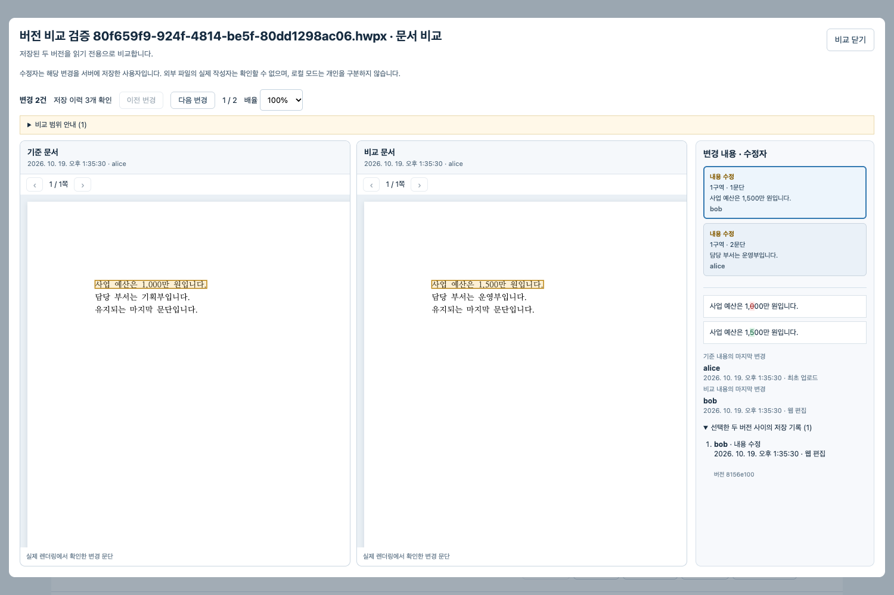

# 저장 버전 비교와 수정자 표시

문서함 또는 편집기의 **버전 기록**에서 기준/비교 열의 버전을 하나씩 선택하고 **선택한 두 버전 비교**를 누른다. 기본 선택은 현재 버전과 그 직전 기준 버전이다. 중간 버전을 건너뛰거나 순서를 반대로 선택할 수 있다. 동일 버전은 선택해 비교할 수 없다.

좌우에는 저장된 HWPX를 rhwp로 렌더링한 실제 페이지가 표시된다. 오른쪽 목록에서 변경을 선택하면 각 문서의 실제 쪽수와 위치로 각각 이동한다. 앞부분 삽입으로 페이지가 밀렸을 때 같은 쪽 번호를 강제로 맞추지 않는다. 이전/다음 변경, 개별 쪽 이동, 공통 배율, 변경 위치로 돌아가기를 제공한다. 본문·일반 표 셀은 원문을 대조한 뒤 native 좌표로 강조한다. 좌표를 확인할 수 없는 중첩 표와 개체는 위치를 추정하지 않고 안내를 표시한다.



## 수정자의 의미

- 수정자는 **해당 변경을 서버에 저장한 계정**이다. 외부에서 작성한 뒤 업로드한 파일의 실제 작성자를 추측하지 않는다.
- 문단/표 셀의 내용과 서식을 중간 버전까지 추적한다. 이후 다른 사용자가 다른 문단을 저장해도 이전 문단의 마지막 변경 계정은 유지된다. 비교 구간 안의 저장 기록도 함께 표시한다.
- 삭제·추가·서식 변경·개체 변경·상대 순서 변경을 구분한다. 복원은 복원을 실행한 계정의 새 저장 기록이며, 기존 버전이나 blob은 변경하지 않는다.
- 반복 문단 등의 대응이 불명확하면 수정자를 단정하지 않는다. 이 기능은 문자마다 작성자를 추적하는 공동 편집 로그가 아니다.
- 기존 버전에는 수정자 정보가 없으므로 **수정자 기록 없음**으로 표시한다. 현재 소유자를 과거 작성자로 소급하지 않는다.
- 인증이 없는 개발 모드는 **로컬 사용자 · 개인 식별 불가**로 표시한다. 개인별 구분에는 기존 `HWP_AUTH_TOKENS` 인증 설정이 필요하다.

## 구현 경계

`version_authors`는 추가 테이블이다. 업로드·편집·재업로드·복원·복제·양식 적용·보고서 저장 모두 인증 미들웨어의 사용자로 기록하며, 요청 본문의 작성자 정보는 사용하지 않는다. 기존 문서 행 잠금, 임대/기준 버전 검사, blob 영속화 및 DB 커밋 트랜잭션 안에서 기록한다. 실패한 저장은 수정자 기록도 커밋하지 않는다. `python -m app.migrate` 또는 앱 시작 시 테이블이 만들어지며, 과거 버전은 그대로 유지된다.

읽기 전용 API:

```text
GET /api/documents/{document_id}/compare?left={version_id}&right={version_id}
```

두 버전이 해당 문서에 속하는지와 읽기 권한을 검사한다. blob 크기와 SHA-256을 확인하고, 분석 후 권한을 다시 확인한다. 응답과 버전 파일은 `no-store`다. 비교는 편집 임대를 얻거나 현재 버전을 바꾸지 않는다.

`compare_hwpx.py`는 불변 HWPX에서 본문·셀·서식·개체를 읽는다. 서식 ID를 실제 정의와 글꼴명으로 해석하고, 문단 ID/캐시된 줄 배치 같은 직렬화 차이는 제외한다. 중간 버전의 문단 대응과 저장 계정을 서버에서 결합한다. rhwp의 기본 비교 대화상자는 현재 편집 문서를 교체하므로 호출하지 않는다.

렌더러는 별도 iframe의 읽기 전용 `HwpDocument`다. 편집 명령, 자동 저장, 파일 선택기, AI 호출이 없다. `comparison-core.mjs`가 Studio의 검증된 WASM과 정확히 일치하는 JS binding만 배포한다. npm의 원본 WASM으로 대체하지 않는다. 따라서 기존 고정 개발 엔진 kit를 재사용할 수 있으며, 프런트엔드 빌드만 갱신하면 된다. SVG는 허용된 요소와 내부/data 이미지 참조만 남긴 뒤 표시하고 외부 자원을 가져오지 않는다.

## 범위와 한도

- 두 문서 각각 30MB, 2,000개 문단·개체, 총 250,000자, 실제 페이지 500쪽까지 지원한다. 초과하면 오류를 표시한다.
- 수정자 추적은 최대 80버전·80MB·16,000개 문단·개체다. 연결된 이력을 끝까지 확인할 수 없으면 이를 알리고, 확인되지 않은 수정자를 만들어 넣지 않는다.
- 본문·표 셀의 문구와 참조 서식을 비교한다. 굵기만 변경한 경우도 서식 수정으로 나타난다. 표 속성, 그림 리소스, 구역 설정과 기타 개체는 개체 단위다. 개체 내부의 문자별 비교, 모든 서식 속성의 자연어 설명, 변경 수락/병합은 제공하지 않는다.
- 바탕쪽·머리말·수식 등은 세부 글자 위치를 자동 강조하지 않는다. 사용 글꼴과 rhwp 지원 범위에 따라 한컴 화면과 차이가 날 수 있다. 한컴 및 격리망 검증은 별도 수동 확인 대상이다.

## 검증 방법

백엔드: `.venv/bin/python -m pytest -q` (Windows는 `.venv/Scripts/python`). 빌드 검사는 `node --test scripts/*.test.mjs`, 프런트엔드 타입 검사는 `cd frontend && npx tsc --noEmit`.

새 실제 엔진 브라우저 검사는 `frontend/tests/version-comparison.spec.ts`다. **별도 DB**의 API에 alice/bob/reader 계정을 설정하고, 같은 토큰 객체를 `HWP_COMPARE_TOKENS`로 전달한다. 테스트용 토큰은 각각 24자 이상인 임의 값으로 생성한다. 실제 사용자 데이터베이스에서는 실행하지 않는다.

```sh
# API와 built preview를 먼저 별도 포트로 실행한 뒤, frontend에서:
HWP_E2E_URL=http://127.0.0.1:15192 \
HWP_COMPARE_PUBLIC=/absolute/path/to/verified/public \
HWP_COMPARE_TOKENS="$TEST_ACCOUNT_TOKENS" \
npx playwright test tests/version-comparison.spec.ts
```

고정 실제 WASM으로 합성 문서를 생성하고, 임의 두 버전 선택, 서로 다른 저장 계정, 역순 비교, 글자 서식, 표 셀, 페이지 삽입, 미저장 편집 보존, 권한 오류와 늦은 응답을 확인한다. 이 검증에는 모델 호출이나 모의 AI 응답을 사용하지 않는다. 기존 편집/저장/다운로드/복원 검사는 `engine.spec.ts`, `editor-workspace.spec.ts`, `roundtrip.spec.ts`에 있다.

2026-10-19 macOS에서 백엔드 전체 550개, 이후 추가 경계 사례를 포함한 비교 테스트 14개, Node 검사 44개, TypeScript와 diagnostic 빌드를 통과했다. 실제 rhwp 비교 브라우저 검사 6개와 기존 회귀 검사 7개도 통과했다. 기존 회귀 7개 중 1개는 실제 엔진과 **모의 AI 응답**을 사용한다. 이 결과는 실제 AI 품질, Windows 재실행 또는 한컴 호환성 검증을 뜻하지 않는다. [검증 기록](evidence/version-comparison-2026-10-19.json)에서 범위를 확인할 수 있다.

실행 중인 이전 빌드에는 코드 변경이 자동 반영되지 않는다. 기존 문서를 저장한 뒤 API를 재시작하고 프런트엔드를 다시 빌드해야 한다. 현재 개발 엔진 cache를 사용하는 Mac 빌드 명령은 다음과 같다. 출력 경로는 사용하는 실행기의 정적 파일 경로에 맞춘다.

```sh
node frontend/node_modules/typescript/bin/tsc --noEmit --project frontend/tsconfig.json
node scripts/build-frontend.mjs --public .cache/developer/public --out .cache/developer/macos-app-dist --diagnostic
```
