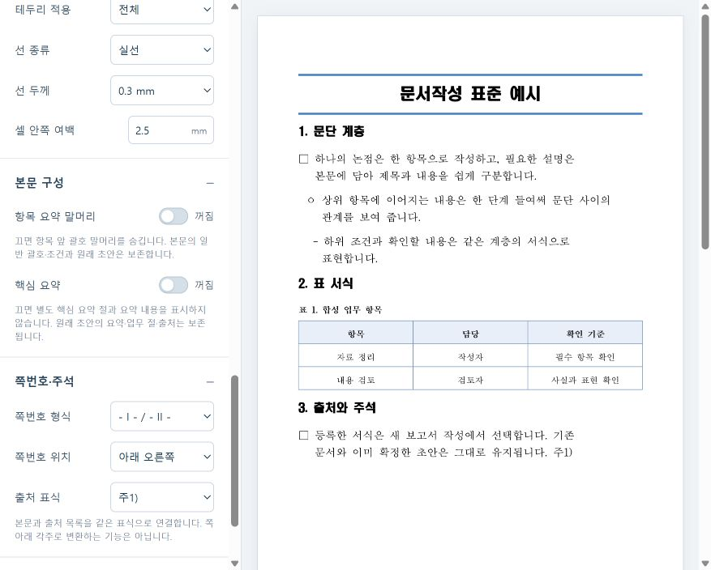

# 문서 표준 편집 확장 — 2026-10-18

문서 표준 편집의 설정을 23개에서 35개로 늘렸다. 설정 검색, 선택 목록과 ON/OFF를 지원하며 오른쪽 예시는 기존과 같이 실제 rhwp가 그린다. 확인 화면은 <http://127.0.0.1:15186/>다. 앞선 15183·15184·15185 앱과 기존 자료는 보존했다.

| 항목 | 조절 범위 |
|---|---|
| 표 안 정렬 | 왼쪽·가운데·오른쪽, 위·가운데·아래 |
| 표 테두리 | 전체·바깥선·가로선·없음, 실선·파선·점선, 지원하는 11개 두께, 색 |
| 셀 여백 | 0~5mm |
| 대제목 | 파란 상하선 안의 세로 위치 -12~24pt, 기본 12pt |
| 본문 구성 | 항목 앞 괄호 요약 말머리 표시, 별도 핵심 요약 절 표시 |
| 쪽번호 | `- 1 -`, `1`, `- I - / - II -`, 없음; 아래 왼쪽·가운데·오른쪽 |
| 출처 표식 | `[S1]`, `주1)`, `*1` |

말머리를 끄면 항목 앞의 한정된 `(말머리)`만 숨긴다. 본문 안의 일반 괄호·조건·수치·출처는 유지한다. 핵심 요약을 끄면 요약 절과 요약 내용을 표시 계획에서 제외한다. 두 설정 모두 저장된 `ReportDraft` 원문·해시를 바꾸지 않는다. 목차는 실제로 표시하는 제목만 참조하여 UUID·원문 해시·실제 쪽수를 검증한다. 출처 표식은 본문·표·그림·확인 사항·출처 목록에서 같은 ID를 사용하며 쪽 아래 각주로 변환하는 기능은 아니다.

제목은 파란 윗선을 유지하면서 글자 위 여백을 조절한다. 실제 엔진 좌표에서 0pt의 위/아래 간격 약 4.86/22.5px가 기본 12pt에서 약 20.86/22.5px로 바뀌었다. 글꼴과 크기가 다르면 화면에서 다시 조정할 수 있다. 파란 상하선·계층 들여쓰기·기준 원본은 유지한다.

`revision: 1`은 기존 23필드와 해시를 그대로 사용한다. 새 35필드는 `revision: 2`의 필수 설정이다. 이전 표준을 불러오면 편집 사본에만 새 기본값을 보완하고 새 ID로 등록한다. 기존 등록·동일 ID 재확인·이미 준비한 미리보기·저장 재시도는 원래 snapshot을 유지한다. 서식 검증에 제목선 위치와 실제 쪽번호 필드의 형식·위치·문단 정렬도 포함하며 스타일 ID 재번호는 허용한다.

숫자 쪽번호는 native footer PAGE 필드, 대시·로마자 쪽번호는 native `pageNum`을 사용한다. 고정 숫자 문자열을 넣지 않는다. 이 엔진은 footer PAGE의 로마자 서식을 숫자로 표시하므로 로마자는 실제 지원하는 `- I -` 형식으로 제공한다. 엔진을 새로 수정하지 않았다.

## 확인

- 관련 백엔드 고유 136개 사례를 변경 영향별로 확인했다. 전체 영향 122개 이후 제목·필드 서명, 누락 거절, 말머리 표시 변경의 관련 묶음을 재실행했다. 실행 수를 중복 합산하지 않는다. 저장 감사 17개도 통과했다.
- 실제 rhwp E2E 고유 8케이스가 통과했다. 35개 설정·등록, 지연 응답·잘못된 값, 등록 응답 유실, 이전 등록 보존, 등록 서식의 보고서 편집→목차 갱신→저장→일반 편집기 재열기, 기존 자동 목차·긴 제목·frozen legacy를 확인했다. 최종 변경의 2케이스는 r4에서 재확인했다.
- r3의 새 SVG 검사에서 CSP가 `fetch(blob:)`를 차단해 1실패·1통과했다. 제품 보안 정책은 유지하고 시험에서만 생성된 SVG Blob 참조를 읽도록 고쳤다. r4에서는 실제 첫째/둘째 쪽의 `- I -`/`- II -` 표시를 확인했다. 실패 기록도 보존한다.
- 기본·표/흐름도·긴 제목의 스캐폴드와 두 배치 출력 9개가 기준 커밋 `44450151cf9cdf6c2899d23420e0c23aaa2da882`의 모듈 결과와 바이트 단위로 같다. 긴 제목 fixture·기준 HWPX·과거 증거는 변경하지 않았다.
- 앱 안 브라우저에서 가운데/아래 정렬, 0.3mm 선, 2.5mm 셀 여백, 말머리·핵심 요약 OFF, 아래 오른쪽 로마자 쪽번호와 `주1)`를 확인하고 **확장 표준 검수 · 요약 숨김 · 로마자**로 등록했다. 검수 DB의 문서 4개·버전 7개·표준 2개, blob 9개가 읽기 전용 감사를 통과했다.

AI 응답은 mock이며 실제 모델 호출은 0회다. 자동 시험의 승인과 AI의 화면 관찰은 사람의 최종 검수와 구분한다. 새 Hancom 시험·폐쇄망 설치·Docker 운영 배포를 수행한 것으로 표시하지 않는다. 기존 Hancom 2018 색상 해석 차이도 이 변경에서 보정하지 않았다.

상세 영수증은 [검증 근거](evidence/standard-controls-2026-10-18.json), 새 개발자 실행은 [원클릭 빠른 시작](developer-quickstart.md)을 따른다.
