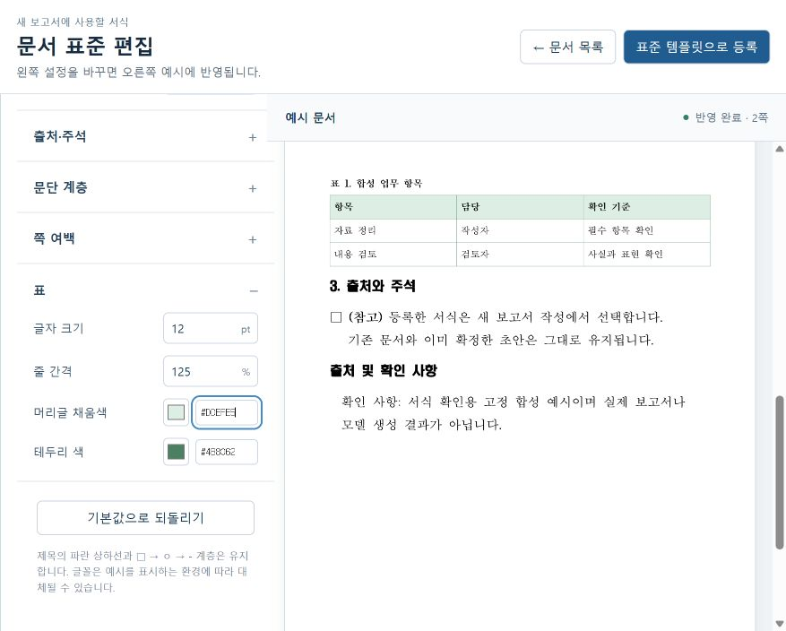

# 문서 표준 편집 — 2026-10-18

문서 목록의 **문서 표준 편집** 또는 템플릿 마켓의 기본 표준 카드에서 연다. 왼쪽의 23개 설정을 바꾸면 400ms 입력 대기 후 서버가 고정 합성 예시 HWPX를 만들고, 오른쪽에서 실제 rhwp가 전체 쪽을 그린다. CSS로 문서 모습을 흉내 내거나 모델을 호출하지 않는다. 변경 반영 중에는 이전 예시임을 표시하고 등록을 막는다.

## 사용 흐름

1. 대제목·절 제목·본문·출처의 크기/줄 간격/문단 뒤 간격, □·ㅇ·- 들여쓰기, 쪽 여백, 표 글자/줄 간격/머리글 채움색/테두리 색을 조정한다. 제목의 파란 상하선과 계층의 행걸침은 유지한다.
2. 최신 예시의 모든 쪽이 표시된 뒤 **표준 템플릿으로 등록**에서 이름을 정한다. 설정 값·기준 해시·예시 HWPX를 서버가 다시 대조하고 blob fsync와 DB commit 이후 등록 완료를 표시한다.
3. **이 표준으로 보고서 작성** 또는 보고서 작성 화면의 **문서 서식 표준**에서 선택한다. 세 작성 목적 프로필과 시각 서식을 독립적으로 선택한다.
4. 등록된 설정을 다시 불러와 수정하면 새 ID로 등록한다. 이전 등록·기본 기준·기존 문서를 덮지 않는다.

## 구현과 보존 경계

- `visual_standards.py`, `db.py`, `schema.py`: 사용자 범위의 불변 설정과 예시 파일을 별도 저장한다. 현재 세 작성 목적 프로필과 기존 HWPX 양식 복제 마켓을 재해석하지 않는다. 인증 전환 시에도 명시적인 `HWP_LEGACY_OWNER`로만 기존 local 등록을 이전한다.
- `document_standard.py`, `report_hwpx.py`, `report_layout.py`, `report_rich.py`: 선택적 `visual_settings`를 실제 문단·표·쪽 여백과 폭/행 높이 계산에 전달한다. 없는 경로는 예전 함수 호출과 값을 유지한다. 표준 원본과 프로필은 불변이다.
- `reports.py`, `report_preview.py`: 등록 snapshot 전체를 새 작업 입력·입력 해시·미리보기·승인에 고정한다. 같은 요청 ID 재확인은 등록 목록을 다시 해석하지 않는다. 새 작업은 현재 사용자 권한·등록 파일·설정/기준 해시를 검증한다. 기존 UUID·원문 해시·실제 쪽수·수렴 한도와 저장 재확인은 유지한다.
- `standard-designer.tsx/css`, `preview-svg.ts`, `main.tsx`, `reports.tsx`, `template-market.tsx`: 설정 편집과 진입·선택을 연결한다. 안전한 SVG 이미지로 표시하고 늦은 응답을 세대 번호로 배제한다. 숨긴 엔진이 입력 포커스를 가져가면 현재 설정 입력만 복원하며, 다른 입력·버튼으로 이동한 사용자를 과거 필드로 돌리지 않는다.
- `audit-storage.py`: 새 표준의 immutable blob도 정식 참조 파일로 감사한다. 파일 삭제·복구는 하지 않는다.

기존 기본 경로는 HEAD `5d75900eb71671be696b9201f871c2c310f3878f`의 모듈과 일반·표/흐름도·긴 제목 샘플의 스캐폴드/두 배치 출력을 비교했다. 9개 출력 모두 바이트 단위로 같다. 긴 제목 fixture와 과거 실행 증거는 변경하지 않았다.

## 검증

- TypeScript와 진단 빌드 통과. 최종 검수 앱의 실제 서빙 10파일 SHA 일치. 기존에 검증한 선택 수정 WASM을 재사용했다.
- 보고서 입력·미리보기·프로필·목차의 관련 pytest 72건 통과. 표준 API/저장 계약 27건과 엄격한 리비전 검사 1건, 저장 감사 15건, 새 서식 렌더링 5건 및 기존 기본 서식/표현 시험도 통과했다. 일부 기존 시험 파일은 여러 관련 묶음에 포함되므로 합계를 새 고유 시험 수로 표시하지 않는다.
- 실제 rhwp E2E의 목표 6케이스를 관련 변경별로 재실행해 모두 통과했다: 새 편집기/등록/모바일/포커스, 지연 응답/잘못된 값 차단, 등록 응답 유실 재확인, 등록 서식의 보고서 생성/목차/저장/일반 편집기 재열기, 기존 기본 목차, 기존 마켓의 기본 표준 미리보기. 생성 응답은 mock이며 실제 AI 호출은 0회다.
- 등록 서식의 합성 보고서는 실제 3쪽, 제목 5개 UUID/텍스트 해시/쪽수가 저장·웹 재열기 후 같았고 HWPX SHA도 같았다. 자동 시험의 확정 클릭은 사람 검수로 계산하지 않는다.
- 실제 앱 안 브라우저에서 본문 16pt·180%, 표 채움 `#DDEFE5`·테두리 `#4B8062`를 조정하고, 2쪽 예시와 입력 포커스 유지·등록·보고서 선택·재열기를 확인했다. 원본 파일 7개는 그대로이며 검수용 DB에만 예시 표준을 추가했다.
- 실제 검수 DB/파일의 읽기 전용 감사도 통과했다. 기존 문서 4개·버전 7개와 등록 표준 1개의 blob 8개가 모두 검증됐고 참조 없는 파일은 0개였다.

검수 앱은 `http://127.0.0.1:15185/`다. 기존 `15183` 앱과 이전 UI 검수 사본 `15184`는 보존했다. 상세 시험 영수증과 해시는 [검증 근거](evidence/visual-standards-2026-10-18.json)에 있다.

## 범위

미등록 설정과 미확인 등록 요청은 현재 탭 메모리에 보관하며 새로고침 복구는 지원하지 않는다. 등록이 완료된 설정·예시는 서버에서 다시 불러온다. 글꼴은 기존 기준을 사용하며 환경에 따라 대체될 수 있다. 고정 예시가 1~6쪽을 벗어나면 생략 없이 등록을 막는다. 이는 이 편집기 예시의 안전 한도이며 유효 보고서 전체의 쪽수 한도가 아니다.

새 한컴 저장·재열기나 Docker/WSL 배포 시험을 수행한 것으로 해석하지 않는다. 앞서 관찰한 한컴 2018 색상 해석 차이도 이번 기능에서 보정하지 않았다. 실제 모델 생성 품질과 사람의 최종 검수는 별도다. 이전 UI·블록 선택 수정을 포함한 변경은 현재 미커밋이며 푸시하지 않았다.
